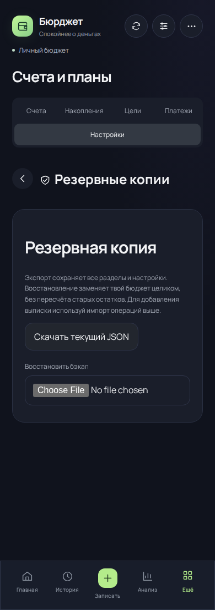
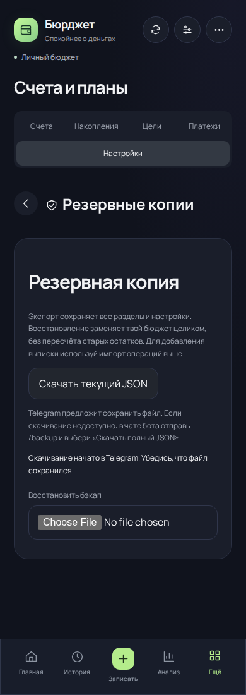

# Скачивание бэкапа в Telegram — 4.6.3

В миниаппе «Скачать текущий JSON» использовал браузерный клик по `blob:`-ссылке. Теперь авторизованная миниаппа запрашивает краткоживущую ссылку и вызывает `Telegram.WebApp.downloadFile`. Обычный браузер и демо сохраняют скачивание локального JSON; ссылка освобождается с задержкой, элемент загрузки добавляется в DOM.

| Сценарий | До | После |
| --- | --- | --- |
| Telegram WebView блокирует локальный файл | Кнопка могла ничего не сохранить | Нативный диалог Telegram и HTTPS-файл |
| Пользователь отменил копию перед заменой | Запрос загрузки сразу считался сохранённой копией | Подтверждение восстановления остаётся закрытым |
| Сбой подготовки или неподдерживаемый Telegram | Не было понятного результата | Ошибка и инструкция `/backup → Скачать полный JSON` |
| Другой клиент успел изменить бюджет | Локальный файл соответствовал открытому экрану | Устаревшая ревизия отклоняется при подготовке; уже подготовленный файл сохраняет прежнюю ревизию |

Ссылка действует пять минут. HMAC привязывает её к пользователю, ревизии, сроку и имени файла; токены сессии и Telegram в URL не передаются. Доступ повторно проверяется при скачивании. Один SQL-запрос получает точную ревизию из текущего состояния или существующих автоматических копий. Изменений схемы, денежных записей и остатков нет. Ответ содержит `attachment`, JSON, `no-store`, `nosniff` и CORS для Telegram Web.

Локально прошли 454 теста. Проверены авторизация, подмена пользователя в ссылке, срок действия, смена ревизии, сохранение прежнего снимка, нативное подтверждение и отмена, некорректные ссылки и сеть. В CI выполнен `scripts/check-backup-download-browser.mjs`: настоящие ревизии до/после, реальный Worker и SQLite, HTTPS, эмуляция моста Telegram и блокировки `blob:` в WebView. Это автоматическая эмуляция, а не проверка на физическом Android.

Документация Telegram: https://core.telegram.org/bots/webapps#downloadfileparams

## Подтверждённый сценарий и снимки

[Visual audit evidence](https://github.com/M3A9tt/budget-app/actions/runs/40277788862) прошёл. Сравниваются ревизии `79c7053ead0af898f8c35ad6edf6f3569edae7a2` и `1a0156a192409ebd32e47fc86ba1fa7918456697` (проверочный merge-коммит PR #53). Источник нового кода — `f86a969f74325c4bd31253c60be1897122999ea8`. [Вымышленные данные и условия до](audit-4.6.3/before.json), [после](audit-4.6.3/after.json).

На обеих ревизиях Chromium эмулирует мост Telegram и блокирует переходы по `blob:`; при этом авторизация, выдача ссылки, JSON-вложение и хранение проверяются настоящим Worker на SQLite. После изменения вызван нативный метод, а GET по выданной ссылке без заголовка авторизации вернул точный бэкап. До изменения заблокированная загрузка ошибочно открывала подтверждение копии; после отмены нативного диалога галочка и восстановление остаются недоступными. После согласия в диалоге нужна отдельная галочка пользователя. Состояние бюджета не изменилось.

| После нажатия до исправления | После нажатия после исправления |
| --- | --- |
|  |  |

[Отмена перед восстановлением: подтверждение закрыто](audit-4.6.3/restore-after-390.png). Проверены ширины 320, 390, 768 и 1280 px, переполнения и ошибок страницы нет. Снимки просмотрены; физический Android не использовался.

[Budget checks](https://github.com/M3A9tt/budget-app/actions/runs/40277788825) прошёл на Linux и Windows: 454 теста, сборки приложения и Worker; существующие сценарии финансового интерфейса в Chromium также прошли.
