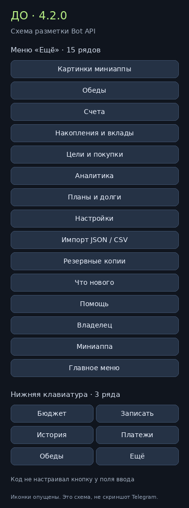
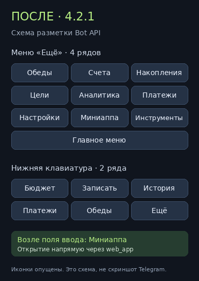

# Бюрджет 4.2.1: компактные кнопки и прямое открытие миниаппы

21 октября 2026. До: `7e3cbdf3be1e9c7669115481014acec5fb42bbc0` (4.2.0). После: `c792c6f4b7547cb1be86a332e140e7f91fa3ebea` (4.2.1). В обоих случаях вымышленный профиль владельца с включёнными обедами.

## До → после

| До 4.2.0 | После 4.2.1 |
| --- | --- |
|  |  |

**Это схемы по фактической разметке Bot API, не скриншоты Telegram.** Изображения показывают реальные порядок и группировку кнопок из сравниваемых исходников. Иконки на схемах опущены; шрифт, отступы и итоговые размеры в настоящем клиенте определяет Telegram. Исходная разметка с иконками: [до](audit-4.2.1/before.json), [после](audit-4.2.1/after.json).

| Сценарий | До | После |
| --- | --- | --- |
| «Ещё», профиль владельца с обедами | 15 рядов преимущественно по одной кнопке | 4 ряда: основные разделы и «Инструменты» |
| Нижняя клавиатура | 3 ряда × 2 кнопки | 2 ряда × 3 кнопки, те же шесть действий |
| Короткие действия и поля формы | Компоновка в пары только на главной и при добавлении | Единое правило на всех экранах, по 2–3 в ряд |
| Выбор в формах | До 8 одиночных вариантов | До 6 вариантов на странице, короткие в парах; индексы сохранены |
| Длинная запись с названием и суммой | Отдельная строка | Отдельная строка сохраняется, данные не обрезаются ради сетки |
| Открытие миниаппы | В отдельных старых меню callback вызывал /app и новую карточку со ссылкой | Штатная кнопка возле поля ввода и inline-кнопка имеют тип web_app; открытие без отправки названия кнопки в чат |
| Старая callback-кнопка | Дополнительное сообщение с кнопкой | Разметка обновляется на месте, подсказка — всплывающим ответом; повторное нажатие открывает напрямую |

## Что изменено

- `buttonRows` в `server/bot-navigation.js` отвечает только за представление: не меняет callback, порядок действий и финансовые данные. `compactMenuRows` учитывает длинные названия, суммы и отдельные записи. Выбор формы и редактирование полей используют то же правило раскладки.
- В «Ещё» остаются счета, накопления, цели, аналитика, платежи, настройки, обеды (когда включены), миниаппа и «Инструменты». Импорт, копии, картинки, обновления, помощь и функции владельца доступны через «Инструменты». Настройка главной остаётся в настройках.
- `miniAppButton` создаёт прямую web_app-кнопку. `configureMiniAppMenu` устанавливает Telegram MenuButtonWebApp через setChatMenuButton. Это соответствует [Bot API](https://core.telegram.org/bots/api#menubuttonwebapp) и [способу запуска из меню](https://core.telegram.org/bots/webapps#launching-mini-apps-from-the-menu-button).
- При /start и /menu настраивается кнопка у поля ввода. Выпуск обновляет её и компактную клавиатуру у существующих получателей патчноута. Повторная рассылка того же релиза не создаёт новых сообщений.
- Устаревший callback `b:v:app` обновляет старую клавиатуру через editMessageReplyMarkup, без sendMessage или editMessageText. От такого callback нельзя открыть Mini App от имени клиента: нужен повторный тап уже по новой web_app-кнопке. Набранная вручную команда /app остаётся запасным способом получить ссылку; это не путь нажатия новых кнопок.

## Проверки

Локально прошли **402 теста** (до изменения — 398). Новые регрессии проверяют прямой тип web_app без callback, нативную кнопку, обновление старой кнопки без текста в чате, компактность основных меню, правильную категорию со второй страницы выбора и отсутствие повторной рассылки. Обновлены существующие сценарии по новым подписям и расположению разделов.

Production build, bundle Worker, проверка нового патчноута, синтаксис скриптов и git diff --check прошли. CI проверяет те же исходники на Linux/Windows и критические сценарии Mini App в Chromium; результаты приведены в PR релиза.

Рисунки построены из двух версий исходников скриптом `node scripts/bot-keyboard-audit.mjs`; затем `python scripts/render-bot-keyboard-audit.py` (Pillow, шрифт DejaVu Sans) создаёт схемы. Никаких настоящих финансовых данных или запросов к Telegram при этом нет. Метаданные содержат точные SHA и отправляемую разметку.

## Выпуск и ограничения

- Версия 4.2.1 и патчноут `2026-10-21.2`; схема D1 и финансовый импорт не меняются.
- Для единого процесса публикация существующего Worker budget-staging перенесена на main. Worker, D1, секреты и список доступа прежние. Только Markdown, снимки или тесты не запускают deployment.
- Кнопки, уже присланные Telegram до обновления, не переписываются массово по истории: старый callback ремонтируется при нажатии. Для получения новой нижней клавиатуры достаточно релизного сообщения или /menu.
- Точное отображение и открытие WebView на физическом устройстве требуют проверки в настоящем Telegram; схема Bot API и серверные тесты её не подменяют. Без MINI_APP_URL кнопка миниаппы не создаётся.
