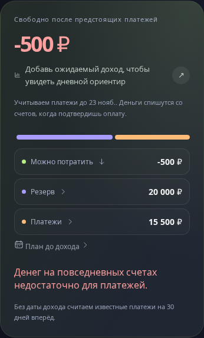
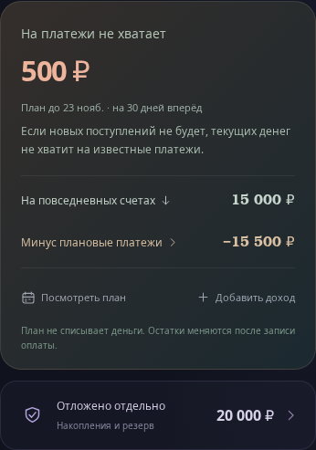
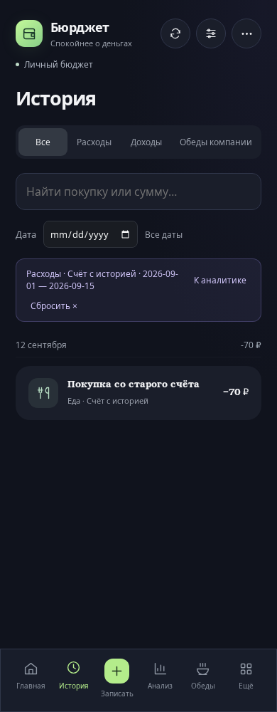

# Бюрджет 4.6.0 — понятный остаток и аналитика по выбранным записям

Сравнение исходной версии `83feca385d040f8888e8a1774c152dcd44ace082` (4.5.0) и реализации `72a04df8fba15e271de2fe13f474ffe74c4c7e11` (4.6.0). Последующий коммит добавляет только этот отчёт, сценарий съёмки и доказательства. Данные вымышленные, общие для обеих ревизий; реальные пользовательские записи в отчёт не включены.

Съёмка Chromium: 24 октября 2026, 12:00 Europe/Moscow, мобильный экран 390 × 1000, масштаб 1. Для снимка целого бюджетного блока — 390 × 2000, для компьютера — 1280 × 1000. Полные снимки страницы содержат закреплённую навигацию на высоте исходного окна; это поведение полноэкранной съёмки. Telegram и внешние Google Fonts одинаково отключены в обеих ревизиях. Точные настройки и исходные данные: [capture.json](audit-4.6.0/capture.json).

## Главная: деньги и будущие платежи

Раньше отрицательный остаток назывался «Можно потратить», а общая цветная полоса смешивала текущие деньги, накопления и будущие расходы. Теперь заголовок прямо говорит о нехватке; ниже — реальные деньги на повседневных счетах и вычет платежей до указанной даты. Накопления вынесены отдельно. Счета раскрываются в том же блоке; план и добавление дохода доступны рядом. При неизвестной сумме платежа указано, что результат рассчитан только по известным суммам.

| До | После |
|---|---|
|  |  |

Остатки не пересчитаны и не мигрированы: на повседневных счетах 15 000 ₽, известные платежи 15 500 ₽, результат −500 ₽, накопления 20 000 ₽. В новой версии это подписано «На платежи не хватает 500 ₽». План не списывает деньги; подтверждение оплаты продолжает создавать связанную операцию.

Полные снимки: [до](audit-4.6.0/before-home.png), [после](audit-4.6.0/after-home.png). Компьютер: [до](audit-4.6.0/before-home-desktop.png), [после](audit-4.6.0/after-home-desktop.png). Исправлено размещение бюджетного блока и последних операций в сетке; скрытая подпись таблицы теперь ограничена собственным контейнером и не расширяет страницу.

## Аналитика: единый период, счёт и переходы

Категории и изменение к прошлому периоду объединены в один список. Обычные покупки, платежи по плану, сплиты/кредиты и возвраты долгов распределены без двойного учёта. Два коротких вывода открывают свои исходные записи. Крупные покупки и график свёрнуты; их раскрытие сохраняется при возврате из истории и редактирования. Текущие лимиты перенесены к будущему плану, чтобы не смешивать их с историческим отчётом.

| До | После |
|---|---|
|  |  |

В дополнение к текущему месяцу, 7 и 30 дням можно выбрать прошлый месяц или свои даты (до 366 дней) и конкретный счёт. Нулевой счёт с историей остаётся доступен. График длинного периода группируется по неделям или месяцам; суммы и переходы соответствуют точным границам каждой группы.

Новый сценарий, которого в 4.5 не было: 1–15 сентября, «Счёт с историей» с текущим нулевым остатком. Расход 70 ₽, доход 200 ₽. Нажатие расхода открывает единственную подходящую операцию, не покупки других счетов или остаток месяца. Возврат сохраняет счёт, даты и раскрытый график.

| Выбранные даты и счёт | Соответствующая история |
|---|---|
|  |  |

## Исправление календарного сравнения

В 4.5 «Этот месяц» брал предыдущий отрезок такой же длины непосредственно перед первым числом. Для 1–24 октября это давало 7–30 сентября. Теперь используются 1–24 сентября. Завершённый месяц сравнивается с целым предыдущим календарным месяцем; для короткого месяца даты ограничены его последним днём. Для 7/30 дней и произвольных дат сохраняется сравнение с непосредственно предшествующим отрезком такой же длины.

| Значение на одинаковых данных | До | После |
|---|---:|---:|
| Расходы 1–24 октября | 2 850 ₽ | 2 850 ₽ |
| Доходы за эти даты | 2 000 ₽ | 2 000 ₽ |
| Доходы − расходы | −850 ₽ | −850 ₽ |
| Предыдущие даты | 7–30 сентября | 1–24 сентября |
| Расходы предыдущих дат | 4 750 ₽ | 950 ₽ |
| Изменение расходов | −1 900 ₽ | +1 900 ₽ |
| Расходы полного сентября | 4 950 ₽ | 4 950 ₽ |
| Предыдущие даты для полного сентября | 2–31 августа | 1–31 августа |
| Расходы предыдущих дат для сентября | 30 ₽ | 55 ₽ |

Разница возникала из-за покупки 30 сентября и покупки 1 августа, которые попадали в неверные сравнения. Текущие расходы и реальные остатки сохранены. Доказательства рассчитаны импортом моделей непосредственно из каждой ревизии, а не подстановкой старых значений в новый интерфейс: [financial-evidence.json](audit-4.6.0/financial-evidence.json).

В новом отчёте 2 850 ₽ = обычные покупки 2 300 ₽ + платежи по плану 200 ₽ + сплит 300 ₽ + возврат долга 50 ₽. Компания оплатила обед 400 ₽, а свой перевод в накопления составил 3 000 ₽: оба исключены из личных расходов. Крупнейшая покупка 1 500 ₽ составляет 53%; рост категории «Техника» с 250 до 1 800 ₽ подтверждён записями.

## Связность и проверки

Общие модели периода, групп расходов и состояния бюджета используются миниаппой, ботом, текстовыми и графическими итогами. Бот сохраняет свои существующие диапазоны 7/30 дней; выбор прошлых месяцев и своего счёта добавлен в миниаппу. Никаких новых списаний, миграций остатков или независимого финансового хранилища нет.

- 438 тестов: календарные границы, февраль/високосный год, валютный сохранённый курс, группы без двойного учёта, точные суммы категорий/дней/недель/месяцев, ссылки на исчезнувшую категорию и конкретную покупку, изменение/удаление операции и остатки счетов, общие модели бота и итогов.
- Реальный Chromium: выбранные даты и нулевой счёт с историей → категория/день/группа → история → изменение → возврат; сумма отчёта обновляется, фильтр и раскрытие графика сохраняются. Запись «только история» не меняет остаток.
- Дополнительные проверки: нехватка денег, положительный остаток и неизвестная сумма платежа; отсутствие горизонтального переполнения на 320/360/390/430/768/1280 px. Существующие сценарии обедов/доплат/удаления, переводов, рассрочек, календаря, доходов и резервного копирования проходят вместе с новыми.
- Сборка приложения, проверка Worker, проверка версии выпуска и `git diff --check` проходят. CI дополнительно запускает тесты на Linux и Windows и Chromium на Linux.

Повторение съёмки из корня репозитория:

```sh
BROWSER_EXECUTABLE_PATH=/path/to/chromium node scripts/capture-clarity-comparison.mjs
```

Можно задать `AUDIT_BEFORE_REF`, `AUDIT_AFTER_REF`, `AUDIT_SCREENSHOT_DIR`. Скрипт создаёт отдельные worktree, использует один профиль и фиксированное время, проверяет точные финансовые значения и неизменность данных, затем удаляет временные worktree. Проверка не обращается к профилям пользователей и не записывает данные на сервер.
