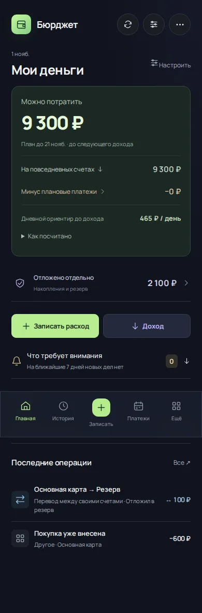
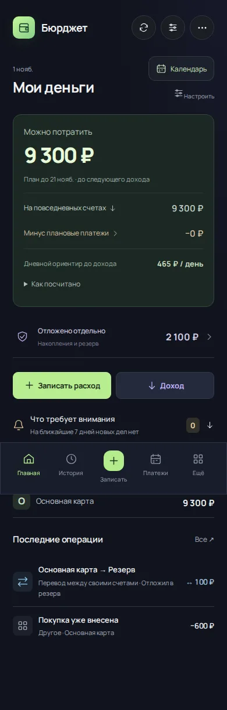
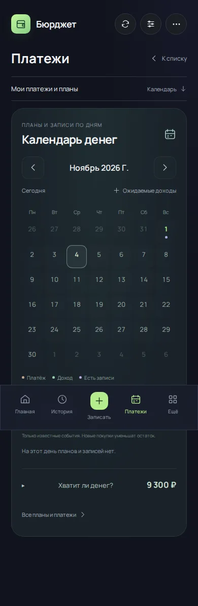
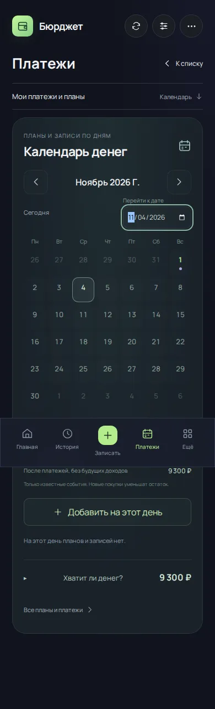
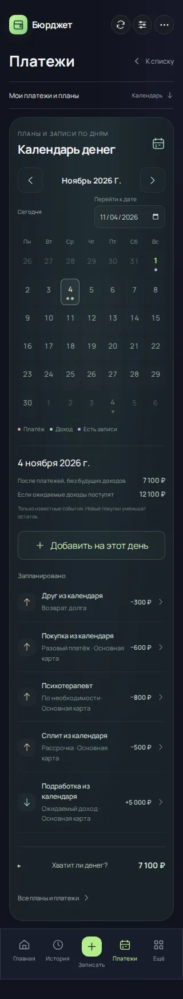
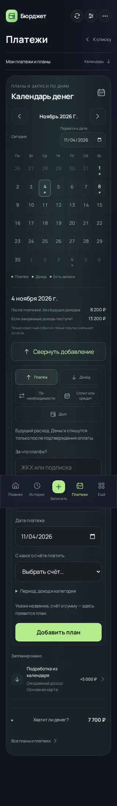

# Связанный календарь · 4.14.0

Требование Андрея: календарь должен быть доступнее, позволять работать со всеми будущими платежами и использовать общую систему денег. 5.0 должна быть большим системным обновлением. Эти правила закреплены в [AGENTS.md](../AGENTS.md); обязательные блоки и критерии готовности — в [плане 5.0](ROADMAP-5.0.md). Эта поставка остаётся этапом 4.x.

## Что изменилось

| Сценарий | 4.13 (`bac95bee7425fb1d3fb29422c6850d79e6feee27`) | 4.14 |
|---|---|---|
| Доступ с главной | Платежи → Календарь, либо Ещё → Календарь в аналитике | Видимая кнопка «Календарь» в одно нажатие; общий экран платежей, ссылка `?calendar=1` |
| Выбор дальней даты | Перелистывание месяцев | Прямой переход к дате и прежние стрелки |
| Добавление из выбранного дня | Переход только к ожидаемым доходам | Платёж, доход, сохранённый шаблон «По необходимости», график сплита/кредита, существующий долг |
| Перенос | Только плановый расход/доход | Также отдельный неоплаченный взнос, в том числе частично оплаченный, и срок возврата долга |
| Уже внесённая оплата плана | Нужно идти в список платежей | Связь с историей или пропуск периода прямо из события календаря |
| Записанный перевод | Отсутствует среди фактов дня | Видимая запись с маршрутом счетов, переход к общей форме редактирования |
| Событие в боте | Источник ищется по префиксу ID | Точные `source/sourceId/period/paymentId`, карточка выбранного события, общий перенос |

## Источник истины и сквозные связи

Новых независимых финансовых списков нет. `CalendarCreate` использует существующие `PlannedForm`, `InstallmentForm` и выделенную из раздела долгов общую `DebtForm`. Дата выбирается в календаре, редактируется в форме и сохраняется в исходной сущности; после сохранения календарь показывает фактическую выбранную дату.

- Плановые расходы и доходы — `recurring` → `plannedOccurrences` → `scheduledEvents` → календарь, бюджет, прогноз, сводка и включённые уведомления.
- Нерегулярный платёж — назначение даты существующему шаблону через `schedulePlanned`; сам шаблон не копируется.
- Взнос — существующий `installments.payments[paymentId]`; перенос меняет только его дату и сохраняет оплаты с тем же ID. Остальные взносы не меняются.
- Долг — существующая запись `debts[sourceId]`; меняется срок, возвращённые деньги сохраняются. Создание источника защищено от повторного ID.
- Факт — общий ledger/история, включая переводы. Нажатие открывает обычную форму; новые финансовые эффекты при просмотре не создаются.
- `rescheduleEvent` применяется в миниаппе и боте; просроченная карточка с прежней датой отклоняется, даже если событие перенесено раньше. Напоминание на старую дату удаляется.

Перенос/создание плана не списывают деньги. Подтверждённый доход увеличивает остаток; ожидаемый — только сценарный прогноз. Связь со старой оплатой не списывает повторно. Ручной режим уведомлений сохраняется.

## Проверки и ограничения

Доменные и UI-проверки проверяют все источники, частичную оплату и перенос взноса, перенос и оплату долга, удаление оплаты и восстановление события, точные переходы при похожих ID, сохранность счетов/истории, общий перенос в боте, создание с изменённой датой, JSON round-trip и дубли команд. Реальный Chromium-сценарий `test:calendar` проходит все пять способов создания, переносы, оплату, связь со старой записью, редактирование перевода и ширины 320/390/768/1280. Данные вымышленные; живые бюджеты не менялись.

Будущие собственные переводы и отложение в резерв пока не являются плановыми событиями — фактические переводы показываются. Долг без срока не получает выдуманную дату. Из календаря связь старой оплаты реализована для планов; для взносов и долгов сохраняются существующие действия их разделов. Недельный обзор и полный сценарий согласования ранее введённых данных остаются в обязательной работе к 5.0. G01–G07 этим выпуском не объявляются исправленными.

522 теста, production build и Worker bundle прошли; все шесть Chromium-сценариев и проверки Windows/Linux завершились успешно на исходном коммите `88170a80a6069290663e988d4573377b1ceb564d`: [run 41338704144](https://github.com/M3A9tt/budget-app/actions/runs/41338704144). Локально Chromium отсутствует; браузерные доказательства получены в CI, просмотрены перед слиянием PR #66.

## Реальные снимки и суммы

Съёмка выполнена на коммите `7538bc99c49acc88973ff84e22adb90f6469e7a9` в [run 41338569569](https://github.com/M3A9tt/budget-app/actions/runs/41338569569). Последующий коммит добавил возможность создать ещё один нерегулярный шаблон при уже существующих и регрессионный тест; показанные состояния не изменены. Одинаковые начальные вымышленные данные, дата 01.11.2026, размер экрана 390×844. [Fixture](connected-calendar-2026-11-01/fixture.json), [результаты действий](connected-calendar-2026-11-01/evidence.json).

| Главная 4.13 | Главная 4.14: видимый вход в календарь |
|---|---|
|  |  |

| Один выбранный день 4.13 | Тот же день 4.14: переход к дате и добавление |
|---|---|
|  |  |

Следующие снимки — результат интерактивного сценария после добавления событий из той же исходной fixture. Это демонстрация действий; исходные данные при этих снимках уже изменены сценарием.

| Все пять источников в выбранном дне, 320 px | Общая форма добавления, 320 px |
|---|---|
|  |  |

| Действие | Остаток карты | Резерв | Неоплаченные обязательства до дохода | Можно потратить | Фактов расхода |
|---|---:|---:|---:|---:|---:|
| Исходно: старая покупка уже внесена | 9 300 ₽ | 2 100 ₽ | 0 ₽ | 9 300 ₽ | 1 |
| Добавлены расход, доход, встреча, сплит и долг | 9 300 ₽ | 2 100 ₽ | 2 200 ₽ | 7 100 ₽ | 1 |
| Перенесён один взнос, затем оплачен долг | 9 000 ₽ | 2 100 ₽ | 1 900 ₽ | 7 100 ₽ | 2 |
| Старая покупка связана с планом | 9 000 ₽ | 2 100 ₽ | 1 300 ₽ | 7 700 ₽ | 2 |
| Сеанс оплачен; следующей встречи нет | 8 200 ₽ | 2 100 ₽ | 500 ₽ | 7 700 ₽ | 3 |
| Отредактирована подпись существующего перевода | 8 200 ₽ | 2 100 ₽ | 500 ₽ | 7 700 ₽ | 3 |

Ожидаемые 5 000 ₽ от подработки не вошли в реальные остатки. Второй взнос сплита остаётся в будущем графике и за текущим бюджетным горизонтом, а не исчезает. Перевод остаётся одной существующей записью; его сумма не считается расходом.
