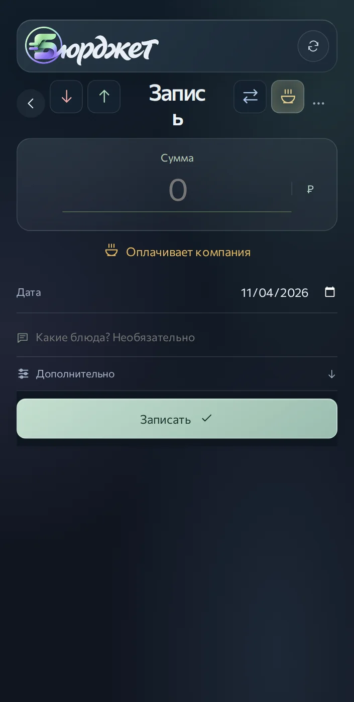
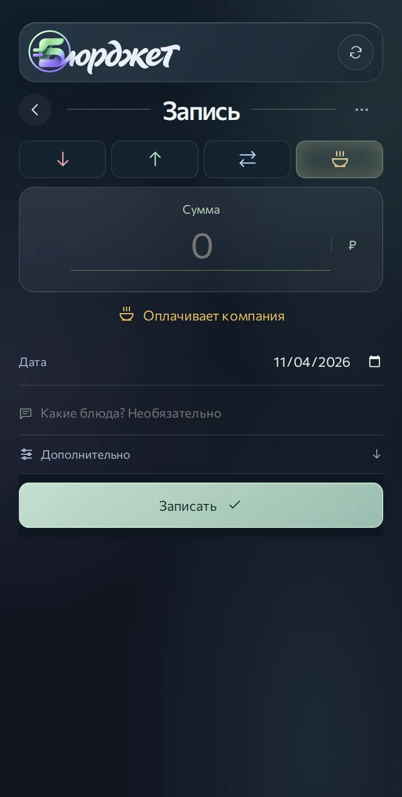
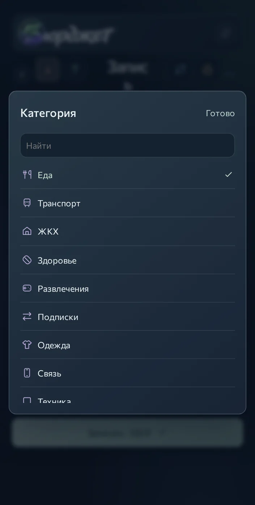
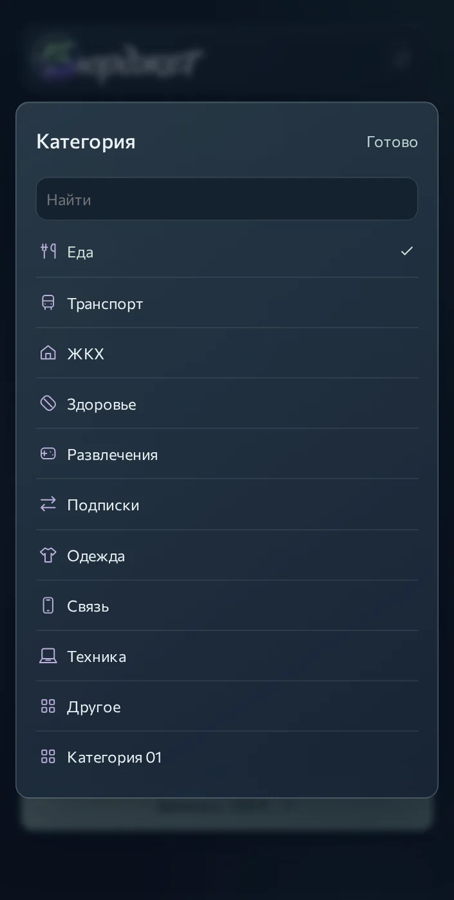
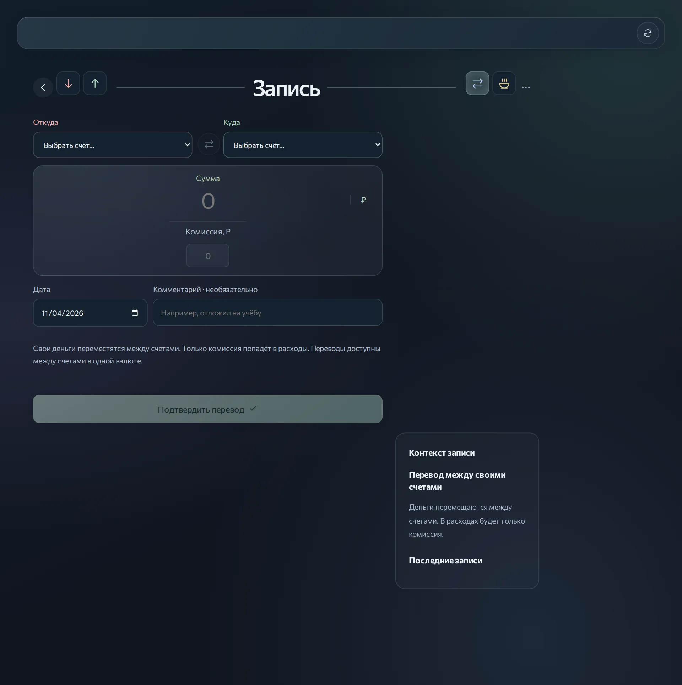
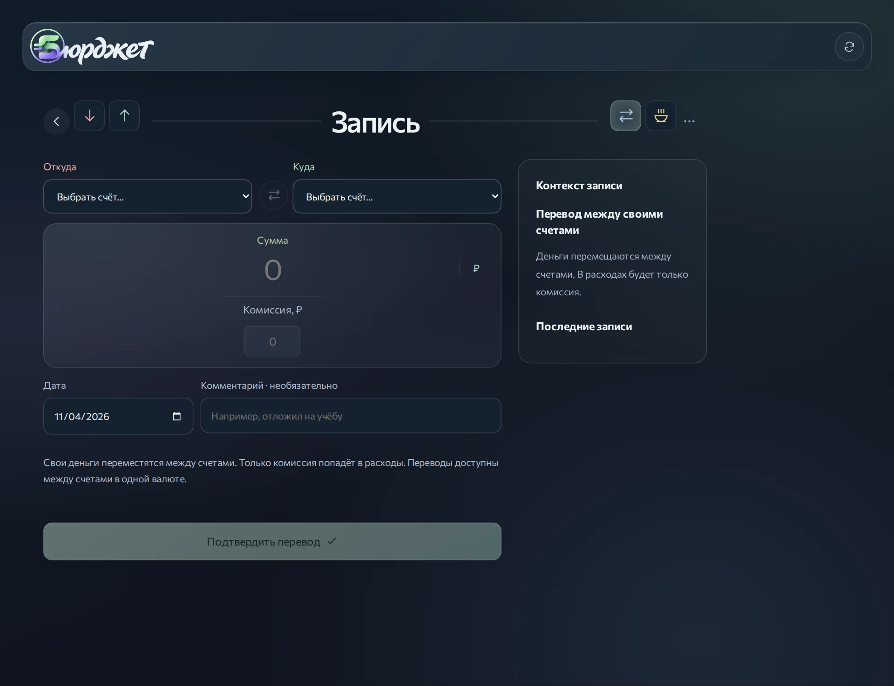

# Проверка записи и выбора категорий по ЗАВЕТАМ · 5.0.1

Запрос Андрея: заново проверить результат после двух снимков с разбитым заголовком «Запись» и неудобным окном категории. Одна успешная сборка здесь недостаточна; применяются правила AGENTS.md: эталон перевода, сохранение стекла и цвета, крупный читаемый заголовок, явные действия, телефон и десктоп, фокус, движение и сквозные финансовые связи.

## Причина и исправление

В исходном `392f0bb2fdea65e9ff24387384bd55a7e802e099` после 420 px переключатели типа позиционировались поверх строки заголовка, а его область получала 100 px отступа с каждой стороны. Узкий экран с CSS-шириной 421–600 px попадал в эту раскладку; текст переносился внутри слишком узкой области. Прежние проверки отсутствия общего горизонтального скролла этого не ловили.

У существующих правил адаптации порог согласован с реальным размером формы: отдельная строка переключателей до 767 px, широкая композиция с 768 px. Заголовок не переносится между буквами; шрифт не уменьшен. Старое временное переопределение удалено вместо накопления ещё одного слоя поверх него.

У общего EntryPicker одна прокручиваемая область списка внутри ограниченного по высоте диалога. Поиск и закрытие остаются доступны. При повторном открытии выбранный пункт попадает в видимую область; после закрытия фокус возвращается в исходный переключатель. Нажатие на внутренний отступ окна не закрывает его, на фон — закрывает. Применяется один компонент для счёта и категории; финансовый источник и суммы не дублируются.

При просмотре широкого экрана обнаружена дополнительная проблема: старое правило десктопа скрывало логотип в шапке, а новая нижняя навигация не показывала прежний боковой логотип. Видимость восстановлена в существующей персональной шапке; используется утверждённый общий Brand и исходный ресурс. Блок контекста записи переведён со старой третьей строки сетки во вторую, рядом с общей формой: устранена пустота сверху.

## Обязательные сценарии приёмки

`npm run test:layout` сравнивает исходную и изменённую ревизии на одинаковых вымышленных данных. Сначала воспроизводит перенос в исходной версии, затем проверяет:

- Расход, доход, перевод и обед: 320/390/420/421/470/600/767/768/1024/1280 px, однострочный заголовок, отсутствие пересечений с кнопками и горизонтального скролла, удобная область нажатия. Отдельные снимки перевода и обеда для сравнения композиции.
- Каталог с 35 категориями: прокрутка до последней, выбор категории с эмодзи, сохранение суммы, повторное открытие с видимой отметкой выбора, поиск и отсутствие результатов, «Готово», Escape, нажатие внутри/снаружи диалога, возврат фокуса.
- Диалог на высотах 420/600/930 px, в том числе тесная область при работе с полем поиска. Это эмуляция доступной высоты, не заявление о проверке физической клавиатуры Android.
- Редактирование сохранённого расхода и возврат к фильтру операций без записи. Открытие будущего расхода из календаря, проверка общей формы и отмена с возвратом к выбранному дню; план и остатки сохраняются.
- Видимость и загрузка утверждённого логотипа на всех проверяемых ширинах; на десктопе блок контекста начинается на одной высоте с формой.
- Фактическая загрузка локального Commissioner. Уменьшенное движение в мобильной проверке; отдельный десктопный контекст с наведением, сменой типа во время анимации и уходом курсора.
- Действие → исходные записи → счета → бюджет: расход 100 ₽ с выбранной категорией, доход 200 ₽, перевод 50 ₽ с комиссией 5 ₽, обед компании 350 ₽ и будущий расход 400 ₽. Диалоги и переключение типов до сохранения ничего не записывают.

Контрольная математика: исходно карта 10 000 ₽, наличные 2 000 ₽; после расхода/дохода/перевода/обеда — карта 10 045 ₽, наличные 2 050 ₽. Только комиссия перевода входит в расходы. Обед компании не списывает личные деньги. Будущий расход оставляет эти остатки и четыре фактические записи, увеличивая обязательства на 400 ₽; «Можно потратить» — 11 695 ₽. Отдельно сохраняется один перевод и один план.

| Шаг | Карта, ₽ | Наличные, ₽ | Денежный смысл |
|---|---:|---:|---|
| Начало | 10 000 | 2 000 | Вымышленные остатки |
| Расход 100 | 9 900 | 2 000 | Одна запись с выбранной категорией |
| Доход 200 | 10 100 | 2 000 | Одна запись дохода |
| Перевод 50 + комиссия 5 | 10 045 | 2 050 | Перевод отдельно; расход только комиссия |
| Обед компании 350 | 10 045 | 2 050 | Личные деньги не списываются |
| Будущий расход 400 | 10 045 | 2 050 | Один план; доступно 11 695 ₽ |
| Отмена редактирования и подтверждения | 10 045 | 2 050 | Пять исходных сохранений; новых записей нет |

Это проверка Chromium с эмуляцией размеров и касаний плюс отдельный десктопный контекст. Физический Telegram WebView не заявляется проверенным. Снимки и fixture сохраняются в артефакте CI `financial-ui-screenshots/entry-layout`; снимки ниже фактически просмотрены. Финансовые данные пользователей не использовались.

## Результаты и сравнение ревизий

- До: `392f0bb2fdea65e9ff24387384bd55a7e802e099` (5.0.0).
- После: `7d9b335de8f39c0d722e7a8824bfcf3d047a391e` (5.0.1); слияние PR #71 — `c741560f527e302097376c1ee5e557a9001d3579`.
- [Полный CI итоговой ревизии](https://github.com/M3A9tt/budget-app/actions/runs/41786540049): успешен. 550 тестов, production build и Worker bundle на Linux и Windows; девять наборов Chromium на Linux. Ошибок страницы в новом сценарии нет.
- Автоматическое измерение воспроизвело перенос на 421 и 470 px в исходной ревизии; после исправления во всех 40 сочетаниях ширины и типа заголовок однострочный, пересечений и горизонтального скролла нет.
- Дата фикстуры — 04.11.2026 по Москве. До/после сняты с одинаковыми данными, viewport и DPR 1.5. Десктопный контекст с движением — отдельный viewport 1280×900, DPR 1. Значения нативного поля даты рисует Chromium; финансовое значение ISO неизменно.
- Исходные [данные](entry-layout-2026-11-04/fixture.json) и [измерения со снимками финансового состояния](entry-layout-2026-11-04/evidence.json) сохранены рядом с изображениями.

### Телефон, 470×930: форма обеда

До — заголовок перенесён между буквами. После — самостоятельный заголовок и отдельная строка четырёх типов; шрифт, цвет обеда и мягкие поверхности сохранены.

| До | После |
|---|---|
|  |  |

### Телефон, 470×930: общий выбор категории

До — ограничение списка отдельными 48dvh обрезало нижнюю строку при наличии свободного места в диалоге. После — список использует оставшуюся высоту, поиск и закрытие остаются на месте. Сквозной сценарий отдельно выбрал последнюю, 35-ю категорию и сохранил сумму 100 ₽.

| До | После |
|---|---|
|  |  |

### Широкая раскладка, 1280×930: перевод как эталон формы

До — пустая шапка и контекст под формой. После — общий фирменный логотип в шапке и контекст рядом с полями. Сумма остаётся главной, комиссия — второстепенной.

| До | После |
|---|---|
|  |  |

### Дополнительные состояния

[Короткий экран 470×420: поиск и выбранная категория](entry-layout-2026-11-04/after-category-height-420.webp). Проверены также высоты 600 и 930 px.

[Настоящий десктопный контекст во время движения и наведения](entry-layout-2026-11-04/after-desktop-motion.webp) → [после ухода курсора](entry-layout-2026-11-04/after-desktop-rest.webp). Мобильный контекст отдельно проверяет системное уменьшение движения.

## Публикация

[Штатная выкладка 5.0.1](https://github.com/M3A9tt/budget-app/actions/runs/41787387373) завершилась успешно 04.11.2026 в 09:52 по Москве для merge-коммита `c741560f527e302097376c1ee5e557a9001d3579`. Повторные проверки Linux/Windows, независимая резервная копия базы, сборка, Chromium, reliability и проверка bundle завершены успешно. Cloudflare подтвердил публикацию существующего `budget-staging`; Version ID `19ab59d0-96a2-4c9e-9b3c-0e8c114a1a11`.

Публикация подтверждена журналом штатного workflow. Снимки в отчёте получены в Chromium на сравниваемых исходных ревизиях; это не снимки физического Telegram WebView и не отдельная проверка интерфейса после развёртывания. Автоматические рассылки через инструмент публикации не запускались.
