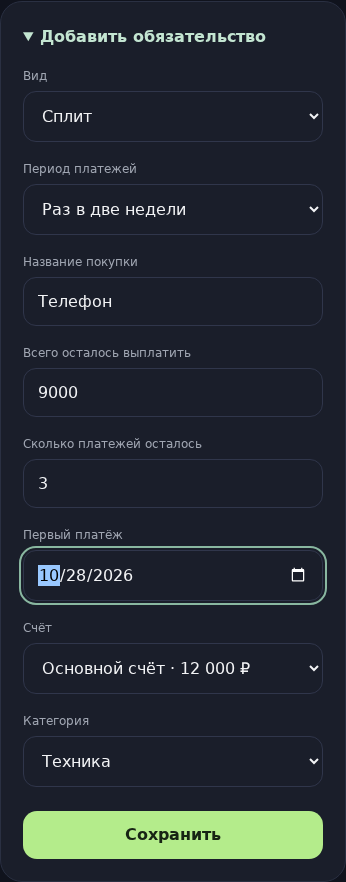
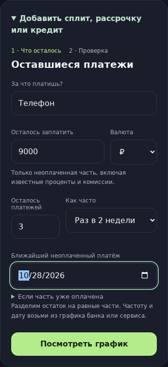

# 4.3.0 · Расходы в проверке дня и понятный график платежей

В напоминании появились реальные расходы за проверяемый день. Создание сплита, рассрочки и кредита теперь начинается с неоплаченного остатка и заканчивается проверкой конкретных дат и сумм.

## Настоящее «до → после»

Сравниваются исходные ревизии [b401cbc](https://github.com/M3A9tt/budget-app/commit/b401cbcfa95171bd550d68345584402595753778) и [6e03a20](https://github.com/M3A9tt/budget-app/commit/6e03a20b460a24c6522ef4c507d3829f316e8633). Снимки получены в Chromium из обеих ревизий на одних вымышленных данных, с датой 21 октября 2026 года и экраном 390 × 1200. Метаданные, исходный бюджет и ввод — в [capture.json](audit-4.3.0/capture.json). Финансовые данные пользователей не использовались.

| До: все поля одним списком | После: только оставшиеся платежи |
| --- | --- |
|  |  |

Вместо неоднозначного «Первый платёж» — «Ближайший неоплаченный платёж». Сумма относится к оставшейся части покупки. Рядом есть пример, а число платежей принимает только целое значение. Валюта видна до ввода суммы; на следующем шаге предлагаются счета в этой валюте.


Убраны повторяющиеся большие карточки выбора раздела внутри уже открытых кредитов, долгов и разовых платежей. Возврат к видам платежей остался обычной ссылкой. В карточке рассрочки на виду ближайшая неоплаченная часть и прогресс; остальные платежи и связанные записи раскрываются по желанию.

Полные страницы: [до](audit-4.3.0/before-page.png), [после](audit-4.3.0/after-page.png).

## Как добавить сплит или рассрочку

Пример: телефон стоит 12 000 ₽, первые 3 000 ₽ уже оплачены. По графику сервиса осталось три списания раз в две недели, ближайшее — 28 октября.

1. Открой «Платежи и доходы → До погашения → Кредиты, сплит, рассрочки» и раскрой добавление.
2. Введи название «Телефон», остаток **9 000 ₽**, **3** платежа, период **раз в 2 недели**, дату **28 октября**.
3. На проверке увидишь **28 октября, 11 ноября и 25 ноября — по 3 000 ₽**. Выбери счёт. В «Тип и категория» при необходимости уточни «Сплит» и категорию расходов.
4. Создай график. Деньги остаются на счёте; ближайшие платежи учитываются в «Можно потратить».
5. После реального списания открой нужный платёж, проверь сумму и сохрани оплату. Появится одна связанная запись в истории.

Уже оплаченные части в новый график не включаются. Этот способ учёта отражает расходы по фактическим платежам: полную стоимость покупки дополнительно записывать не нужно.

График делит остаток на равные части с распределением копеек. Частота и дата берутся из графика банка или сервиса. Переменные банковские суммы и проценты автоматически не рассчитываются; фактическую сумму можно уточнить перед подтверждением оплаты.

Те же пояснения и предпросмотр дат доступны при добавлении через бота.

## Что изменилось в проверке расходов

Содержимое получено вызовом настоящей функции `expenseReminder` из каждой ревизии: [до](audit-4.3.0/before-reminder.json), [после](audit-4.3.0/after-reminder.json). Это данные сообщения, а не снимки клиента Telegram.

| Сценарий на одном бюджете | До | После |
| --- | --- | --- |
| Кофе 180 ₽ и такси 380 ₽ за 21 октября | Только вопрос | Обе записи с суммами и счётом; итог **560 ₽** |
| Обед компании 330 ₽ | Вопрос без детализации | Не включён в личные траты и итог 560 ₽ |
| Больше пяти расходов за день | Списка нет | Последние пять, общий итог всех расходов и число остальных |
| Открыть проверяемые записи | Отдельной кнопки нет | «Записи за день»: история с точной датой и типом «Расход» |
| Расход добавлен или удалён после неудачной отправки | Повторяется сохранённый текст | Список и сумма собираются из актуального бюджета |
| Отсрочка перешла за полночь | Сохраняется дата вопроса | И список, и все действия относятся к исходному дню |
| Нажать просмотр истории | — | Проверка остаётся открытой, баланс не меняется |

Если расходов пока нет, сообщение говорит об этом прямо. Кнопка «Без трат за этот день» доступна только при пустом списке; сервер дополнительно проверяет записи при нажатии. Пользовательский текст и стиль напоминаний сохранены.

## Проверка всей финансовой цепочки

Ниже результат вызовов реальных общих функций создания графика, оплаты, удаления оплаты и расчёта бюджета. Доход ожидается 1 ноября; в исходном бюджете уже есть платёж за ноутбук 6 000 ₽ до этой даты. [Машинный результат](audit-4.3.0/finance-scenario.json).

| Действие | На счёте | Расходы месяца | Предстоящие платежи до дохода | Можно потратить | Записей |
| --- | ---: | ---: | ---: | ---: | ---: |
| До нового графика | 12 000 ₽ | 560 ₽ | 6 000 ₽ | 6 000 ₽ | 3 |
| Создан график телефона | 12 000 ₽ | 560 ₽ | 9 000 ₽ | 3 000 ₽ | 3 |
| Первый платёж телефона оплачен | 9 000 ₽ | 3 560 ₽ | 6 000 ₽ | 3 000 ₽ | 4 |
| Оплата удалена | 12 000 ₽ | 560 ₽ | 9 000 ₽ | 3 000 ₽ | 3 |

Создание графика не списывает деньги и не добавляет расход. Подтверждение меняет счёт, историю и остаток обязательства. Удаление возвращает деньги и снова открывает платёж. Повторное сохранение того же черновика блокируется его постоянным ID, чтобы после неясного ответа сервера не появился второй график.

Существующие графики, записи и остатки не переписывались; схема хранения не менялась.

## Проверки и воспроизведение

- Базовая ревизия: **402** теста. Изменённая версия: **410 из 410**.
- Новые проверки: фильтрация и исторические валютные суммы в напоминании; ограничение длинного текста; переход в историю и изоляция пользователей; обновление очереди отправки; отсрочка после полуночи; пошаговое добавление через бота; совпадение предпросмотра и сохранения; защита от повторного графика.
- Chromium: создание, возврат назад без потери ввода, совпадение расписания, отсутствие списания до подтверждения, реальная оплата один раз; ширина **320, 360, 390, 430, 768 и 1280 px**, без горизонтального переполнения и ошибок страницы.
- Производственная сборка и сборка Worker проходят. Матрица Linux/Windows и Chromium проверяются в [PR №47](https://github.com/M3A9tt/budget-app/pull/47/checks).

```sh
npm ci
npm test
npm run build
npm run worker:check
npx --no-install playwright-core install --with-deps chromium
npm run test:browser
AUDIT_BEFORE_REF=b401cbcfa95171bd550d68345584402595753778 \
AUDIT_AFTER_REF=6e03a20b460a24c6522ef4c507d3829f316e8633 \
node scripts/capture-payment-ux-comparison.mjs
```

Оба коммита должны быть доступны локально. Скрипт создаёт отдельные рабочие копии, подставляет одинаковые данные, фиксирует часы, снимает интерфейс и проверяет точные финансовые значения.

Для структуры формы использован принцип коротких тематических шагов с объяснением запрашиваемых данных из [GOV.UK Design System](https://design-system.service.gov.uk/patterns/question-pages/). Для карточек — идея наглядного прогресса погашения из [YNAB Loan Planner](https://www.ynab.com/whats-new/ynabs-loan-planner-just-got-better). Расчёты и финансовые правила остаются общими для Бюрджета.
