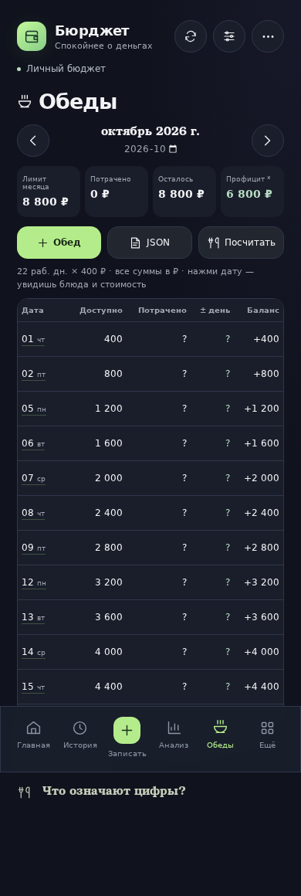
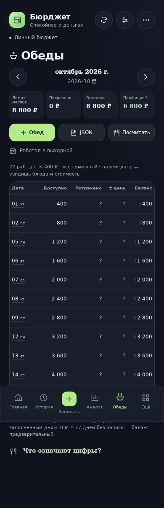
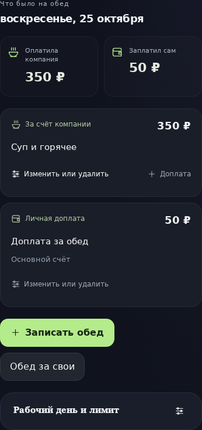
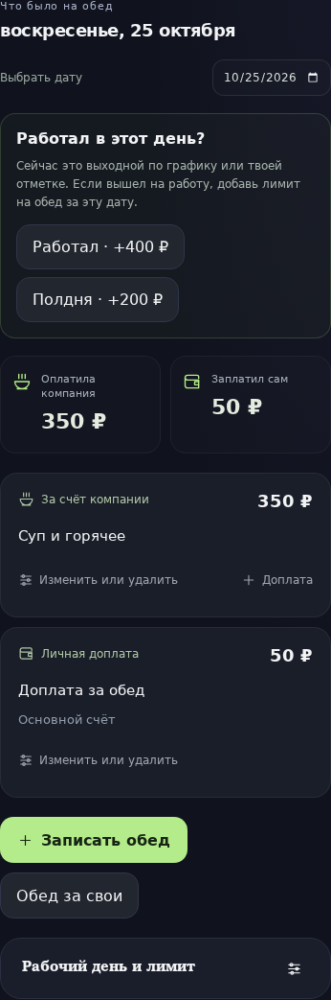
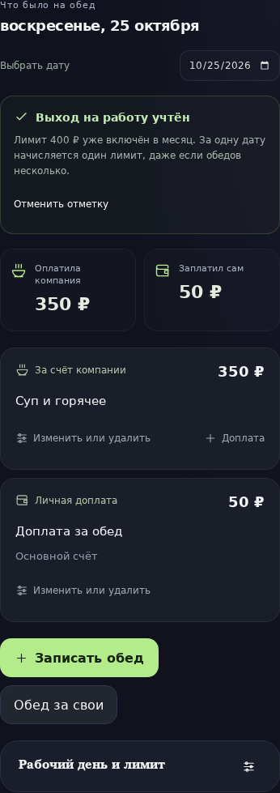

# Бюрджет 4.6.1 — работа в выходной и лимит на обед

Проверяемый сценарий: в воскресенье человек вышел на работу, компания оплатила обед, но дневной лимит остался нулевым. Пользователю нужен понятный способ добавить именно эту рабочую дату, сохранив обычную пятидневку.

До: `e5197becd24ba7969acfd6a32c67261ad20506c2` (4.6.0). После: `5b4e35d1cf897d288dffcd2b541adb5e998b0502` (4.6.1). Следующий коммит добавляет только отчёт, снимки и сценарий съёмки. Оба исходника действительно запускаются отдельно; картинки не являются макетами.

## Причина и исправление

Ручное исключение «Полный день» уже существовало в настройках карточки даты. Однако пустые выходные скрывались из таблицы, выбрать произвольную дату напрямую было нельзя, а подпись настроек объясняла только отпуск и полдня. Даже после ручной отметки дополнительного выхода вопросы об обеде отсекались отдельным фильтром будней.

Теперь в таблице есть действие **«Работал в выходной»**, а сегодняшний день показывается и без записей. Можно выбрать дату и отметить полный день или полдня. В выходной с нулевым лимитом это действие видно сразу в карточке; после отметки видно, что лимит уже включён в месяц, и можно отменить отметку. Будущий выход увеличивает план месяца, а начисленный остаток — только с наступлением даты.

Обновление дня и чтение графика общие для миниаппы, бота, расчёта лимита и очереди напоминаний. Дополнительный рабочий день получает обычный дневной лимит один раз, независимо от числа заказов. Бот показывает сумму после изменения и предупреждает о нулевом лимите при записи обеда в выходной. Обычные настройки дней вопросов сохраняют своё действие; отдельно отмеченный выход вне графика больше не блокируется ими. Выключенные вопросы не включаются автоматически.

Компания может оплатить обед вне работы, поэтому сама запись обеда не меняет график автоматически. Существующие обеды, доплаты и остатки не переписываются. Используются прежние поля `lunchDayMod` и `lunchDayOff`, без миграции финансового хранилища.

## Реальные снимки до и после

Одинаковая дата: **25 октября 2026, 12:00 Europe/Moscow**. Chromium, 390 × 1000, масштаб 1, ru-RU. Карточка дня снята целиком в одинаковом окне 390 × 1800. Telegram и внешние Google Fonts отключены одинаково. Данные вымышленные: [профили и настройки съёмки](audit-4.6.1/capture.json).

| Пустой выходной до | Пустой выходной после |
|---|---|
|  |  |

| Карточка записанного обеда до | Карточка после: явное предложение отметить выход |
|---|---|
|  |  |

| После отметки через старые настройки | После отметки через новое действие |
|---|---|
|  |  |

После ручной отметки расчёт лимита в обеих версиях одинаков — этот расчёт уже был. Исправлены доступ к исключению и использование этого исключения напоминаниями. Таблица после отметки: [до](audit-4.6.1/before-marked-table.png), [после](audit-4.6.1/after-marked-table.png).

## Точные значения

В октябре базовый график даёт 22 дня × 400 ₽ = 8 800 ₽. На 25 октября начислено 6 800 ₽. В воскресенье уже записан обед компании 350 ₽ и личная доплата 50 ₽; на личном счёте осталось 950 ₽ из исходных 1 000 ₽.

| Значение | До отметки выхода | После полного дня |
|---|---:|---:|
| Лимит месяца | 8 800 ₽ | 9 200 ₽ |
| Начислено на 25 октября | 6 800 ₽ | 7 200 ₽ |
| Лимит воскресенья | 0 ₽ | 400 ₽ |
| Компания оплатила | 350 ₽ | 350 ₽ |
| Личная доплата | 50 ₽ | 50 ₽ |
| Подтверждённый итог заполненных дней | −350 ₽ | +50 ₽ |
| Личный счёт | 950 ₽ | 950 ₽ |

| Поведение на одной дате | 4.6.0 | 4.6.1 |
|---|---:|---:|
| Пустое сегодняшнее воскресенье видно в таблице | Нет | Да |
| Вопрос об обеде при отмеченном полном дне, без записанного обеда, вопросы включены только по будням | 0 | 1 |
| Вопрос при уже записанном обеде | 0 | 0 |

Числа получены из исходных моделей каждой ревизии; проверено точное сохранение счетов, операций и истории после изменения дня: [financial-evidence.json](audit-4.6.1/financial-evidence.json).

## Проверки

- **444 теста проходят.** Дополнительные проверки покрывают воскресенье, полдня, праздник, собственный недельный график, будущую смену, сброс на календарь, конфликт с отпуском, повторное нажатие, несколько обедов, удаление обеда со связанной доплатой, восстановление бэкапа и отклонение неправильной даты/доли.
- Проверен полный серверный путь: два независимых профиля → отметка выхода у одного → воскресный cron → только одно сообщение нужному пользователю → повтор cron без дубля. При сбое отправки и последующей отмене выхода вопрос удаляется из очереди.
- **Полный Chromium-прогон проходит:** пустое воскресенье → отметка полного дня → ввод обеда → возврат к той же дате → отмена → полдня → повторный полный день → будущий праздничный день. Личный счёт не меняется от отметок. Нет горизонтального переполнения на 320/360/390/430/768/1280 px; остальные финансовые сценарии продолжают проходить.
- Сборка приложения, сборка Worker, проверка версии выпуска и `git diff --check` проходят. CI повторяет проверки на Linux и Windows, браузерный прогон — на Linux.

Повторение съёмки:

```sh
BROWSER_EXECUTABLE_PATH=/path/to/chromium node scripts/capture-lunch-workday-comparison.mjs
```

Можно изменить `AUDIT_BEFORE_REF`, `AUDIT_AFTER_REF`, `AUDIT_SCREENSHOT_DIR`. Скрипт использует отдельные worktree, фиксированные часы и одинаковые вымышленные профили, проверяет суммы и неизменность финансовых записей, затем удаляет временные worktree. Профили пользователей на сервере не читаются и не изменяются.
