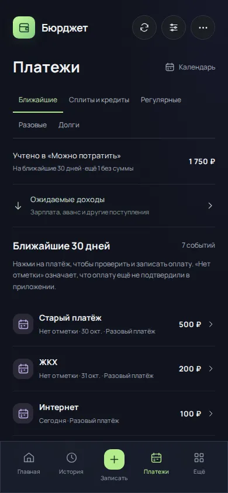
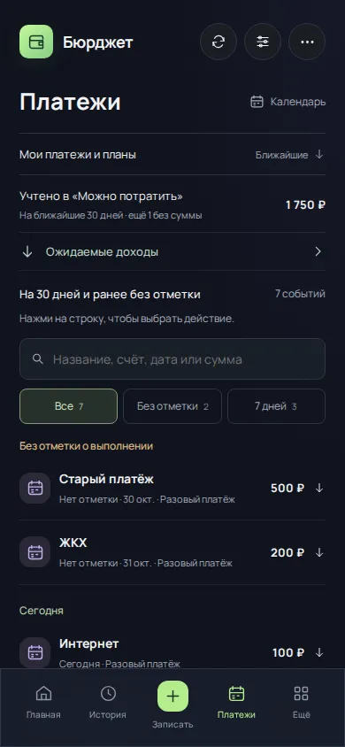
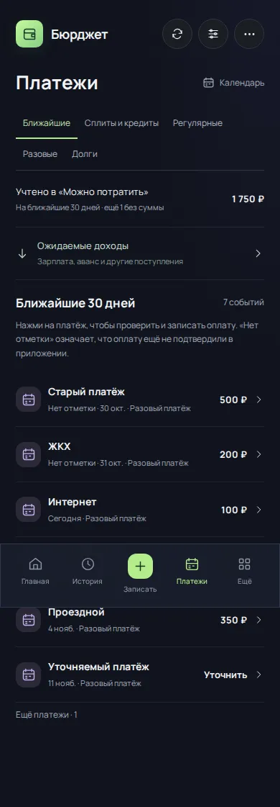
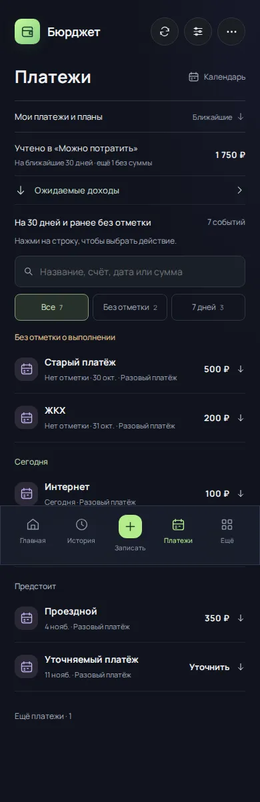
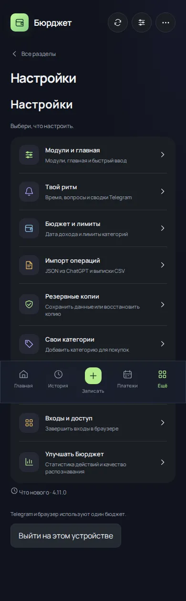
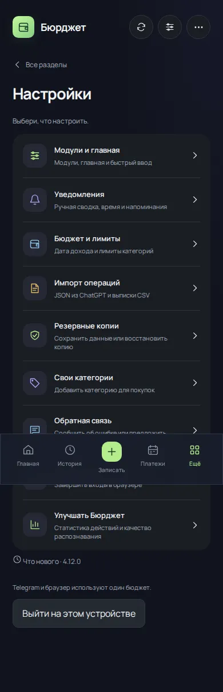

# 4.12.0 — разбор платежей перед записью денег

Основа: bd6c289782ffe10f4e093a437dd9e942eb375ea4 (4.11.0). Продолжение работы над опытом использования перед 5.0.

## Что исправлено в сценарии

| Задача | 4.11.0 | 4.12.0 |
| --- | --- | --- |
| Нажать платёж | Сразу открывается форма новой оплаты | Раскрываются счёт, период и выбор действия; денег это не записывает |
| Найти старый период | Общий список по датам | Поиск по названию, счёту, дате и сумме; отдельный фильтр «Без отметки» |
| Сосредоточиться на ближайшем | Общий горизонт на 30 дней с прошлым | Фильтр «7 дней» от сегодня до шестого следующего дня включительно |
| Расход уже внесён вручную | Привязка в центре внимания или разделе регулярных | Привязка доступна у события в общем списке платежей |
| Расход включён в начальный остаток или больше не нужен | Связь и пропуск рядом в одной панели | Два явных варианта с разным смыслом; пропуск не выдаётся за оплату |
| ЖКХ оплачивается в другой день | Перенос в других представлениях | Перенос одного события прямо в списке, без изменения будущего графика |
| Найти настройки бота | «Твой ритм», повтор заголовка настроек | «Уведомления» с пояснением ручной сводки; один заголовок |

Постоянный ряд разделов заменён раскрываемым меню «Мои платежи и планы», чтобы поиск и сами события не уходили за первый экран. Учётная сумма плана и ожидаемые доходы остаются доступны в компактном виде.

Группы «Без отметки о выполнении», «Сегодня», «Предстоит» читают один scheduledEvents. Это не новый параллельный журнал просрочки. Отсутствие отметки не является доказательством неоплаченного долга.

## Какие связи сохранены

Подготовка новой оплаты использует prepareEvent и существующую форму с подтверждением. Сумма, валюта и фактическая дата остаются проверяемыми перед записью. Привязка и пропуск используют прежние linkPlannedTransaction / skipPlanned; перенос — reschedulePlanned через OccurrenceDateForm. Календарь, бюджет, история и напоминания читают те же записи и переопределения дат.

Сплиты и долги открывают существующие разделы управления. Возможность привязки старой оплаты взноса этим изменением не изобретается: ручная привязка в этом обновлении относится к регулярным и разовым планам. Будущий мастер массового согласования начальных остатков и старых периодов остаётся отдельной задачей.

Поиск и фильтры работают локально, не сохраняют деньги и не создают новые статусы. Список событий и имена счетов индексируются на текущем снимке данных. Несовпадение суммы плана и выбранной исторической записи показывается перед подтверждением, автоматического сопоставления нет.

## Проверка

Проверенная ревизия: ad9c6e8906f43498656abc724ee973813c78c9c0. Успешно: 503 теста на Linux и Windows, production build, Worker bundle, dependency audit, четыре Chromium-набора и визуальный аудит. [Итоговый прогон 41285151280](https://github.com/M3A9tt/budget-app/actions/runs/41285151280). Ошибок страницы нет.

Новый сценарий подтвердил: ноль сохранений при раскрытии строки и поиске; связь и пропуск без повторного списания; сохранение будущего плана; перенос в календаре; одну новую оплату с отражением в истории; сохранение ручного режима уведомлений; отсутствие горизонтального переполнения списка и раскрытых действий на 320/390/768/1280 px. Дополнительная регрессия проверяет последовательное переключение всех разделов без дублирования меню.

## Реальные экраны до и после

Одинаковые вымышленные исходные данные, одна дата, viewport 390 × 844, reduced motion. До: bd6c289782ffe10f4e093a437dd9e942eb375ea4. После: ad9c6e8906f43498656abc724ee973813c78c9c0.

| Экран | До | После |
| --- | --- | --- |
| Первый экран платежей |  |  |
| Весь список |  |  |
| Настройки |  |  |

Верхнее управление свёрнуто, поиск и фильтры доступны сразу, прошлые события отделены от сегодняшних и будущих. Следующие снимки показывают реальные шаги одного сценария после последовательных изменений тестового профиля, а не разные версии на неизменном состоянии:

- [Выбор старой оплаты](payment-experience-2026-11-01/after-recorded-payment-390.webp).
- [Сумма уже учтена в остатке / период не нужен](payment-experience-2026-11-01/after-skip-period-390.webp).
- [Перенос отражается в календаре](payment-experience-2026-11-01/after-moved-calendar-390.webp).
- [Раскрытая панель на 320 px](payment-experience-2026-11-01/after-actions-320.webp).

Полностраничные снимки сохраняют фиксированное нижнее меню на позиции viewport; содержимое за ним доступно прокруткой в приложении. Исходные PNG — в CI-артефакте `financial-ui-screenshots/payment-experience`, WebP, fixture.json и evidence.json хранятся рядом с отчётом. Повторение: `npm run test:payments`.

## Точная цепочка состояния

| Действие | Остаток счёта | Операций | Сохранений состояния |
| --- | ---: | ---: | ---: |
| Исходный профиль с ранее внесённым ЖКХ | 1800 ₽ | 1 | 0 |
| Раскрыть строку, искать | 1800 ₽ | 1 | 0 |
| Связать старую операцию с ЖКХ | 1800 ₽ | 1 | 1 |
| Пропустить старый неактуальный период | 1800 ₽ | 1 | 2 |
| Перенести интернет на два дня | 1800 ₽ | 1 | 3 |
| Подтвердить новую оплату проездного 350 ₽ | 1450 ₽ | 2 | 4 |

Итоговый «Можно потратить» — 750 ₽: 1450 ₽ на счёте минус 700 ₽ оставшихся плановых платежей. Ещё одно событие без суммы явно отмечается как неизвестное; его сумма не выдумывается. Пропуск не создаёт фиктивную оплату, будущий план до его фактического подтверждения сохраняется.

Во время CI исправлена нестабильная проверка manifest: случайный фрагмент криптографического хеша мог совпасть с коротким тестовым ID. Проверка теперь проверяет точную безопасную схему manifest и отсутствие приватного содержимого. Механизм копирования не ослаблен и не изменён.

Финансовые G01–G07 из системного аудита здесь не объявляются закрытыми. Хранилище не мигрируется. Успешный Preview не равен обновлению Telegram: рабочая выкладка остаётся защищена обязательной независимой копией; отказ Cloudflare10000 не обходится. Номер 5.0 оставлен для цельного выпуска после устранения критичных дефектов и восстановления выкладки.
