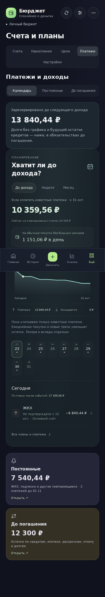
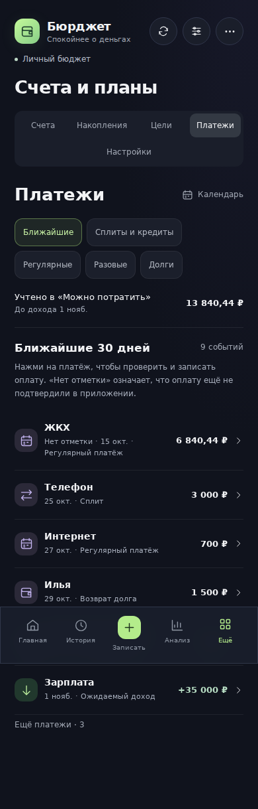
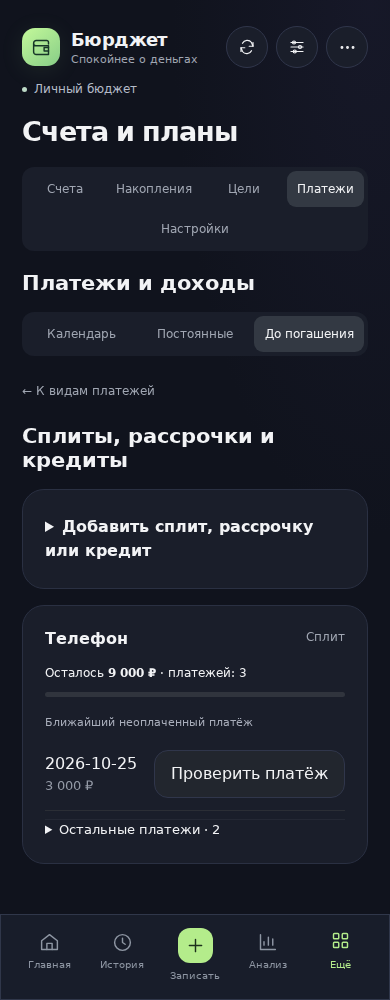
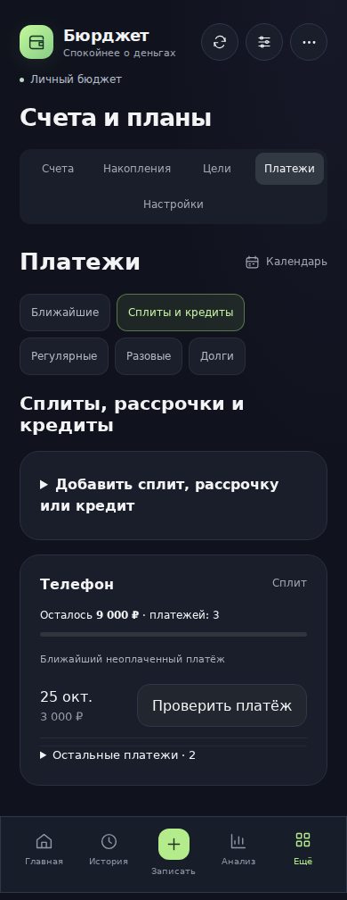
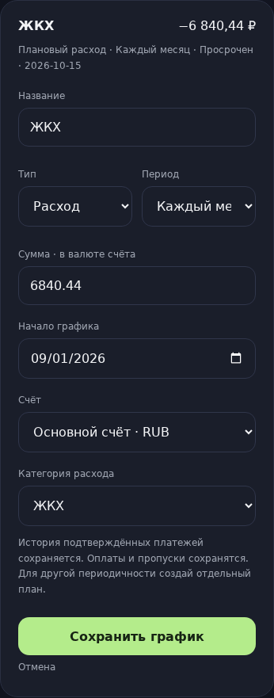
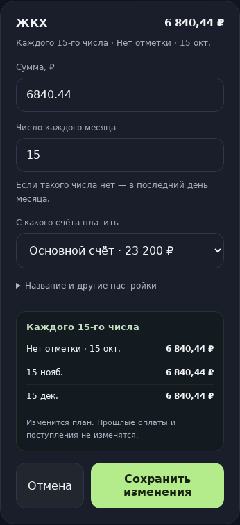

# Платежи: упрощение меню и редактирования, 4.4.0

Проверено 23 октября 2026 года. Все данные в снимках вымышленные. Сравниваются реальные ревизии:

- До: `1a3dfeb6db3342c1314bbbb8e849f3f6a120c143` (4.3.0).
- После: `d4b33e5d7b2ab4df7aca58b9038daa0efb1dc1ea` (код 4.4.0; следующий коммит добавляет этот отчёт и доказательства).
- Одинаковые профиль, дата `2026-10-23`, время `12:00 Europe/Moscow`, Chromium и ширина 390 px. Обзор и сплиты сняты при высоте 1000 px; карточки редактора — при высоте 1600 px, обрезаны по границе настоящей карточки. Переходы перед снимком завершены; содержимое интерфейса не подменялось.

## Обзор

Раньше первым открывался большой календарь, затем повторялись карточки категорий. Сейчас сразу виден список ближайших событий; все пять разделов доступны напрямую. Календарь остаётся небольшой дополнительной кнопкой. Строка «Учтено в „Можно потратить“» показывает ровно сумму из общего бюджета и его горизонт, а не все будущие платежи за всё время.

| До | После |
| --- | --- |
|  |  |

Список ближайших событий охватывает 30 дней и более ранние неподтверждённые события. Его горизонт отличается от бюджета до следующего дохода; оба подписаны. «Нет отметки» означает отсутствие подтверждения в приложении, а не установленный факт задолженности. Нажатие открывает существующую форму проверки операции.

## Сплиты и кредиты

Промежуточный раздел «До погашения» удалён: путь от обзора сокращён с двух переходов до одного. Карточка показывает неоплаченный остаток, ближайший платёж и раскрываемый график. Выплаченные графики собраны под отдельным раскрытием; факты оплаты по-прежнему открывают операции в истории.

| До | После |
| --- | --- |
|  |  |

Добавление сплита сохраняет двухшаговую форму 4.3.0: неоплаченный остаток → проверка графика. Долги добавляются через человека, направление и остаток; срок, валюта и комментарий раскрываются отдельно. Добавление плана или долга само по себе не проводит денежную операцию.

## Ежемесячный платёж

Вместо семи открытых полей сначала показываются сумма, число месяца и счёт. Название, тип, период, дата начала и категория перенесены в настройки. Ниже видны три ближайшие неоплаченные даты из того же расчёта, который используется после сохранения. Если в месяце нет выбранного числа, используется последний день месяца.

| До | После |
| --- | --- |
|  |  |

Редактирование меняет план. Записанные оплаты, поступления, пропуски и остатки сохраняются. Смена типа, валюты и периодичности блокируется, когда уже есть факты или пропуски; пояснение находится рядом с настройками. Пауза, пропуск, возврат пропуска, история и удаление доступны через «Настроить и посмотреть историю». Завершённые разовые планы и планы на паузе свёрнуты.

Полные страницы редактора: [до](audit-4.4.0/before-monthly-editor.png), [после](audit-4.4.0/after-monthly-editor.png).

## Исправления логики на реальных сравниваемых ревизиях

Сценарий: план начат 1 сентября, день оплаты отдельно установлен на 15-е, сумма переменная. Форма меняет только название, не передавая скрытые `dueDay` и `variable`.

| Результат сохранения | До | После |
| --- | ---: | ---: |
| Число оплаты | 1 — ошибочно сбрасывалось | 15 |
| Переменная сумма | Нет — терялась | Да |
| Остаток основного счёта | 23 200 ₽ | 23 200 ₽ |
| Ранее записанная оплата | 6 800 ₽ | 6 800 ₽ |

Это результаты выполнения функций из соответствующих коммитов, а не предположения по коду. Машинные данные: [edit-regression.json](audit-4.4.0/edit-regression.json). Бот пользуется той же валидацией: изменение названия сохраняет отдельное число месяца, а изменение первой даты в его форме задаёт новое число из этой даты.

## Проверка всей финансовой цепочки

На том же вымышленном профиле сумма ЖКХ меняется с 6 840,44 ₽ на 6 700 ₽, дата — с 15-го на 28-е. Доход ожидается 1 ноября; накопления в доступные деньги не входят. Есть также интернет, сплит, долг и разовый ремонт.

| Действие | Основной счёт | Учтённые обязательства | Можно потратить | Прошлая оплата | Оплат ЖКХ за октябрь |
| --- | ---: | ---: | ---: | ---: | ---: |
| До изменения | 23 200 ₽ | 13 840,44 ₽ | 10 359,56 ₽ | 6 800 ₽ | 0 |
| Сохранить 6 700 ₽ и 28-е число | 23 200 ₽ | 13 700 ₽ | 10 500 ₽ | 6 800 ₽ | 0 |
| Подтвердить фактическую оплату | 16 500 ₽ | 7 000 ₽ | 10 500 ₽ | 6 800 ₽ | 1 |
| Удалить эту оплату | 23 200 ₽ | 13 700 ₽ | 10 500 ₽ | 6 800 ₽ | 0 |

Предпросмотр, сохранённый план и события дают одинаковые даты: 28 октября, 28 ноября и 28 декабря. Сохранение плана не меняет счета, операции или историю. Подтверждение списывает один раз и снимает обязательство; удаление возвращает деньги и обязательство. Дополнительные тесты проверяют перенос платежа за дату следующего дохода, напоминание в новый день, частичную оплату сплита, восстановление пропуска и 29 февраля при числе 31.

Точные результаты: [finance-scenario.json](audit-4.4.0/finance-scenario.json). Исходный профиль, даты, размеры экрана и SHA: [capture.json](audit-4.4.0/capture.json).

## Проверки и повторение

- 416 тестов: финансовая модель, интерфейс, бот, хранение и авторизация.
- Chromium: переходы, месячный редактор, независимые сумма и число, неизменная история, подтверждение одного списания, частичная оплата и редактирование сплита, восстановление пропуска, возврат в выбранный раздел.
- Проверка отсутствия горизонтального переполнения в каждом из пяти разделов и в редакторе на ширинах 320 / 360 / 390 / 430 / 768 / 1280 px. Ошибок страницы не было.
- Production build, Worker bundle и проверка нового патчноута.

Воспроизведение снимков (нужны установленные зависимости и Chromium):

```sh
AUDIT_BEFORE_REF=1a3dfeb6db3342c1314bbbb8e849f3f6a120c143 \
AUDIT_AFTER_REF=d4b33e5d7b2ab4df7aca58b9038daa0efb1dc1ea \
BROWSER_EXECUTABLE_PATH=/path/to/chromium \
node scripts/capture-payments-menu-comparison.mjs
```

Схема хранения не меняется, миграции финансовых остатков нет. Формы не создают отдельный расчёт: предпросмотр, бюджет, события и напоминания используют существующую общую модель.
