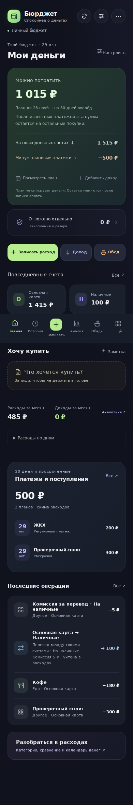
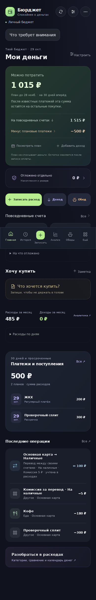
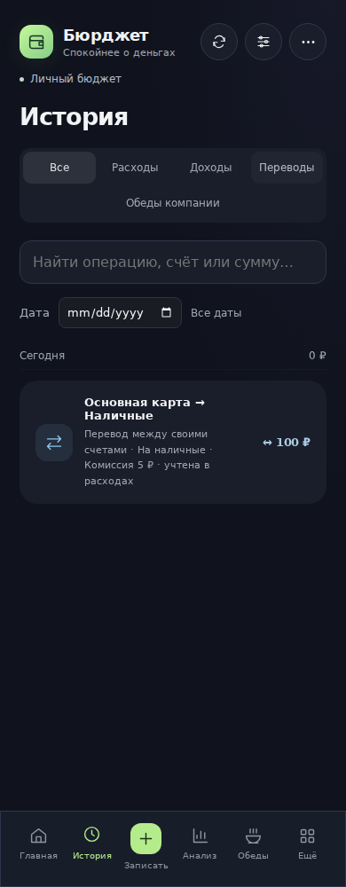
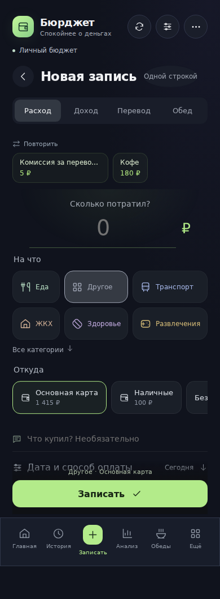
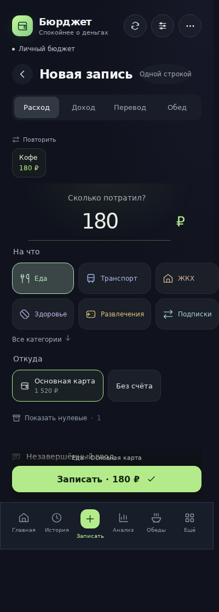

# 4.7.0 — сводка без спама и управляемые платежи

29 октября 2026 года. База сравнения: `de7a07076471ec3ed1d02092b1a37bfb12fc917f` (4.6.3 и аудит PR #54). Финальная ревизия исходников и результаты Linux/Windows/Chromium фиксируются в PR этого выпуска.

## Что получает пользователь

- Одна ручная сводка «Что требует внимания» в боте и миниаппе. Повторное открытие редактирует сообщение; параллельное первое открытие защищено общей блокировкой. Платежи, обеды и проверка расходов ведут к исходным данным.
- В настройках можно выбрать «Только вручную» или «Одна общая сводка». Новые профили начинают с ручного режима. Старые настройки не переключаются молча: виден выбор нового режима. В новом режиме нет отдельных ежедневных вопросов по каждому делу; разовые напоминания назначаются явно.
- У ЖКХ отдельно задаются месяц учёта и день оплаты. Например, платёж 10 ноября может относиться к октябрю. Перенос отдельного платежа отменяет его старое разовое напоминание и не сдвигает следующий месяц.
- Повтор оплаты сплита/плана готовит следующий связанный платёж. Из истории и архива можно отменить ошибочную оплату, а в боте — подтвердить частичную сумму и выбрать счёт.
- Перевод открывается из истории. Можно изменить или отменить оба движения и комиссию. У старого перевода без связи комиссия выбирается явно; её нельзя угадывать по тексту.
- График неоплаченной части и ожидание возврата изменяются отдельно от состоявшихся фактов. Реальные деньги за возврат фиксируются отдельным доходом.
- Ожидаемый доход допускает несколько частичных поступлений. Прогноз учитывает оставшуюся часть, а текущий баланс — только полученное. Горизонт бюджета сокращает явно выбранный опорный доход; мелкое поступление не прячет риск нехватки.
- Сверка уточняет остаток сейчас. Прошлая дата не присваивает старую сумму сегодняшнему счёту. Восстановление и импорт проверяют финансовую согласованность и размер профиля.
- Черновик формы можно продолжить после перезагрузки. Ошибка 503 объясняется как сбой сервера. Асинхронная загрузка SDK показывает первый экран и корректно ждёт Telegram.
- В настройках видны сеансы входа в браузере и их отзыв. Появились персональные квоты картинок и актуальный календарь 2027.

## Реальные сравнения интерфейса

Обе ревизии запускаются отдельно на одном вымышленном профиле, дате 29 октября 2026 года и одинаковом viewport 390 × 1000. Исходные данные: [fixture.json](audit-4.7.0/fixture.json). Сценарий: [check-reliability-browser.mjs](../scripts/check-reliability-browser.mjs).

| 4.6.3 | 4.7.0 |
| --- | --- |
|  |  |
|  |  |
|  |  |

На строке перевода содержимое почти прежнее; изменение — доступная карточка действия, а не выдуманный редизайн. [Предпросмотр изменения перевода](audit-4.7.0/after-transfer-preview.png) показывает последствия для счетов.

Новые сценарии без существовавшего аналога: [ручная сводка 390 px](audit-4.7.0/after-attention-390.png), [320 px](audit-4.7.0/after-attention-320.png), [перенос ЖКХ](audit-4.7.0/after-housing-moved.png), [диагностика 503](audit-4.7.0/after-auth-503.png), [первый экран при задержке SDK](audit-4.7.0/after-sdk-wait.png).

## Точные финансовые результаты

| Проверка | Было / ошибка 4.6.3 | Ожидаемый и проверенный результат 4.7.0 |
| --- | --- | --- |
| Повтор взноса | Счёт 700, обязательство 300, свободно 400 → обычный расход оставлял обязательство и свободно 100 | Счёт 400, обязательство 0, свободно 400; второй факт связан со следующим взносом |
| Сверка старой датой | Исторические 1 000 ₽ заменяли текущие 900 ₽ | Прошлая дата отклоняется; текущая корректировка показывается отдельно, расход 100 ₽ остаётся |
| Некорректный бэкап | Долг 100 и погашение −900 давали остаток 1 000; график 300 при total 100 принимался | Оба файла отклоняются до замены профиля |
| Изменение перевода | Не было общей команды изменения/отмены | На вымышленных счетах 1 415 / 100 перевод меняется со 100+5 на 200+10 → 1 310 / 200; отмена → 1 520 / 0, комиссия отсутствует |
| Доход частями | Первый факт закрывал всё ожидаемое поступление | Ожидалось 600: получено 200 → баланс +200, ожидается 400; получено 400 → баланс суммарно +600, ожидание закрыто |
| Доставка и сбой квитанции | 2 внешние отправки на 1 логическое задание в воспроизведении аудита | Сохраняется состояние принятой отправки, повтор завершает квитанцию без новой внешней отправки |
| Неопределённый сетевой результат | Мог приводить к слепому повтору | Задание остаётся в состоянии uncertain; автоматический повтор допускается только при известном отказе, например 429 |
| Перенос ЖКХ | В интерфейсе регулярного расхода не было прямого переноса отдельного события | Остатки неизменны; изменяется один period, dueDay и будущие периоды сохраняются |

## Покрытие 22 пунктов аудита

«Исправлено» относится к указанным сценариям и проверкам, не к обещанию отсутствия любых будущих ошибок.

| Пункт | Результат |
| --- | --- |
| F01 | Исправлено: контекстный повтор и общий связанный факт |
| F02 | Исправлено простым однозначным сценарием «остаток сейчас»; историческая сверка не имитируется |
| F03 | Усилены проверки вложенных погашений, графиков, денег, валют, ссылок и ID |
| F04 | Изменение/отмена перевода и комиссии в миниаппе и боте, явная связь новых комиссий |
| F05 | Отмена оплаты из записи/архива, досрочная дата, изменение будущей части, ожидание и отдельный факт возврата |
| F06 | Частичная сумма и счёт доступны в нативной форме бота |
| F07 | Общая модель состояния обеда; явный reset ответа; повторная проверка очереди |
| F08 | Явный опорный доход, частичные поступления и предупреждение о ближайшей нехватке |
| F09 | Частично: общий серверный контракт команд, preflight объёма, предупреждение и постраничный cron. Переход с JSON — отдельный этап |
| F10 | Черновик переживает reload, отделён от финансового состояния, ограничен пользователем и сроком |
| F11 | Статус 503 не выдаётся за завершившийся сеанс; доступен код обращения |
| F12 | SDK загружается асинхронно, готовность ожидается с таймаутом, shell доступен сразу |
| F13 | Сохраняется прогресс фонового обхода; восстановление сводки проверено после часа и через полночь |
| F14 | Явные состояния delivery; отдельная политика известного отказа и неопределённого результата. Гарантия exactly-once не заявляется |
| F15 | Уникальность категорий, одинаковый запрет будущей истории CSV/JSON, клиентская ошибка длинного отчёта |
| F16 | Wrangler 4.154.0; полный аудит зависимостей и production-аудит — 0 находок на проверке |
| F17 | Версионируемый календарь 2027, ручные исключения сохранены, 247 рабочих дней проверены |
| F18 | Частично: документированы сроки, безопасная очистка временных данных и обход страницами. Квитанции денег не удаляются; независимые автоматические копии и миграция выделены отдельно |
| F19 | Частично: персональная и общая квоты, кэш и текстовый fallback. Глобальный lock рендера сохранён; справедливая очередь с приоритетами требует отдельной реализации |
| F20 | Частично: тип/пауза ошибки Telegram, код обращения, длительность сохранения и безопасные события доставки. Полная операционная панель и агрегированные метрики ещё не заявляются |
| F21 | Deploy зависит от полного workflow проверок Linux/Windows/Chromium того же исходного коммита и дополнительно проверяет новый сценарий |
| F22 | Обновлены входная версия README, ссылки на актуальную архитектуру, политика хранения и обозначение classic как отдельного архива |

PR #50–53 остаются выпущенной основой. Здесь не выдаются за новые функции их аналитика, рабочие выходные, отображение переводов или нативное скачивание бэкапа.

## Проверки

- Прежний набор и новые регрессионные сценарии: `npm test` (итог и число тестов записаны в validation.json).
- `npm run build`, `npm run worker:check`, `node scripts/check-release.mjs`.
- `npm run test:browser`: полный финансовый Chromium-прогон, ширины 320/360/390/430/768/1280, отсутствие ошибок страницы.
- `npm run test:reliability`: сводка, перенос/оплата ЖКХ, следующий взнос, изменение/отмена перевода, сохранение черновика, 503 и задержка SDK.
- [Результат новой ревизии](audit-4.7.0/after-browser-results.json) и [результат исходной ревизии](audit-4.7.0/before-browser-results.json).

Локально использован headless Chromium 153 из пакета @sparticuz/chromium; CI использует Chromium, установленный Playwright. Физические Android/iOS не проверялись. Финансовые данные реальных пользователей не читались и не изменялись.

## Включение нового режима

Бот: «Что требует внимания» → «Уведомления» → «Только вручную» или «Одна общая сводка» → подтверждение. Миниаппа: Настройки → Твой ритм → Режим уведомлений → сохранить.

Для ЖКХ: открыть регулярный план, выбрать день оплаты и при необходимости «за предыдущий месяц». Перенос отдельной оплаты находится в её карточке и сводке. Напоминание на конкретное время назначается отдельно.

## Что остаётся отдельным этапом

Полная нормализация финансового хранилища, независимые автоматические аварийные копии и очередь рендера с приоритетами не замаскированы увеличением лимитов. [План хранения](STORAGE-EVOLUTION.md) задаёт целевые сущности, контроль точного совпадения денег, переключение и проверяемый откат. [Политика хранения](DATA-RETENTION.md) объясняет действующие сроки и границы.

Календарь 2027 проверен по [официальному сообщению Минтранса](https://mintrans.gov.ru/eye/press-center/branch-news/9491) о постановлении Правительства РФ от 17.09.2026 № 1187.
