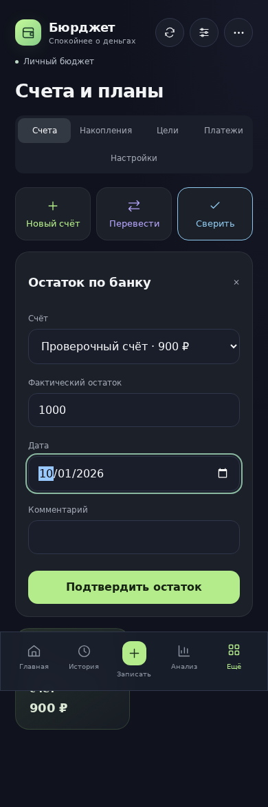
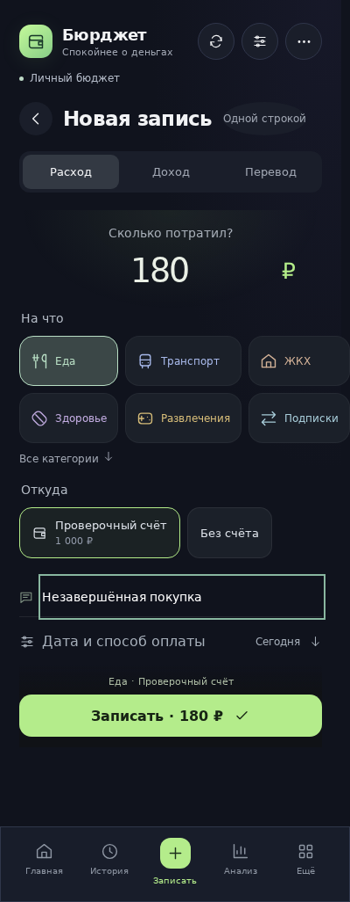
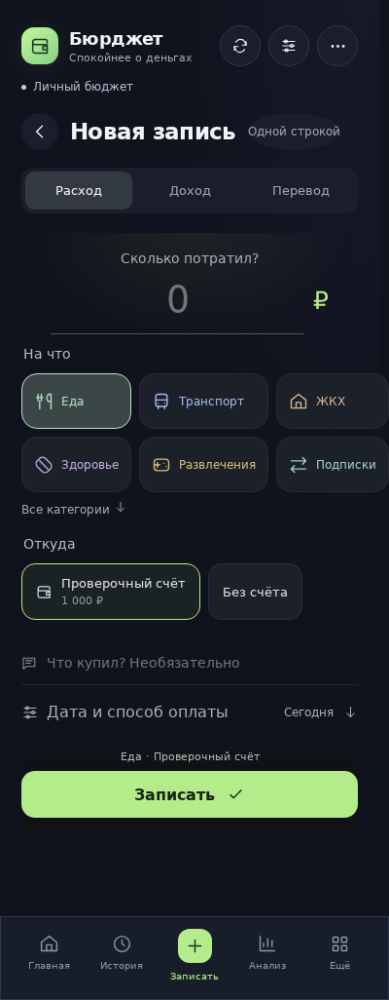

# Аудит Бюрджета: миниаппа, бот и сервер — 28 октября 2026

**Объект:** действующая архитектура 4.6.3, коммит `c074475ca06a6f46dfde31254c97abad035e9834`. Состав проекта: 94 JS/JSX-модуля `src`, 31 серверный модуль и 58 тестовых файлов. Детально проверены финансовые модели, пути ввода/сохранения, API, импорт/экспорт, очередь, основные экраны, сборка и workflows. Классический `?classic=1` рассмотрен как отдельный архивный интерфейс; его старые проблемы из `AUDIT.md` не приписываются новой D1-системе.

**Вывод:** следующий цикл стоит посвятить исправлению и отмене действий, согласованности оболочек и росту истории. Общий финансовый движок, CAS-ревизии и защита повторного сохранения уже работают. Однако связанные действия ещё расходятся на уровне повторов, форм, ответов об обедах, валидации восстановления и пользовательских переходов. Добавлять функции поверх этих расхождений дорого: сначала стоит укрепить общий контракт действий.

## Как проверялось

- Все **454/454 теста** проходят. Сборка Vite и Worker проходят; Worker — 1 448 089 байт. Полный существующий Chromium-прогон финансовых сценариев также проходит, включая ширины 320–1280 px.
- Отдельно выполнены воспроизведения моделей, Worker API и очереди на вымышленных профилях и SQLite в памяти. Их результаты: [evidence.json](audit-2026-10-28/evidence.json), сценарий: [probes.mjs](audit-2026-10-28/probes.mjs).
- Отдельные проверки реального интерфейса Chromium: неверная диагностика 503, блокирующий SDK, потеря черновика после перезагрузки, сверка прошлой датой. Результаты: [browser-evidence.json](audit-2026-10-28/browser-evidence.json), сценарий: [browser-probes.mjs](audit-2026-10-28/browser-probes.mjs).
- Проверены зависимости через `npm audit` и `npm audit --omit=dev`; версии и результаты собраны в [validation.json](audit-2026-10-28/validation.json).
- Финансовые данные пользователей не читались и не изменялись. Настройки доступа в Cloudflare, фактические инфраструктурные лимиты/тариф, секреты, реальные телефоны Android/iOS и аварийное восстановление боевой базы не проверялись. Это анализ исходников с локальным воспроизведением, а не сертификат безопасности.

В этом изменении публикуются только анализ и доказательства. Снимки показывают существующее поведение; макеты якобы исправленного интерфейса не создавались. Пункты ниже различают подтверждённые ошибки, функциональные пробелы, спорные правила и риски роста. **P1** — первая очередь из-за денег/восстановления; **P2** — ближайший цикл надёжности и упрощения; **P3** — сопровождение.

## Что уже является хорошей основой

1. `ledger.js` используется разными оболочками для сумм, операций и возврата учётных списаний. Большинство подтверждений создаёт общие факты, а остатки сплитов/долгов вычисляются из связанных записей.
2. Сервер сохраняет ревизии с CAS и долговечными квитанциями повторного запроса. Повтор финансовой команды после потерянного ответа не должен создавать ещё одно списание; соответствующие сценарии проверены существующими тестами.
3. Предыдущий профиль сохраняется атомарно перед изменением; сохраняются 50 состояний. Новый экспорт 4.6.3 привязан к ревизии и короткоживущей подписанной ссылке, проверяет доступ и не передаёт сессионные учётные данные в URL.
4. Telegram-подпись проверяется на сервере, веб-коды одноразовые, cookie `Secure`/`HttpOnly`/`SameSite=Strict`; финансовые профили изолированы по пользователю. Это проверяется тестами чужих идентификаторов и конфликтов.
5. Чистые модели периода, планов и бюджета уже позволяют синхронно менять миниаппу, бот и отчёты. Поэтому дальнейшее развитие можно вести небольшими связанными изменениями.

## Первая очередь: деньги, ошибки пользователя и восстановление

### F01 — «Повторить» теряет смысл связанного платежа · P1 · воспроизведено

**Где:** `src/entry-assist.js: repeatEntry`, `src/EntryComposer.jsx`, `server/bot-views.js: transaction`.

Повтор взноса сплита удаляет `installmentPaymentId`; повтор оплаты плана удаляет `recurringId`. При этом сумма и описание сохраняются, и доступна обычная кнопка записи. Если человек таким способом записывает следующий взнос, счёт уменьшается, а обязательство остаётся неоплаченным.

Точный пример: счёт 700 ₽, оставшийся взнос 300 ₽, свободно 400 ₽. Повтор оплаченного взноса создаёт обычный расход: счёт 400 ₽, обязательство всё ещё 300 ₽, свободно 100 ₽. При подтверждении следующего взноса было бы: счёт 400 ₽, обязательство 0 ₽, свободно 400 ₽. Автоматического банковского списания здесь нет — ошибка касается учёта и свободного остатка.

**Исправление:** для связанных фактов показывать контекстное действие «Следующий платёж»/«Открыть график». Создание обычного расхода из такой записи должно быть отдельным явным выбором. **Приёмка:** один и тот же следующий взнос подтверждается одинаково через историю, график и бот; ни один путь не оставляет одновременно расход и ту же неоплаченную часть.

### F02 — сверка прошлой датой заменяет сегодняшний остаток · P1 · воспроизведено в модели и UI

**Где:** `src/finance-tools.js: reconcileAccount`, форма `AccountTools` в `src/FinancePanels.jsx`.

Дата сверки может быть прошлой, но сумма присваивается текущему счёту без применения более поздних операций. Пример: исходно 1 000 ₽, 28 октября покупка 100 ₽ → сейчас 900 ₽. Ввод «1 октября было 1 000 ₽» меняет сегодняшний остаток на 1 000 ₽, покупка 100 ₽ остаётся в истории.

Это подтверждённая неоднозначность семантики даты: пользователь может ожидать историческую сверку, а выполняется коррекция текущего остатка. **Исправление:** в простом интерфейсе сверять «остаток сейчас» с сегодняшней датой. Если необходимы исторические банковские снимки — выделить их в отдельную операцию с расчётом последующих движений и предпросмотром результата. **Приёмка:** показано, какой именно остаток изменяется и почему; поздние расходы не исчезают из результата исторической сверки.

| Перед подтверждением прошлой даты | После подтверждения: текущий счёт заменён |
|---|---|
|  |  |

### F03 — восстановление проверяет структуру слабее, чем команды создания · P1 · воспроизведено

**Где:** `src/ledger.js: migrateData`, `src/debt-state.js`, `src/installment-state.js`.

Валидатор принимает долг 100 ₽ со старым погашением **−900 ₽**; получившийся остаток долга — **1 000 ₽**. Также принимается рассрочка с `total:100` и суммой графика **300 ₽**; бюджет учитывает 300 ₽. Не хватает единого контроля денег, типов/валют и некоторых ссылок вложенных объектов.

Это не обход доступа к чужому профилю: риск возникает при восстановлении некорректного/старого файла в собственный профиль. Но успешный предпросмотр сейчас недостаточно доказывает финансовую согласованность файла.

**Исправление:** общий валидатор доменных сущностей для команд, API и восстановления; у неоднозначного старого формата — предупреждение и исправление до подтверждения. Не пересчитывать реальные остатки молча. **Приёмка:** отрицательные/нечисловые погашения, неверные валюты, повторяющиеся ключи и противоречивые суммы графика либо отклоняются, либо явно нормализуются по документированному правилу с сохранением оригинала.

### F04 — перевод с комиссией пока нельзя нормально исправить или отменить · P1 · пробел функции

**Где:** `transferMoney`, `src/activity-history.js`, `src/MiniApp.jsx: Transactions`, `server/bot-views.js: movement`.

Перевод уже виден в истории, но в миниаппе строка не открывает редактирование, а в боте карточка предлагает только навигацию. Обратной доменной команды нет. Комиссия создаётся отдельным расходом без `transferId`, поэтому будущую отмену нельзя надёжно связать с ней по одной заметке/дате.

**Исправление:** единые `create/update/reverse transfer`, ссылка комиссии на перевод и предпросмотр изменения обоих счетов. **Приёмка:** ошибочный перевод 100 ₽ с комиссией 5 ₽ отменяется одним действием: исходный счёт +105 ₽, целевой −100 ₽, комиссия не остаётся в расходах; повтор отмены безопасен. Для исторических импортов действуют их правила изменения остатков.

### F05 — жизненный цикл сплита неполон · P1 · пробел функции и подтверждённая проблема UX

**Где:** `src/InstallmentCards.jsx`, `src/event-actions.js`, формы бота.

Ошибочную оплату можно отменить удалением исходной транзакции — этот путь работает, что уже проверено. Однако отдельного понятного действия «Отменить отметку оплаты» нет. После закрытия сплит уходит в архив, что затрудняет исправление. При подтверждении будущего взноса форма подставляет сегодняшнюю дату и не выделяет достаточно ясно досрочный платёж. Нет полного сценария возврата товара, ожидания перерасчёта, изменения будущего графика.

**Исправление:** видимая отмена конкретной оплаты с показом возвращаемой учётной суммы; пояснение досрочной оплаты; изменение только неоплаченной части графика; отдельное состояние «Ожидается возврат/перерасчёт». Фактический денежный возврат подтверждать отдельно. **Приёмка:** оплаченные факты остаются связанными с историей, отменённые взносы возвращаются в календарь, ожидаемый возврат не становится уже полученными деньгами.

## Расхождения миниаппы, бота и расчётов

### F06 — частичная оплата сплита доступна не во всех оболочках · P2 · воспроизведено

`EntryComposer` позволяет указать частичную сумму, но `fieldsFor(...,'payInstallment')` в боте возвращает **только поле даты**; `payInstallment` использует весь остаток взноса. Нужен общий черновик подтверждения: сумма, счёт, фактическая дата и связь с взносом. Приёмка — 100 ₽ из взноса 300 ₽ дают остаток 200 ₽ одинаково в двух интерфейсах, с одним списанием.

### F07 — два источника ответа об обеде расходятся · P2 · воспроизведено

`LunchPage` сохраняет «Не заказал» в `data.lunchAnswers`; `notificationJobs` смотрит отдельный список SQL-ответов и наличие корпоративного обеда. При пустом SQL-списке вопрос продолжает отправляться даже после отметки в миниаппе. Ручной «Обед за свои» также не учитывается этим условием. Обратная проблема — сообщение бота предлагает изменить пропущенный ответ, но в карточке дня нет ясного действия снять эту отметку.

Нужен один контракт `lunchDayStatus`: корпоративный обед, личный обед, не заказал, отсутствие, ещё не ответил. Его должны использовать таблица, бот, проверка перед сохранением и отмена задания в очереди. Приёмка — ответ в любой оболочке закрывает вопрос в другой; изменение ответа доступно, не дублирует расход и не меняет рабочий лимит без отдельной причины.

### F08 — любое ожидаемое поступление может резко сократить бюджетный горизонт · P2 · правило продукта, не арифметическая ошибка

`budgetWindow` выбирает ближайший известный доход любой суммы. Проверено: счёт 1 000 ₽ и платёж 2 000 ₽ послезавтра дают −1 000 ₽ свободного остатка. Добавление ожидаемого **1 ₽ завтра** меняет горизонт на завтра и показывает **+1 000 ₽**; платёж послезавтра перестаёт учитываться в этой карточке. Дата и источник в UI указаны, счета не изменились, но результат легко воспринять как разрешение потратить деньги.

Нужно отделить опорный доход для горизонта от любого поступления; дать явный выбор периода и короткую оценку ближайшей нехватки по общей временной шкале. Приёмка — мелкое поступление не скрывает существенный риск без понятного изменения выбранного пользователем периода.

### F15 — общие контракты ещё расходятся в деталях · P2 · три воспроизведения

| Случай | Подтверждённое поведение | Исправление |
|---|---|---|
| Пользовательская категория с ID `food` совпадает со встроенной | Файл принимается; расход 100 ₽, сумма категорий главной 200 ₽, сумма категорий аналитики 100 ₽ | Один каталог категорий с уникальными ID во всех моделях и проверке файла |
| Будущая строка «только история» | CSV принимает, JSON отклоняет | Единая политика дат и предпросмотр, общий путь импорта |
| `/summary` на диапазон больше 366 дней | API возвращает 503 с предложением повторить, хотя диапазон просто не поддерживается | Валидация запроса в 400/422; ясное ограничение или агрегирование длинного периода |

## Рост истории, загрузка и черновики

### F09 — один JSON-профиль ограничивает масштаб · P2 · измерено

**Где:** `src/MiniApp.jsx: mutate`, `server/state-persistence.js`, cron в `server/worker.js`.

При изменении отправляется, проверяется и сохраняется полный профиль. Порог приложения — **1 500 000 байт**. Воспроизводимый профиль с обычными полями операции и 200 событиями журнала перестаёт сохраняться на **3 981 записи**. Это число относится только к данной фикстуре: длинные заметки приблизят предел, короткие записи отодвинут. При превышении есть ошибка, а не автоматическое обрезание истории.

| Записей в фикстуре | Размер профиля | Сохранение в текущем лимите |
|---:|---:|---|
| 1 000 | 432 938 байт | Да |
| 3 000 | 1 148 938 байт | Да |
| 5 000 | 1 864 938 байт | Нет |
| 10 000 | 3 654 938 байт | Нет |

50 предшествующих копий по 1,5 МБ — до 75 МБ одних JSON-данных на профиль, плюс живое состояние. Cron каждую минуту выбирает полные профили всех пользователей и обходит их последовательно. Сейчас это не доказанная перегрузка сервиса; это подтверждённая конструктивная граница роста.

Просто поднять предел нельзя считать решением: D1 ограничивает строку/ряд 2 МБ. Сначала нужны команды отдельных операций, предупреждение об объёме и независимые копии; затем — версия схемы, перенос в отдельные таблицы/страницы истории с проверкой точного совпадения остатков. [Официальные лимиты D1](https://developers.cloudflare.com/d1/platform/limits/).

### F10 — черновик не переживает перезагрузку · P2 · воспроизведено в UI

`draft` и `savedDraft` живут в состоянии/ссылках React. На другой экран и обратно черновик возвращается, но после перезагрузки введённые 180 ₽ и комментарий пропадают. Финансовых записей в этом тесте не было: теряется незавершённый ввод, не подтверждённый расход.

Нужно сохранять короткоживущий черновик отдельно от финансовой базы, восстанавливать с предложением продолжить и очищать после подтверждения/выхода. Автоматическую финансовую отправку offline не добавлять без отдельной модели конфликтов и повторов.

| До перезагрузки | После перезагрузки и открытия формы |
|---|---|
|  |  |

### F11 — ошибка сервера выдаётся за истёкший вход · P2 · воспроизведено в UI

В `AuthGate` наличие Telegram `initData` выбирает текст «Сеанс входа завершился» независимо от причины. В тесте сервер отвечает **503**, а пользователь получает совет переоткрыть приложение и не видит реальную ошибку. Это затрудняет разбор жалоб «не открывается».

Нужны разные состояния: 401/истёкшая подпись, 403/закрытый доступ, сеть, таймаут, 5xx. Код ошибки должен доходить до экрана, а повтор запроса сохранять введённые данные. [Реальный снимок неверной диагностики](audit-2026-10-28/auth-503-misdiagnosed.png).

### F12 — внешний Telegram SDK блокирует первый экран · P2 · воспроизведено

`index.html` подключает обычный синхронный `<script>` до корня приложения. При искусственной задержке SDK на 2 секунды `.mini-shell` не появляется; после освобождения запроса приложение загружается. При проблемах сети ожидание может быть заметнее. Это воспроизведение зависимости, а не установленная причина прежней проблемы конкретного пользователя.

Нужно неблокирующее подключение с явной готовностью SDK, разумным таймаутом и понятным восстановлением. Простая замена на `async` недостаточна: текущий код читает Telegram-клиент при первом рендере и должен корректно дождаться появления SDK.

## Напоминания, эксплуатация и безопасность

### F13 — после пропуска cron больше 15 минут часть сообщений не восстановится · P2 · воспроизведено

Сводка в 21:00 попадает в список в 21:15, но не в 21:16. Если cron не работал всё окно и задание ещё не попало в outbox, отправлять больше нечего. Нужны сохраняемые сроки/задания и ограниченное восстановление пропущенных запусков; уже сформированную очередь повторно использовать. Приёмка — после остановки на час необходимый итог доставляется один раз без шквала старых проверок расходов.

### F14 — outbox не гарантирует единственность внешней отправки · P2 · воспроизведено отказом хранилища

Симуляция: Telegram успешно принял сообщение, запись квитанции в БД не прошла, следующий запуск отправил то же задание ещё раз. Получилось 2 внешние отправки на 1 логическое задание. Финансовые команды используют отдельную идемпотентность; этот результат относится к доставке уведомлений.

Нужны явные состояния попытки/неопределённого результата, повтор по типу ошибки и переиспользование существующего сообщения там, где известен его ID. Нельзя обещать «ровно один раз» лишь наличием outbox: внешний Bot API и D1 не участвуют в одной транзакции.

### F16 — инструменты разработки требуют обновления зависимостей · P2 · подтверждено `npm audit`

Полный аудит: **3 затронутых пакета: 1 high, 2 moderate**. Цепочка: `wrangler 4.151.3 → miniflare 5.20261019.1-beta → undici 7.29.1`. Это не три независимые уязвимости пользовательского приложения. В проверке **production dependencies — 0**. Эксплуатация этих advisories в развёрнутом Worker не доказана.

`npm audit` предлагает обновление Wrangler до 4.154.0. Для части advisories Undici исправление начинается с 7.30.1; применимость зависит от используемого API. Нужен обычный обновлённый lockfile с проверками сборки/Worker, без слепого `audit fix --force`, и периодическая проверка зависимостей в CI. Первичные источники: [Undici cache/redirect advisory](https://github.com/nodejs/undici/security/advisories/GHSA-4w7w-5xrc-9h26), [EventSource advisory](https://github.com/nodejs/undici/security/advisories/GHSA-4qv8-2p9j-2685).

### F17 — производственный календарь заканчивается 2026 годом · P2 · подтверждено кодом

`lunch-schedule.js` содержит даты 2026 года. Остальные годы используют недельный график и предупреждение «календарь не проверен». Предупреждение есть; тихое использование заведомо проверенного календаря 2027 не заявляется. Но перед новым годом нужен версионируемый набор календарей с источником и тестами, плюс ручные исключения для смен. Конкретные даты нового календаря следует брать из проверенного официального источника, а не выводить из старых праздников.

### F18 — срок хранения и фоновые выборки требуют политики · P2 · риск роста

Для снимков и некоторых временных таблиц очистка есть. Для `user_idempotency`, `user_reports_sent`, `user_day_checks`, доставленной обратной связи и части старых данных общей политики нет. Снимки ограничены количеством 50, а не временем — при активном импорте 50 версий могут покрыть короткий срок.

Нужны индексы под выборки, пакетная обработка пользователей и заданий, согласованное хранение квитанций, кратких журналов и независимых резервных копий. Нельзя просто удалить старые квитанции: вместе с этим исчезнет защита от позднего повтора. Выбор срока должен учитывать контракт ключей повторного запроса и восстановление.

### F19 — квота картинок общая для всех пользователей · P2 · подтверждено кодом

`bot_picture_limits` имеет ключ только по дню, дефолт — 24 рендера в сутки на весь сервис; допустимый максимум переменной ограничен 100. `bot_picture_lock` тоже общий. Кэш и текстовый fallback есть. Фактическая настройка production здесь не проверялась, но активность одного пользователя может исчерпать общий запас картинок для остальных.

Нужны справедливая квота на пользователя вместе с общим пределом расходов, приоритет автоматических итогов, понятный статус текстового fallback и очередь рендера. Увеличивать лимит без учёта стоимости/очереди не стоит.

### F20 — диагностика инфраструктуры и ошибок бота недостаточна · P2 · подтверждено кодом

Обязательные финансовые записи не должны зависеть от телеметрии — это уже соблюдено. Но счётчики кликов не показывают время сохранения, ошибки CAS/доставки и очередь неотправленных сообщений. Общая Telegram-функция теряет `error_code` и `retry_after`; бот может показать сырое `e.message`. API, наоборот, скрывает детали, но почти не оставляет безопасной информации для расследования.

Нужны типизированные ошибки, обезличенный код обращения и метрики по версии/маршруту/этапу: успех сохранения, длительность, конфликт, неопределённый ответ, возраст outbox. Telegram 429/запрет отправки/временный сбой должны вести к разным повторным действиям. Суммы и тексты покупок в диагностику не включать.

### F21 — deploy и полная CI-проверка независимы · P2 · подтверждено workflow

PR-проверки запускают Linux/Windows и Chromium. Но deployment на push в `main` — отдельный workflow: он повторяет unit/build/Worker, не ожидая результата Chromium на том же коммите. Текущий процесс слияния после зелёного PR снижает риск, но это зависит от порядка действий. Настройки защиты ветки не проверялись.

Нужен обязательный набор проверок перед merge, однозначный артефакт проверенной сборки и явная зависимость публикации от необходимых проверок. Проверку зависимостей и контрактные сценарии F01–F15 добавить к CI. Документация сама по себе не должна вызывать новый релиз и рассылку — нынешний path filter это уже обеспечивает.

### F22 — документация и архив мешают сопровождению · P3 · подтверждено

README в первой строке называет актуальной 4.2.1, тогда как package/release — 4.6.3. Старый `AUDIT.md` относится к классической системе. `?classic=1` остаётся отдельным приложением с отдельным хранилищем и баннером; его нельзя считать вторым синхронным клиентом D1. Это уже объясняется ниже в README, но входная информация устарела.

Нужен короткий актуальный документ об устройстве системы, ссылки на действующий аудит и единый источник версии. Архив выделить с понятной миграцией/режимом чтения. Предупреждение сборки о chunk 600 КБ относится к лениво загружаемому classic; основной chunk около 392 КБ / 119,5 КБ gzip. Это не означает, что все 600 КБ скачиваются при обычном запуске.

## Что означает безопасность данных в текущей архитектуре

- Приложение сохраняет JSON-профили, снимки и часть черновиков на сервере. Сквозного шифрования, при котором сервер не видит финансовые данные, в этой архитектуре нет: бот и серверные отчёты обрабатывают их.
- Это не означает хранение дисков Cloudflare без шифрования. По [документации D1](https://developers.cloudflare.com/d1/reference/data-security/), данные зашифрованы на хранении и при передаче внутри сервиса; ключами управляет Cloudflare. Это другая граница доверия, чем клиентское E2E.
- JSON-экспорт содержит финансовые данные в читаемом виде. Подписанная ссылка ограничена пользователем/ревизией/5 минутами; отзыв доступа проверяется. Сам файл после скачивания требует аккуратного хранения. Можно добавить необязательный зашифрованный экспорт с проверенным восстановлением.
- Один доверенный `API_TOKEN` имеет широкие полномочия в привязанном профиле. Перед подключением внешнего ассистента нужны отдельные отзываемые ключи/сроки/области `read`, `transactions:write`, `backup:restore`, а не выдача общего ключа.
- Нужны управление веб-сеансами, политика хранения и понятное удаление профиля. Удалённая из активного учёта операция сохраняется в журнале/предыдущих состояниях для отмены; это следует объяснить пользователю.
- Защита от чужого профиля, HMAC и cookie проверена локальными тестами. Доступ администраторов Cloudflare/GitHub, ротация реальных секретов, защита ветки и фактические HTTP-заголовки сервиса отдельно не проверялись. Конфигурация CSP основного сайта требует проверки окружения; защищённый HTML-рендер карточек уже имеет собственную CSP.

## Как упростить архитектуру без большой переписи

Есть реальный круг импортов: `ledger → wishes → account-balances → ledger`. Денежные примитивы, валидация желаний и чтение счетов можно развести на независимые слои. Размер `bot-chat.js` около 42 КБ, `MiniApp.jsx` около 30 КБ; оба соединяют навигацию, ввод, сохранение и множество сценариев. Делить их стоит по ответственности, а не ради новых файлов.

| Слой | Что должно быть общим | Практический результат |
|---|---|---|
| Деньги и даты | Копейки/округление, валюта, фактическая дата, ограничения | Один контракт в создании, импорте, восстановлении и отчёте |
| Команды | Создать/изменить/отменить операцию, перевод, оплату, ответ дня | Бот и миниаппа выполняют одинаковое действие с одинаковыми проверками |
| Сохранение | CAS, квитанция, snapshot, успешный/неопределённый результат | Разный UI не меняет гарантии записи |
| Модели чтения | Каталог категорий, остаток сплита, состояние дня, период/счёт | Исчезают расхождения F01/F06/F07/F15 |
| Интерфейсы | Короткие адаптеры ввода и показа результата | Можно менять экран без переписывания финансовой логики |
| Фоновые работы | Сохраняемые задания, повторы, typed errors, лимиты | Напоминания и картинки проще отлаживать и масштабировать |

Порядок: сначала общие команды и контракты поверх существующего JSON-сохранения; затем отдельные таблицы/пагинация истории с независимой копией и проверкой всех остатков. Огромная одновременная миграция UI, движка и БД усложнит доказательство корректности.

## Идеи полезных функций

| Идея | Зачем нужна | Связь с существующей системой |
|---|---|---|
| Центр проверки | В одном месте найти неподтверждённый платёж, день обеда без ответа, покупку без счёта | Дополнительная карточка по необходимости и ссылки на исходные записи; ежедневную проверку расходов использовать повторно |
| Возврат покупки и ожидание перерасчёта сплита | Разделить «товар вернул», «деньги получил», «график изменили» | Связанные факты возврата и обязательства, с частичными суммами; не обнулять долг по обещанию возврата |
| Доход частями | Отличить часть зарплаты от окончательной изменившейся суммы | Несколько фактов к одному ожидаемому поступлению и оставшаяся сумма |
| Предпросмотр влияния действия | Перед оплатой/отменой видеть счёт, обязательства и доступный остаток после неё | Те же чистые команды на копии данных; сохранение только после подтверждения |
| Импорт как пакет | Сводные суммы, изменения счетов, продолжение проверки и безопасная отмена одного пакета | `batchId`, исходные записи и контроль их последующих изменений; текущие проверки дублей сохранить |
| Закреплённые шаблоны | Записывать транспорт, лекарства и обычные покупки в несколько действий | Развить существующие повторы/подсказки; для связанных платежей оставить специальные действия |
| Короткое закрытие недели | Проверить деньги и незавершённые действия перед итогом | Общий центр проверки, текущий отчёт картинкой с текстом, существующая сверка |
| Валютный обмен по фактическим суммам | Записать, сколько реально списали и сколько зачислили | Общий перевод с двумя валютными суммами/комиссией, зафиксированным курсом и атомарной отменой |

Подробная очередь следующего цикла с критериями готовности: [NEXT-UPDATE-PLAN-2026-10-28.md](NEXT-UPDATE-PLAN-2026-10-28.md).

## Повторение аудита

Из корня репозитория, Node 24+, после установки зависимостей:

```sh
npm test
npm run build
npm run worker:check
node docs/audit-2026-10-28/probes.mjs
BROWSER_EXECUTABLE_PATH=/path/to/chromium node docs/audit-2026-10-28/browser-probes.mjs
BROWSER_EXECUTABLE_PATH=/path/to/chromium npm run test:browser
npm audit --json
npm audit --omit=dev --json
```

Сценарии `probes.mjs` фиксируют наблюдаемое поведение baseline, включая дефекты. Это материалы аудита, не тесты желаемого поведения для будущего CI. После исправлений соответствующие сценарии нужно перенести в обычные regression-тесты с ожидаемым правильным результатом.
