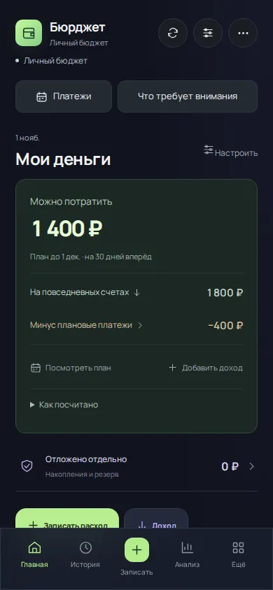
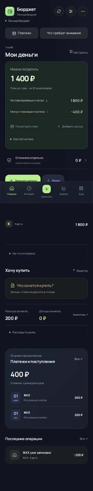
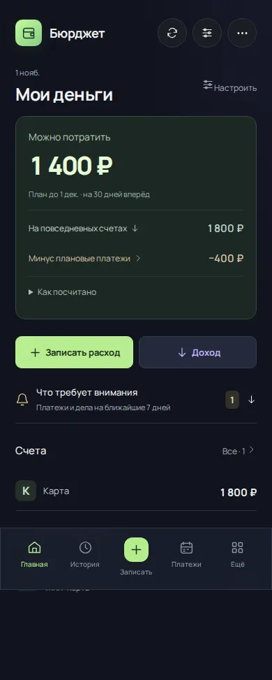
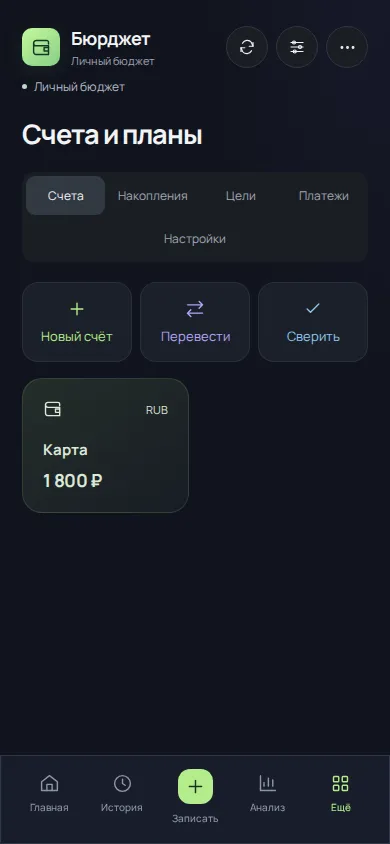
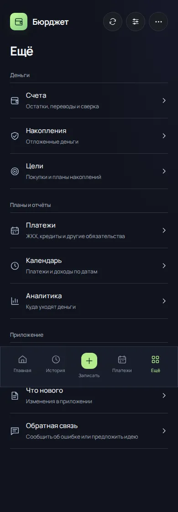
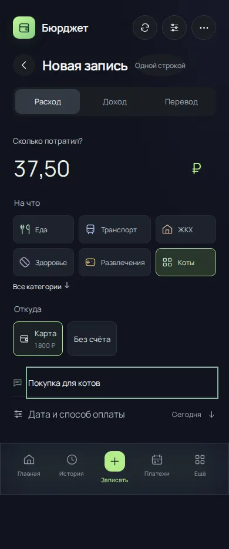

# 4.11.0 — ежедневные действия вместо витрины виджетов

Основа: a60e3ee88d1abceb6c3db16919f2ae9ea44d2c9d (4.10.0). Запрос Андрея: видимый результат упрощения, а не только косметические изменения.

## Что меняется в работе

| Задача | Было в 4.10.0 | Стало в 4.11.0 |
| --- | --- | --- |
| Открыть приложение | Большая главная с большинством виджетов | По умолчанию бюджет, запись, сводка дел по кнопке, счета и последние операции |
| Найти платежи | Дополнительная кнопка над бюджетом и вкладка внутри «Ещё» | Постоянный пункт нижней навигации, отдельный экран |
| Найти раздел | «Ещё» сразу открывает счета и несколько вкладок | Список разделов с короткими пояснениями; «Все разделы» возвращает в меню |
| Записать покупку | Перед суммой — горизонтальный список повторов | Сначала сумма; повторы раскрываются отдельно, категории доступны через поиск |
| Выбрать счёт | Горизонтальная лента кнопок | Кнопки переносятся на следующую строку, названия и остатки видимы |
| Проверить дела | Центр внимания раскрывается перед всем бюджетом | Счётчик и ручное раскрытие под основными действиями |

## Сохранение связей

Существующие настройки состава и порядка главной сохраняются. Компактный вариант применяется при отсутствии явной настройки; все дополнительные виджеты доступны через «Настроить». Первые три ненулевых счёта видны на главной; отрицательные остатки показываются всегда. «Показать нулевые» раскрывает полный список, а «Все» открывает управление счетами.

Бюджет, предупреждения о нехватке и неизвестных суммах, плановые платежи, остатки и история используют прежние общие расчёты. Отложенные деньги показаны при ненулевом резерве, управление накоплениями доступно в «Ещё». Пустая карточка накоплений и повторы ссылок на календарь убраны с главной. Календарь и ожидаемые доходы доступны в разделе платежей и меню.

По снимкам исправлены два дефекта: у строк счетов сброшен размер прежней горизонтальной карточки (около 170 px), кнопка сохранения формы больше не перекрывает поле даты. Снимки дожидаются исчезновения временного уведомления; сами уведомления не перехватывают нажатия.

В нижнем меню пять пунктов: Главная, История, Записать, Платежи, Ещё. Аналитика и обеды доступны через «Ещё», обед также доступен с главной при включённом модуле. Черновик сохраняется при переходе в платежи и обратно; запись из аналитики возвращает туда же.

## Основания и границы

Решения развивают [исследование UX для 4.10.0](UX-RESEARCH-2026-11-01.md): приоритет ежедневных задач у [YNAB](https://www.ynab.com/whats-new/the-great-ynab-remodel), явные счета у [Actual](https://actualbudget.org/docs/accounts/), [progressive disclosure NN/g](https://www.nngroup.com/articles/progressive-disclosure/). Это экспертные гипотезы, а не пользовательское исследование на группе людей. Скорость выполнения задач реальными пользователями пока не измерена.

Финансовые дефекты G01–G07 из глобального аудита этим UX-обновлением не закрываются. Переноса финансовых данных нет. Рабочая выкладка зависит от обязательного резервного копирования; отказ Cloudflare10000 не обходится.

## Проверка результата

Chromium сравнивает ревизии на одном вымышленном профиле и одной дате. Сохраняет высоту главной, положение кнопки расхода и реальные снимки главной, меню, формы и учтённого платежа. Критерии: главная минимум на 20% короче исходной, кнопка расхода выше 650 px при viewport 390 × 844, пять постоянных пунктов навигации. Проверяются ширины 320/390/768/1280, связь оплаты без второго списания, сохранение расхода через выбранную категорию и отражение в истории и остатке.

Проверена ревизия c85206c2c475e9836296f5d3fdcce9e885356af7. 501 тест, production build, Worker bundle, dependency audit, финансовый Chromium, надёжность и сценарии удобства — успешно. Прогон: [41282698615](https://github.com/M3A9tt/budget-app/actions/runs/41282698615). В браузере ошибок страницы нет.

| Замер на одинаковом вымышленном профиле | 4.10.0 | 4.11.0 |
| --- | ---: | ---: |
| Высота содержимого главной | 1742 px | 765 px (−56%) |
| Верх кнопки записи расхода | 727 px | 482 px (на 245 px выше) |
| Ширины без горизонтального переполнения | — | 320, 390, 768, 1280 px |

Это замер одной фикстуры, а не оценка всех пользовательских профилей и не измерение скорости работы человека. Исходные PNG находятся в CI-артефакте `financial-ui-screenshots/usability`; рядом с отчётом сохранены WebP, fixture.json и evidence.json.

## Реальные экраны до и после

Одна дата, одинаковые данные, viewport 390 × 844, reduced motion. До: a60e3ee88d1abceb6c3db16919f2ae9ea44d2c9d. После: c85206c2c475e9836296f5d3fdcce9e885356af7.

| Экран | До | После |
| --- | --- | --- |
| Первый экран главной |  |  |
| Вся главная |  |  |
| Меню «Ещё» |  |  |
| Форма расхода |  |  |

Снимки формы показывают расход 37,50 ₽ до подтверждения; в новой версии дополнительно выбрана своя категория через поиск. Полностраничные снимки сохраняют фиксированную навигацию на позиции viewport: часть содержимого может находиться за ней в таком кадре, в приложении она доступна прокруткой. Это не макеты с переставленными элементами.

## Финансовый результат сценария

| Действие | Остаток счёта | Операций |
| --- | ---: | ---: |
| Исходный профиль с ранее внесённым ЖКХ | 1800 ₽ | 1 |
| Связать эту запись с периодом ЖКХ | 1800 ₽ | 1 |
| Записать покупку для котов 37,50 ₽ | 1762,50 ₽ | 2 |

Покупка видна в истории и на главной; «Можно потратить» составляет 1562,50 ₽: 1762,50 ₽ на счёте минус 200 ₽ оставшегося плана. [Снимок после сохранения](task-first-ux-2026-11-01/after-recorded-expense-390.webp). Незавершённый черновик при переходе в платежи и обратно сохраняет сумму и не создаёт операцию.

Готовые исходники не считаются выложенными в Telegram до успешного deploy.
