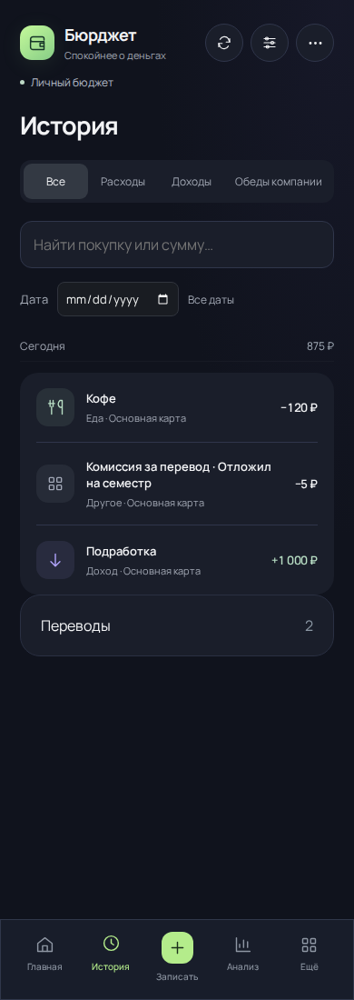
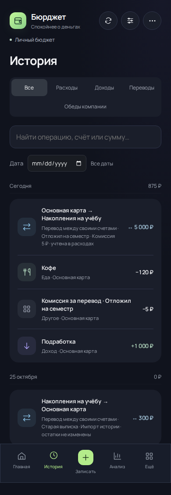
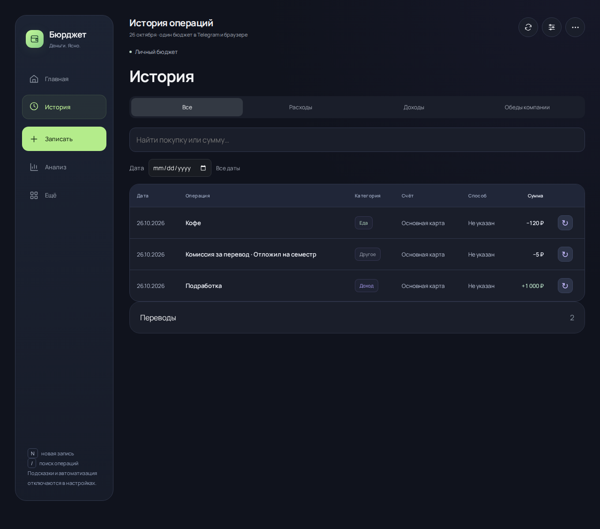
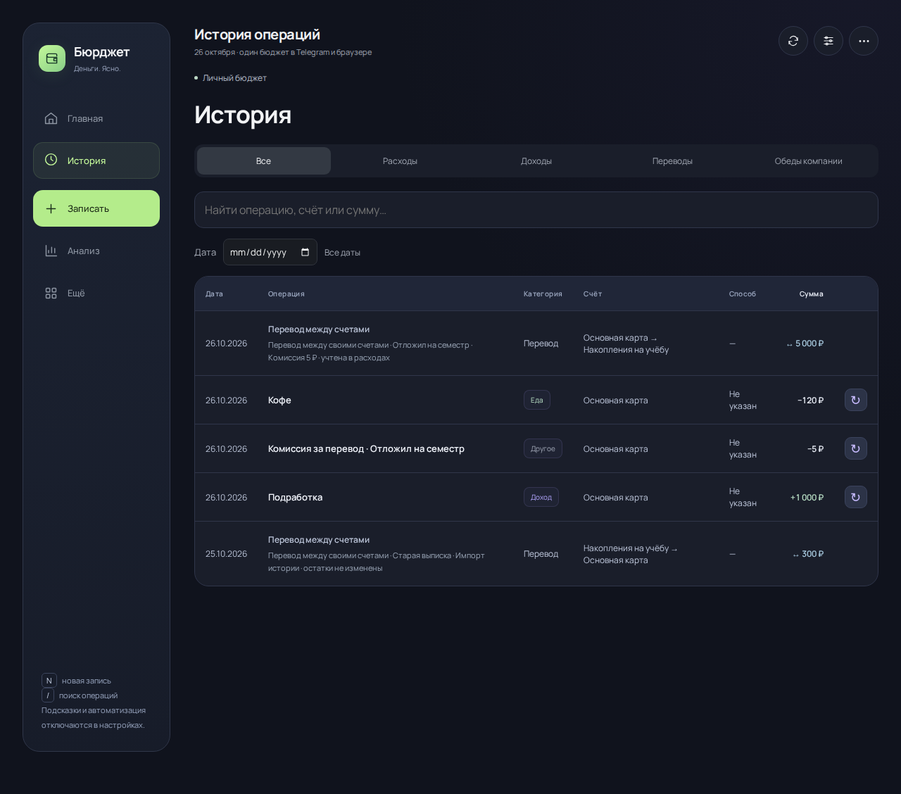

# Переводы в истории — 4.6.2

Сравниваемая версия до изменения: `da5105f` (4.6.1). SHA обоих интерфейсов фиксируются в JSON рядом со снимками.

Переводы теперь входят в общую историю и последние операции миниаппы. В истории бота используется тот же источник данных. Видны направление, сумма, комментарий, комиссия и пометка импорта без изменения остатков. Фильтр «Переводы», дата, поиск и пагинация работают с общей лентой. Перевод не получает действия изменения или повтора обычной покупки.

| Сценарий | До | После |
| --- | --- | --- |
| Общая история | Покупки и доходы; переводы в отдельном свёрнутом блоке снизу | Покупки, доходы и переводы вместе по датам |
| Последние операции | Переводов нет | Направление и сумма перевода видны сразу |
| Фильтр переводов | Нет | Есть в миниаппе и боте |
| Поиск | Названия счетов переводов ищутся отдельно | Оба счёта, комментарий и сумма ищутся в общей ленте |
| Новый перевод за сегодня | Время записи не сохраняется | Сохраняется время; новая запись не теряется среди старых из-за случайного ID |

## Проверка финансовой цепочки

Вымышленные исходные остатки: карта 10 000 ₽, накопления 0 ₽. Доход 1 000 ₽, кофе 120 ₽, перевод в накопления 5 000 ₽, комиссия 5 ₽.

| Показатель | Результат |
| --- | ---: |
| Карта после операций | 5 875 ₽ |
| Накопления | 5 000 ₽ |
| Доход | 1 000 ₽ |
| Расход, включая комиссию один раз | 125 ₽ |
| Итог дня без суммы перевода | +875 ₽ |
| Изменение остатков при просмотре и поиске | 0 ₽ |

Проверены старые импортированные и внешние движения, отсутствующие счета, совпадающие ID операции и перевода, история только из переводов, общий список из 120 записей, фильтры аналитики и открытие перевода в боте без записи новых данных. Исторические записи не переписываются; денежная логика перевода не изменена.

Локально прошли 450 тестов, production-сборка, сборка Worker и проверка патчноута.

## Реальные снимки до и после

Снимки получены в [успешном workflow Visual audit evidence](https://github.com/M3A9tt/budget-app/actions/runs/40275397071). Сравниваются настоящие ревизии `da5105f379aa2b690f5965fa5cf158fd644ce52b` и `1685b438361ec623e455cf891074820a91e48eb6` (проверочный merge-коммит PR #52 с кодом `5d3f8e8ea6bdd9bd5c2a1a054385526a323857ba`). Одинаковые вымышленные данные, дата 26 октября 2026 года и размеры экрана. JSON с исходными данными и SHA: [до](audit-4.6.2/before.json), [после](audit-4.6.2/after.json).

| История до — 390 px | История после — 390 px |
| --- | --- |
|  |  |

| Компьютер до — 1280 px | Компьютер после — 1280 px |
| --- | --- |
|  |  |

[Главная до](audit-4.6.2/home-before-390.png) · [Главная после](audit-4.6.2/home-after-390.png) · [Фильтр переводов](audit-4.6.2/filter-after-390.png).

Скрипт `scripts/capture-transfer-history.mjs` проверяет видимость двух переводов, неизменный итог дня, поиск суммы с пробелом, пометку исторического импорта, отсутствие изменения остатков и горизонтального переполнения. Снимки просмотрены вручную.

[Budget checks](https://github.com/M3A9tt/budget-app/actions/runs/40275397081) прошёл на Linux и Windows: 450 тестов, production-сборка и сборка Worker. Chromium дополнительно проверил финансовые сценарии и новую ленту на ширинах 320, 360, 390, 430, 768 и 1280 px, направление перевода, фильтры по обоим счетам и дате, отдельную комиссию, нейтральный итог и отсутствие кнопок редактирования покупки у перевода. Ошибок страницы нет.
