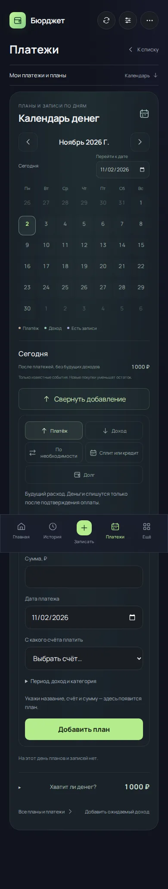
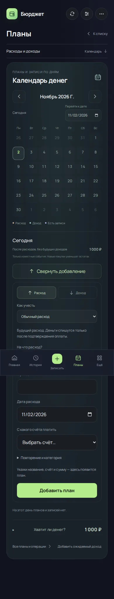
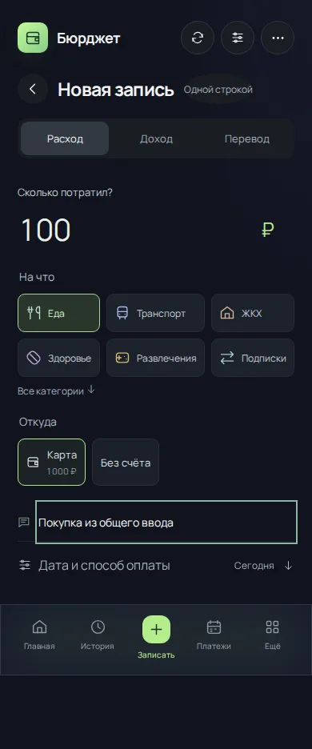
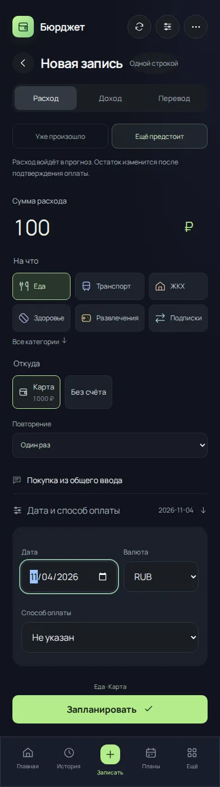

# Расход / доход и состояние операции · 4.15

Исправляется замечание Андрея: расход шире платежа. Направление денег нельзя ставить рядом со способом учёта. Заповедь закреплена в AGENTS.md.

- Направление: расход или доход. Покупка, ЖКХ, сеанс и взнос — расходы.
- Состояние: уже произошло или ещё предстоит. Дата/повторение уточняют операцию.
- Связь: сохранённый шаблон, обязательство, возврат долга. Это источник события, а не третье направление денег.
- Перевод между своими счетами не становится расходом; расходом остаётся комиссия.

Изменение охватывает поведение, а не только подписи. Обычная форма и короткий текст поддерживают будущую дату. Общий `submitEntry` отправляет новую будущую операцию в существующий план, а факт — в существующий ledger. Подтверждение плана связывается с записью через прежние recurringId/period; второй финансовый список не создаётся. Валюта плана должна соответствовать счёту; существующие и связанные факты нельзя незаметно превращать в будущие планы. Сохранённый черновик и повтор команды сохраняют идентичность операции.

В календаре два верхних выбора — «Расход / Доход». «Как учесть» ниже уточняет источник. Сохранённые шаблоны фильтруются по направлению, для дохода доступен возврат долга мне; оплата частями относится к расходам. Раздел «Планы» и списки по повторению включают оба направления.

## Проверки

528 тестов, production build и Worker bundle прошли локально. Добавлены проверки план → факт, отсутствия раннего изменения остатка, запрета превращения существующей оплаты в план, валюты, произвольного расхода без даты и полного диалога бота с повторным подтверждением. `test:entry` проверяет общий ввод, автоматическое планирование по дате, оплату через календарь, доход в той же форме и нерегулярный расход без даты на 320–1280px. Сравнительная база 4.14: `c0954408357b5a78ecf07aa3b36152dab5e9023c`, данные вымышленные. CI сохраняет снимки и точные состояния в `financial-ui-screenshots/unified-entry`.

Будущие собственные переводы пока не поддерживаются и явно отклоняются. Обеды за счёт компании записываются по факту. Не вводилась миграция хранилища; старые ссылки, суммы и маршруты `payments` сохраняются для совместимости. Полная приёмка 5.0 и открытые дефекты глобального аудита остаются отдельной работой.

## Результат Chromium

Все семь сценариев, Windows и Linux прошли на исходном коммите `3d9122268751a1011776551241bf35536d350b4f`: [CI 41358410763](https://github.com/M3A9tt/budget-app/actions/runs/41358410763). Снимки ниже получены из того же прогона и просмотрены. Дата fixture — 02.11.2026, размер экрана 390×844. [Начальные данные](unified-entry-2026-11-02/fixture.json), [точные состояния после действий](unified-entry-2026-11-02/evidence.json). Локально Chromium отсутствует; браузерные результаты получены в CI.

| Календарь 4.14: направления и способы учёта вперемешку | Календарь 4.15: расход/доход, уточнения ниже |
|---|---|
|  |  |

| Обычная форма расхода 4.14 | Та же покупка в 4.15: выбор состояния |
|---|---|
|  |  |

Оба сравнения используют одинаковые начальные данные и введённые значения. Следующий снимок демонстрирует действие после выбора будущей даты:

| Шаг | Остаток | Фактических операций | Будущие события |
|---|---:|---:|---|
| В обычной форме введён расход 100 ₽ на 4 ноября | 1 000 ₽ | 0 | Расход 100 ₽ |
| Расход подтверждён через календарь | 900 ₽ | 1 | Нет неоплаченного расхода |
| В той же форме введён будущий доход 500 ₽ | 900 ₽ | 1 | Доход 500 ₽ |
| Добавлен расход «По необходимости» без даты | 900 ₽ | 1 | Тот же доход; недатированный расход не создаёт событие |

После сохранения состояние видно через существующие планы, события, историю и расчёты. Подтверждённый расход связан с исходным планом; самостоятельная сущность «платёж» не добавлена. Старые подписи клавиатуры бота по-прежнему ведут в тот же раздел.
