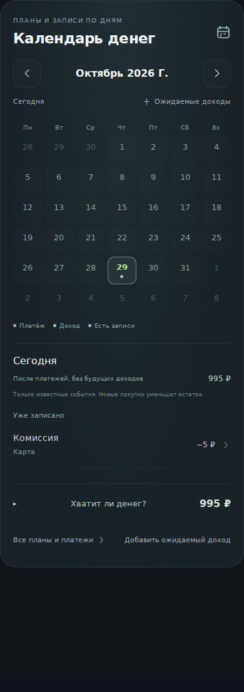
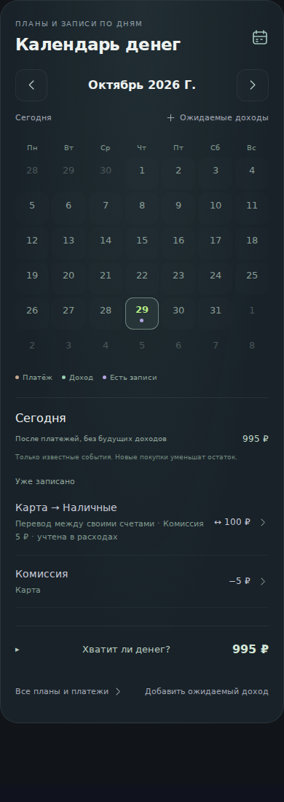
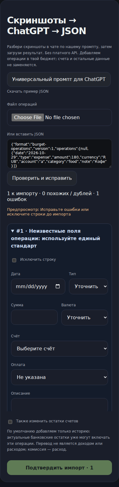
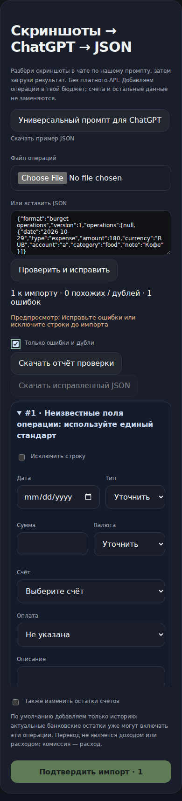

# 4.8.1 — календарь, импорт и валютные оценки

База: be289939b4ea56d79ce4c624ed6c6e247945d145 (main, 4.8.0). Финансовая схема и данные пользователей не мигрируют.

Календарь использует activityEntries: перевод открывает существующий редактор, сумма нейтральна для доходов/расходов, комиссия учитывается один раз.
Импорт позволяет показать только проблемные строки, скачать построчный отчёт и исправленный JSON без исключённых строк. Файлы содержат выбранные операции, без посторонней истории и остатков. Выгрузка не импортирует данные; повторная загрузка снова проверяет дубли.
Общий rate отклоняет отсутствующий/неположительный курс вместо подстановки 1. Сохранённый исторический amountRub не переоценивается. Это защитная остановка, не автоматическая загрузка курсов; экран восстановления объясняет код MISSING_EXCHANGE_RATE. Миграция старых профилей по-прежнему дополняет отсутствующие курсы штатными значениями.

## Проверки

498/498 тестов; build, Worker bundle, release guard, diff check. Полный финансовый Chromium 320/360/390/430/768/1280 и reliability Chromium прошли. Отдельный Chromium проверил callback перевода и фильтр импорта без ошибок страницы.

Снимки — реальные компоненты обеих ревизий, одинаковые вымышленные данные и viewport 390×1100, Chromium 153. Фикстура рядом, повторяемый скрипт scripts/capture-calendar-import-4.8.1.mjs принимает путь к baseline checkout с node_modules. Физический Telegram не проверялся.

| Сценарий | До | После |
|---|---|---|
| Календарь |  |  |
| Импорт |  |  |

После включён фильтр проблемных строк. Точные результаты: перевод 100+5 — общий остаток 995; изменение на 200+10 — 990; отмена — 1000. Без курса USD прежде 100 USD оценивались как 100 RUB, теперь расчёт отклоняется; исторические 10 USD с amountRub=900 остаются 900 RUB.

## Блокер публикации

Workflow 40879834441: Linux/Windows и оба Chromium успешны, safety_backup отказал на экспорте, deploy пропущен. Требуется восстановить доступ CLOUDFLARE_API_TOKEN к D1. Секреты не менялись, защитная зависимость не отключалась. PR не объявляет аварийные копии или публикацию работающими. Нормализация JSON и серверная пагинация остаются отдельным этапом после независимой копии и испытанного отката.
