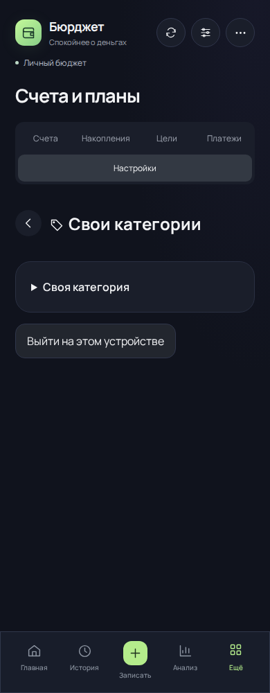
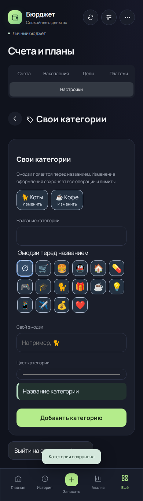
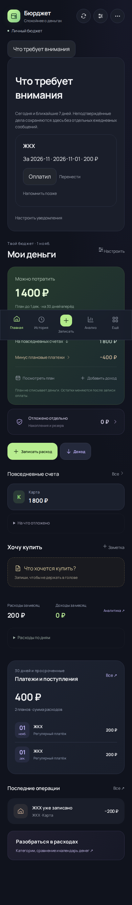
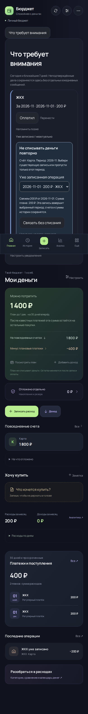

# Бюрджет: системный разбор и исправления 4.9.0

Основа: main `be289939b4ea56d79ce4c624ed6c6e247945d145`, 1 ноября 2026. Проверены общие расчёты, запись/отмена, планы, сводка, бот, категории, импорт/восстановление, хранение и публикация. Личные данные не читались и не менялись. Это анализ кода и воспроизводимых сценариев; проверка на настоящем телефоне и эксплуатационные замеры не заявляются.

## Что обнаружено и исправлено

| Проблема | Влияние | Результат |
| --- | --- | --- |
| Ручной расход не связан с ожидающим его планом | Свободный остаток уменьшается ещё на обязательство; повторное подтверждение может списать ещё раз | Явная связь уже существующей записи с одним периодом. Счёт, сумма, дата, исторический курс и число операций сохраняются |
| Расход уже включён в начальный остаток | Пользователь не понимает, что выбрать вместо повторной оплаты | В сводке и карточке доступны отдельные «Связать без списания» и «Неактуально в этом периоде»; второй вариант использует существующий пропуск периода |
| Пропуск оставлял разовое напоминание в настройках | Устаревшая настройка остаётся после отмены события | При пропуске и связывании удаляется напоминание именно этого периода |
| Свои категории создавались только с одним видом и не редактировались в миниаппе | Сложно находить категории и исправлять оформление | Выбор эмодзи и цвета, редактирование по прежнему ID; операции и лимиты не пересоздаются. Бот использует ту же команду |
| Одинаковые карточки центра внимания | Сложнее различать поступления и расходы | Спокойные цветовые акценты в существующей тёмной теме; текст сохраняет смысл без цвета, отдельный раскрываемый сценарий без списания |
| Тест экрана обедов зависел от реального текущего месяца | В ноябре тест с октябрьскими данными падал | Фиксированная дата только в тестовой среде, календарь приложения не подменяется |

## Правила связывания

Ничего не сопоставляется автоматически по названию или похожей сумме. Пользователь видит счёт плана, период и фактическую сумму записи; различие суммы допускается как фактическая окончательная оплата. Связь закрывает выбранный период. Для частей дохода следует пользоваться существующим отдельным сценарием частичного поступления.

Выбираются только свободные операции того же типа, счёта и валюты. Оплата другого плана, рассрочки, долга, возврат, комиссия перевода и корпоративный обед не подходят. Историческая запись сохраняет `balanceEffect=history-only`. Одна операция не может закрыть два периода. Повтор команды безопасен. Через историю изменений можно отменить связь: план вернётся, второго расхода не появится. Удаление исходной оплаты также возвращает обязательство по существующим правилам.

Если операция не существует, но деньги уже учтены в введённом остатке, используется пропуск. Пропуск не объявляется фактом оплаты; его можно отменить в существующем разделе пропущенных периодов. Следующий месяц не сдвигается.

## Точное «до → после» на вымышленных данных

| Сценарий | До | После |
| --- | --- | --- |
| Счёт 1000 ₽, ручной расход 100 ₽, план 100 ₽ | Остаток 900 ₽, план ждёт оплату | Остаток 900 ₽, та же одна операция, выбранный период закрыт |
| Те же данные, обычное повторное подтверждение | Возник бы второй расход и остаток 800 ₽ | Связь не создаёт второго факта |
| Начальный остаток 1000 ₽ уже учитывает платёж | План продолжает уменьшать доступное | Пропуск периода: 1000 ₽, 0 новых операций |
| Изменение категории с лимитом 500 ₽ | Для нового оформления пришлось бы создавать новую категорию | Прежний ID, тот же лимит и операции; меняются название, эмодзи и цвет |

Проверки: `tests/manual-plans-categories.test.js`. Реальное Chromium-сравнение двух ревизий: `scripts/check-intuitive-browser.mjs`, одинаковая фикстура, 390 px до/после и 320/390/768 px после. CI сохраняет изображения и `evidence.json` в артефакте `financial-ui-screenshots/usability`. Chromium завершился успешно, снимки просмотрены. Копии 390 px сохранены ниже и рядом с отчётом; проверка 320/768 px и остальные кадры доступны в артефакте CI.

## Оставшиеся риски и порядок следующих работ

| Приоритет | Проверенная граница / слабое место | Файлы | Следующее действие |
| --- | --- | --- | --- |
| P0 | Независимый экспорт блокировался Cloudflare 10000; работающие копии не подтверждены | scripts/create-db-backup.mjs, .github/workflows/database-backup.yml | Владелец проверяет доступ токена к D1. До успешной копии не отключать gate и не мигрировать данные |
| P1 | Полный JSON сохраняется большинством действий, лимит 1,5 МБ | server/state-persistence.js, src/MiniApp.jsx | Отдельный выпуск: сущности, постраничное чтение, сверка и испытанный откат по STORAGE-EVOLUTION.md |
| P1 | Для взноса рассрочки нет такого же выбора существующего свободного расхода, как теперь у регулярного плана | src/installment-state.js, src/InstallmentCards.jsx | Добавить отдельную команду связи с проверкой остатка взноса, сохранив частичные оплаты и undo |
| P1 | Связь существующей записи с планом закрывает период окончательно | src/planned-model.js | При развитии частичных расходов ввести единый остаток периода и явно отделить окончательную оплату от части |
| P1 | Полное удаление профиля и сроки исчезновения из независимых копий не реализованы | docs/DATA-RETENTION.md | Спроектировать удаление, отзыв сеансов и срок старых копий вместе, без ложного обещания мгновенного удаления |
| P2 | Разные экраны ещё напрямую соединяют встроенные и свои категории | src/analytics-report.js и архивный App.jsx | Перевести оставшиеся представления на единый каталог; ID и суммы не менять |
| P2 | Журнал изменения операций ограничен 200 событиями | src/ledger.js | При нормализации вынести журнал отдельно; сейчас финансовые transactions не обрезаются |
| P2 | Редкие поля и взаимосвязанные действия распределены между меню/формой/сводкой | server/bot-chat.js, src/PaymentsPage.jsx | Умеренные подсказки «записать / связать / пропустить», один маршрут к исходной записи, без добавления ещё одного списка задач |
| P2 | UI автоматизирован только Chromium | .github/workflows/checks.yml | Проверить Telegram Android/iOS, клавиатуру, масштаб текста и экранный диктор на устройствах |

Порядок: сначала защищённая публикация и независимая копия, затем целостность связей остальных обязательств, затем миграция хранения; визуальные изменения сопровождают конкретные пользовательские действия. PR #50–53 повторно не выдаются за новые исправления. Исправления 4.7/4.8 сохраняются, безопасность публикации не обходится.

## Валидация

Локально 499 тестов прошли, сборка приложения и Worker успешны. Финальные Linux/Windows и три Chromium-набора проверяются CI того же исходного кода. Публикация по-прежнему зависит от успешного независимого копирования; наличие кода в main не означает выкладку.

## Снимки интерфейса

Фикстура: одна вручную записанная оплата ЖКХ 200 ₽, остаток 1800 ₽. До: `be289939b4ea56d79ce4c624ed6c6e247945d145`. После: `fb25ee74d864c0b00d10ee94210807ef50c978fa`. Финальная проверка кода с компактным каталогом бота: `cfb7018b65e13a740af3b52f8d652735c079e99b`, все 499 тестов и три Chromium-набора прошли на Linux/Windows.

| Сценарий | До | После |
| --- | --- | --- |
| Категории |  |  |
| Записанный платёж |  |  |

[Численные результаты](audit-2026-11-01/evidence.json), [исходная вымышленная фикстура](audit-2026-11-01/fixture.json). В обоих состояниях 1800 ₽ и одна финансовая запись; после — связь с планом без нового списания.
