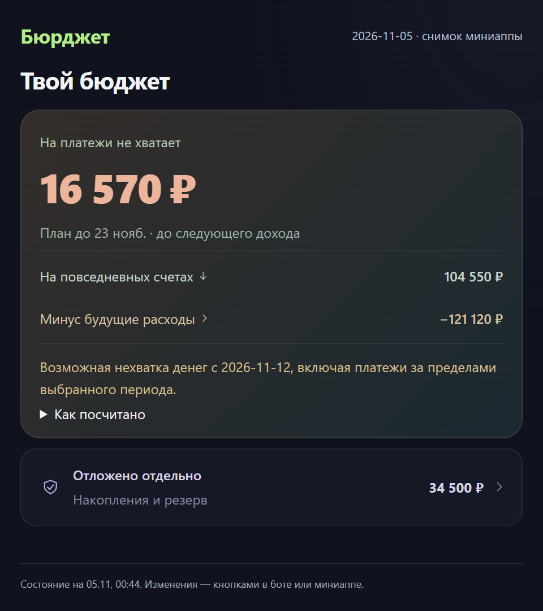
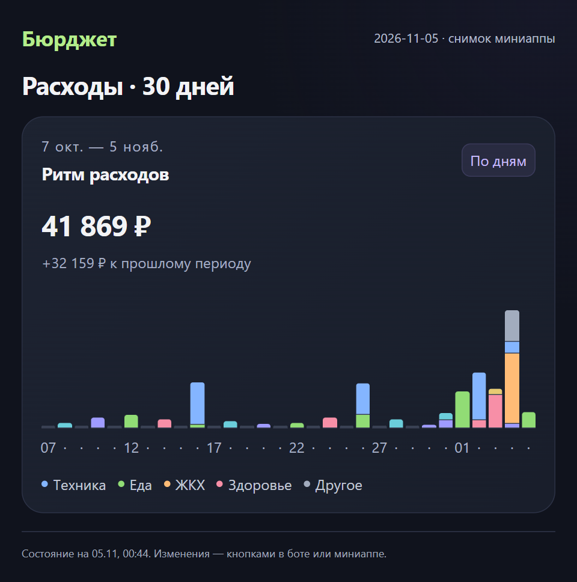
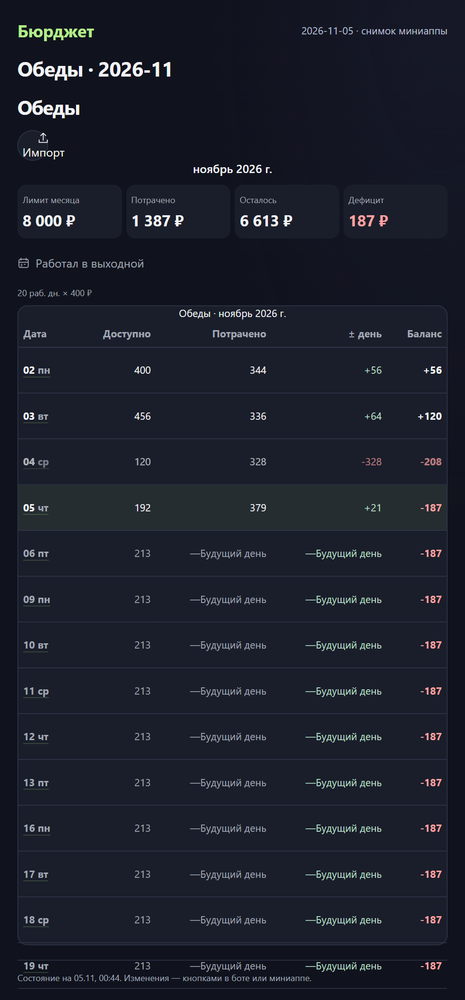
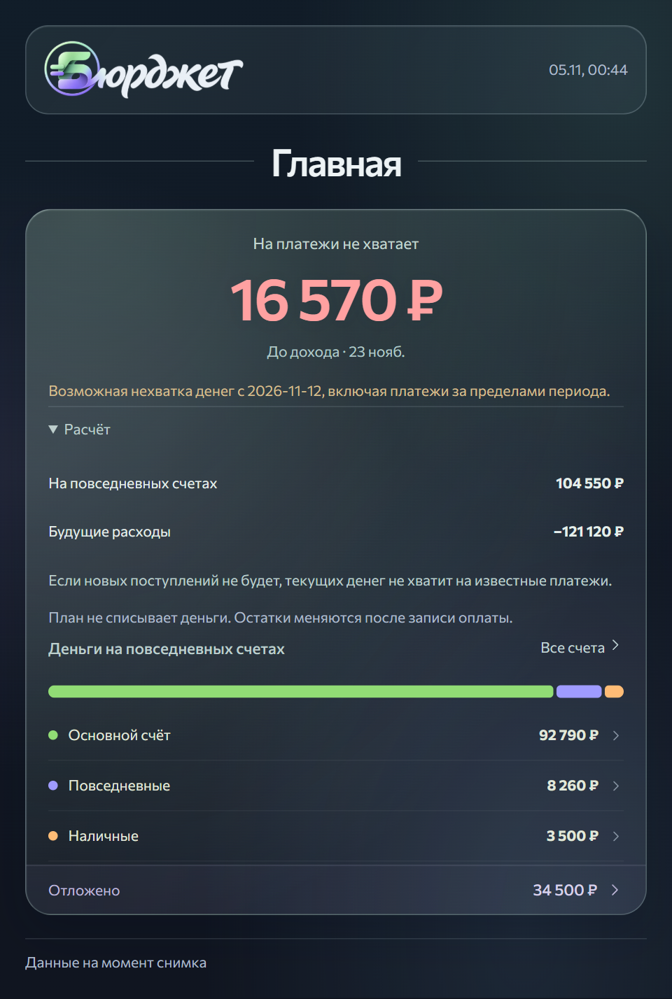
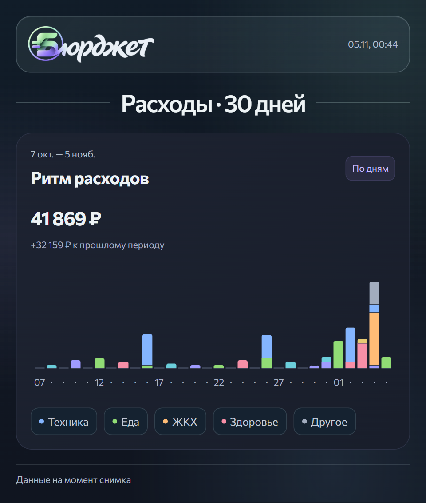
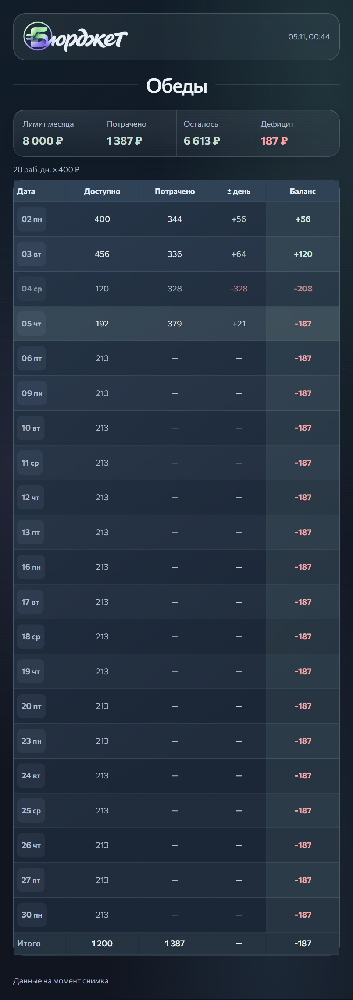

# Карточки бота · 5.0.5a

Основа: main 30a8dae (5.0.5). Сравнения сняты scripts/check-bot-cards.mjs на одинаковых вымышленных данных, времени и ширине 640 px (PNG 960 px). Файлы before-* — прежний renderer из этого коммита; остальные — текущие компоненты и стили.

## До → после

| Бюджет | Аналитика | Обеды |
|---|---|---|
|  |  |  |
|  |  |  |

## Что изменено

- Нынешний Brand с lockup-refined-b.webp и локальный Commissioner загружаются через ASSETS; в самодостаточный HTML включаются data URL. Внешние ресурсы и JavaScript запрещены CSP.
- Общие актуальные стили miniapp, персональный BudgetHero, AccountsPage и MoneyCalendar используются напрямую. Остальные разделы получают компактные карточки из существующего botView, без новых финансовых расчётов.
- Фото меняется через editMessageMedia, включая переход из текстового сообщения. Поля формы редактируют подпись фото; проверка, подтверждение и отмена сохраняют ID. После изменения денег снимок строится заново по актуальному состоянию.
- При ответе «message is not modified» новый экземпляр не создаётся. Новый экран разрешён при удалённом/недоступном сообщении; неизвестная ошибка сети и ограничение Telegram не провоцируют повторную отправку наугад.
- Длинный предпросмотр не обрезается ради подписи: используется текстовая карточка. Файлы, явный режим «Текстом» после фото и установка reply-клавиатуры могут требовать отдельного сообщения по ограничениям Telegram.
- Исправлена потеря результата prompt: retireMenu больше не удаляет клавиатуру только что отредактированной формы.
- Снимки изолированы по пользователю и кешируются по содержимому/выпуску. Для разделов без финансовых данных ключ отражает модель раздела, а не все изменения профиля. Ограничения рендера остаются конечными: 48 на пользователя и 128 суммарно в сутки по умолчанию; настройки окружения имеют приоритет. При исчерпании остаётся текстовый интерфейс.

## Проверки

574 автоматических теста, Worker bundle и сборка успешны. Новый тест проходит снимок → ввод 180 ₽ → подтверждение → отмена без второй карточки, проверяя 10 000 → 9 820 → 10 000 ₽. Проверены отсутствие дублей при неизвестной доставке, 429 и неизменившемся сообщении, безопасная замена удалённого сообщения, точные байты текущих ресурсов.

16 настоящих PNG проверены в Chromium: загруженные логотип/шрифт, ширина, отсутствие переполнения, допустимые размеры Telegram (checks.json). Этот шаг добавлен в CI. Реальный клиент Telegram на телефоне не тестировался; тесты доставок используют Telegram API mock.

## Финальная проверка размера PNG
Первый выпуск выявил пропуск в проверке: геометрия подходила, но PNG насыщенного календаря занимал 2,14 МБ при лимите 1,8 МБ. Масштаб 1,5 вместо 2 сохраняет логическую раскладку 640 px и даёт PNG 960 px. Chromium-проверка теперь вызывает реальный pngInfo для всех 16 файлов и проверяет и байты, и размеры. Публикация проверяет снимок на сервере также без повторной рассылки.
