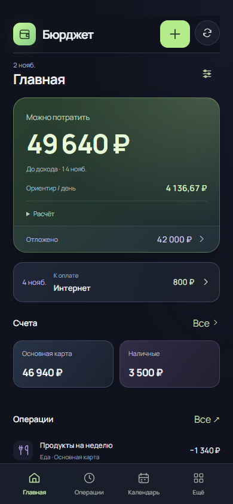
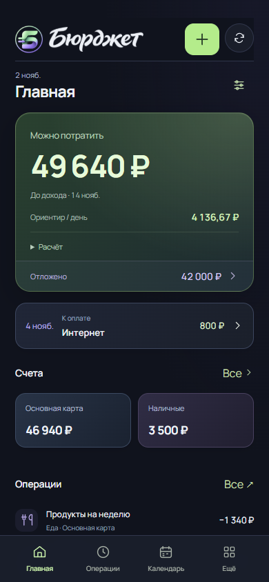

# Фирменный знак и название

Пользователь выбрал третий рукописный вариант из сравнения 08. Основа знака — прежняя объёмная зелёно-лавандовая «Б», два валютных штриха и тонкое кольцо из варианта 06. Металлическая монета с буквенной засечкой из 05 отклонена.

Рукописная надпись доработана для малого размера: открыты тесные соединения, упрощён росчерк «д» и укорочена верхняя часть последней «т». Это отдельное фирменное начертание, а не универсальный интерфейсный шрифт. Финансовые суммы и обычный текст продолжают использовать читаемую текстовую типографику.

## Реализация

- Один `src/Brand.jsx` используется в мобильной шапке и боковой панели. Его `BrandSymbol` также используется при входе и загрузке.
- Прозрачные WebP-ресурсы находятся в `public/brand`: знак 29 376 байт, надпись 51 436 байт. Размеры указаны заранее, чтобы загрузка не сдвигала элементы.
- Доступное название связки — «Бюрджет». Внутренние изображения декоративные, без повторных озвучиваний.
- Значки вкладки, Apple Touch Icon и manifest используют тот же знак. Устанавливаемое приложение называется «Бюрджет».
- Исходные прозрачные PNG сохранены в `scripts/brand-export-source`. `scripts/export-brand-assets.mjs` воспроизводит веб-экспорт и значки. Генеративная правка выполнена встроенным image_gen; запросы сохранены рядом с исходниками.
- Вариант с настоящей Акирой по питомцу сохранён как отдельное направление для других контекстов. Для основной шапки используется буквенный знак.

## Проверка и сравнение

`scripts/check-brand-integration.mjs` проверяет загрузку ресурсов, доступное название, отсутствие перекрытий и переполнения на 320/390/768/1280 px, прежнюю и новую серверные оболочки, вход, значки установки и возврат из формы. Навигация не записывает финансовые данные. `BRAND_BEFORE=1` воспроизводит исходные MiniApp/AuthGate из 244d10d; остальные файлы, влияющие на эти снимки, сохранены теми же.

Снимки выполнены на одном вымышленном профиле:

| До — 244d10d | После — 51f4a5d |
| --- | --- |
|  |  |

[Компьютер](brand/after-1280.png) · [Вход](brand/login-390.png)

Пройдены 544 теста, production-сборка, браузерные сценарии компактной записи с одним дебетом и календарного переноса без изменения остатков. Проверка браузера не заменяет приёмку в настоящем Telegram на телефоне. Изменения встроены в локальную рабочую версию 5.0; отдельный выпуск 5.0 этим этапом не объявляется.

Локальный просмотр: `node scripts/preview-personal.mjs`, адрес `http://127.0.0.1:5188/`. Он использует только вымышленные данные в памяти процесса; реальные API и база не подключаются.
