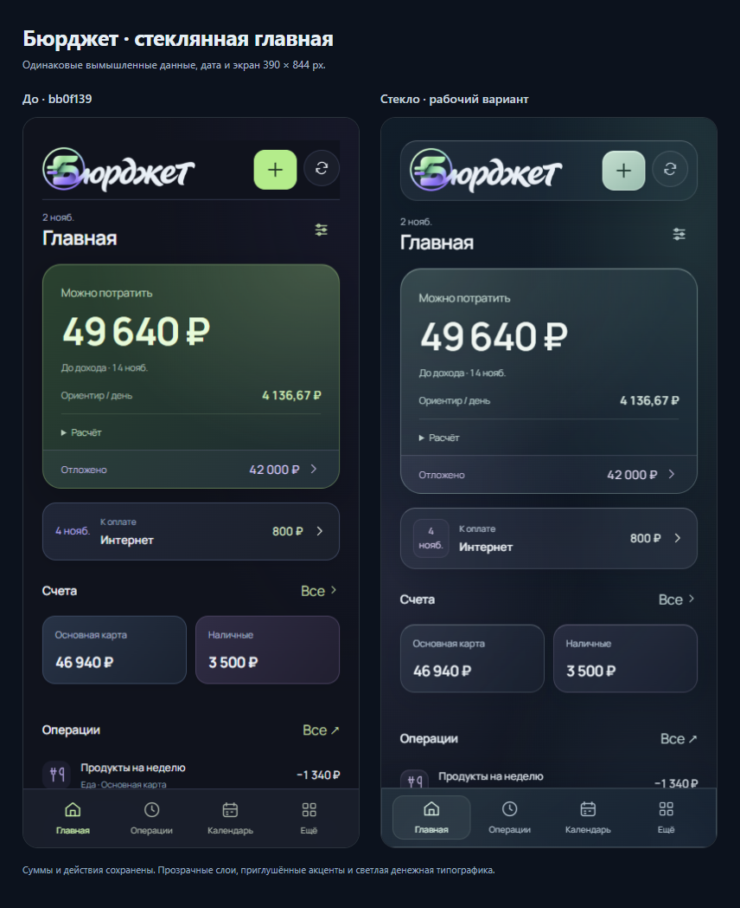

# Стеклянная главная — вариант для разбора

Пользователь запросил стеклянное оформление после замечания о кислотности прежних акцентов. Изменена главная нового представления; визуальная приёмка ещё ожидается. Финансовые компоненты, маршруты и команды используются прежние. Версия приложения этим этапом не повышается до 5.0.

## Изменение

В `src/home-v5.css` заменены существующие поверхности, без дополнительной темы поверх старого оформления. Графитовый фон с мягким шалфейным и лавандовым светом виден через полупрозрачные панели. Размытие ограничено поверхностями, без вложенных размытных слоёв внутри карточек. Светлые границы и внутренние блики обозначают глубину. Денежные суммы светлые, основное действие приглушённо-шалфейное. История сохраняет строки; отдельная стеклянная карточка не добавляется каждой операции.

Неподдерживающие backdrop-filter браузеры получают исходную непрозрачную ветку поверхностей. Появление и раскрытие учитывают reduced motion. Настоящая производительность и восприятие в Telegram на телефоне ещё требуют отдельной приёмки.

## До и после

Исходная ревизия CSS: **bb0f139**. Стеклянный вариант: **e8432c9**. Обе версии сняты с одинаковыми исходными финансовыми компонентами, логотипом, вымышленным профилем, датой и viewport. CSS исходной ревизии подставляется локальным Vite-плагином.

[Главная 390 px](glass-home/after-390.png) · [Компьютер 1280 px](glass-home/after-1280.png) · [Непрозрачная ветка](glass-home/fallback-390.png)

## Проверки

- 320/390/768/1280 px: нет горизонтального переполнения; бюджет и ближайшее событие видны в первом viewport.
- Расчёт раскрывается и сворачивается. Счёт открывает существующий раздел; ближайшее событие — календарь с правильной датой. Возврат работает.
- Сумма бюджета, счета и исходный профиль сохраняются; навигация не записывает финансовое состояние.
- Видимый клавиатурный фокус, reduced motion и обычное появление суммы проверены браузером.
- Непрозрачная ветка проверена **симуляцией отсутствия blur-ветки CSS**, а не настоящим неподдерживающим браузером.
- 544 теста и production-сборка проходят. Проверка бренда подтверждает загрузку ресурсов, обе серверные оболочки и экран входа.

Повторение: `node scripts/check-glass-home.mjs`; для исходного CSS — `GLASS_BEFORE=1`, для непрозрачной ветки — `GLASS_FALLBACK=1`. `node scripts/capture-glass-comparison.mjs` собирает сравнение из готовых снимков. Локальный просмотр остаётся на `http://127.0.0.1:5188/` с вымышленными данными.
