# Мягкое стекло во всём пилоте 5.0

2 ноября 2026. Реализация: `02863b6038d9276446c9bbf9089e9ca7c1d606d0`. Сравнение с `ae15d18`: одинаковые вымышленные данные из [fixture.json](fixture.json), одинаковые размеры окна и отключённые анимации для снимков. Выбранная мягкая главная и дата DD.MM остаются основой.

Общие материалы теперь используются в записи, операциях, календаре, счетах, накоплениях, целях, аналитике, обедах и вложенных настройках. История остаётся списком, календарь — сеткой дат. Убраны повторные заголовки. Тонкие горизонтальные и вертикальные разделители связывают содержимое; правило сохранено в AGENTS.md. Переходы и раскрытия учитывают reduced motion.

Встроено 36 SVG-значков: без CDN, пользовательских URL и вставки SVG-разметки. Выбор доступен у своих категорий, счетов и желаний; прежние эмодзи сохранены. Идентификатор символа хранится в существующей сущности и проходит через резервную копию. Категория отображается в выборе записи, истории, аналитике, календаре и его расшифровке. Значок счёта связан с главной, списком счетов, выбором счёта, накоплениями и окном события.

## До → после

| Экран, 390 × 844 | До | После |
| --- | --- | --- |
| Запись | 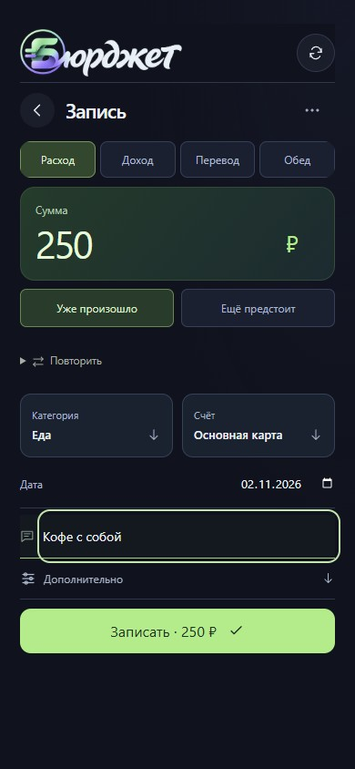 | 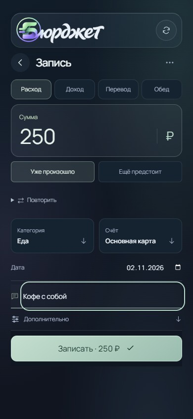 |
| Календарь | 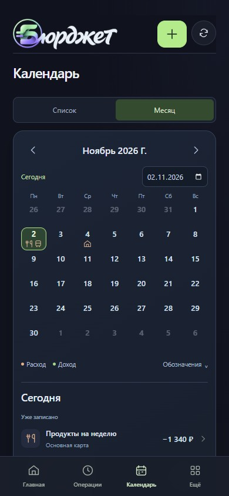 | 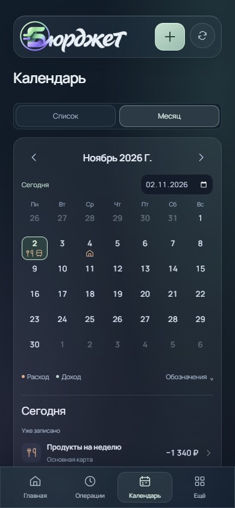 |
| Счета | 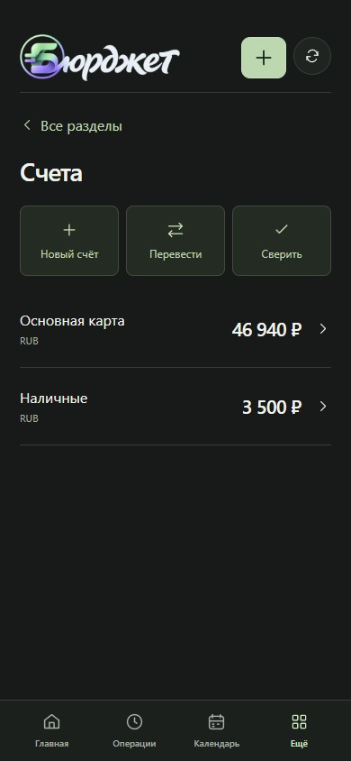 | 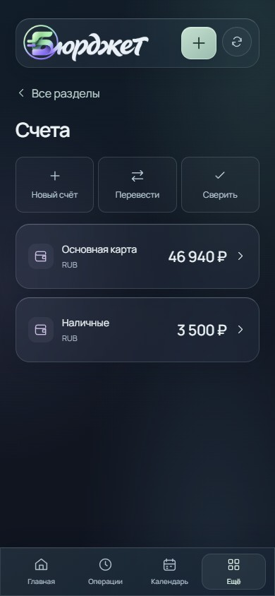 |
| Цели | 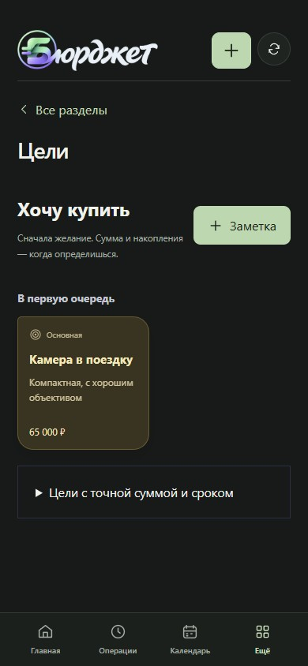 | 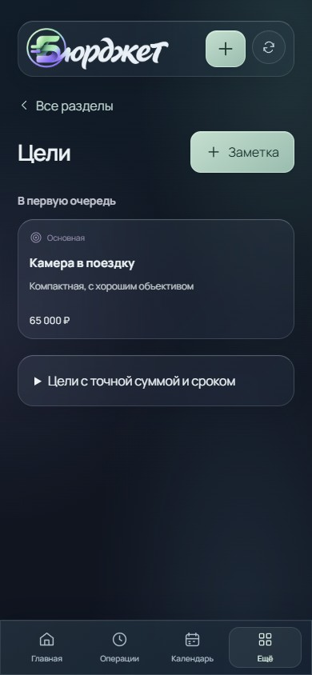 |
| Аналитика | 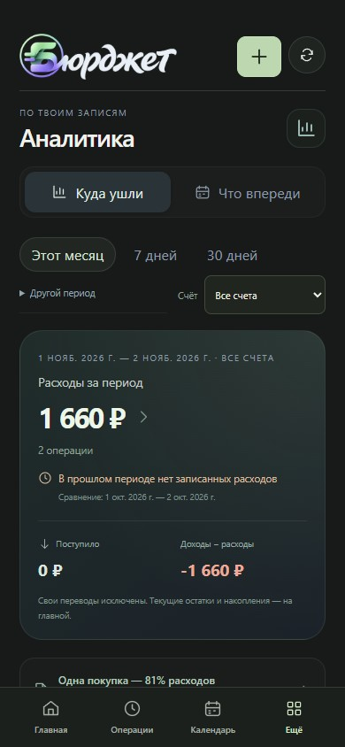 | 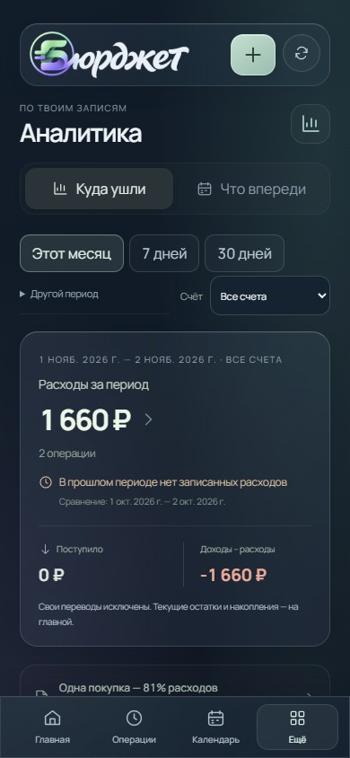 |
| Категории | 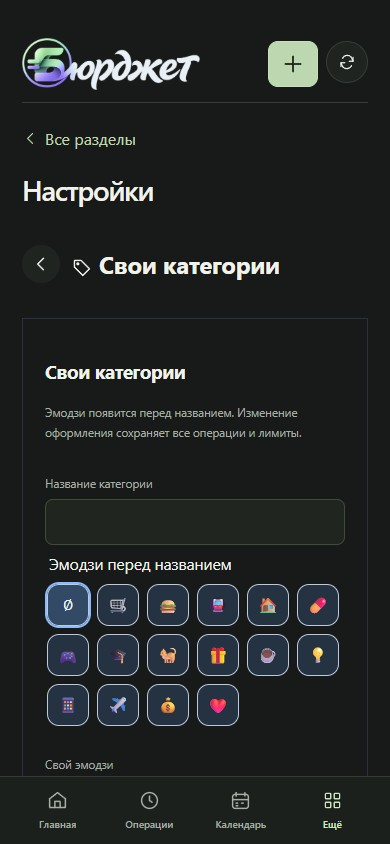 | 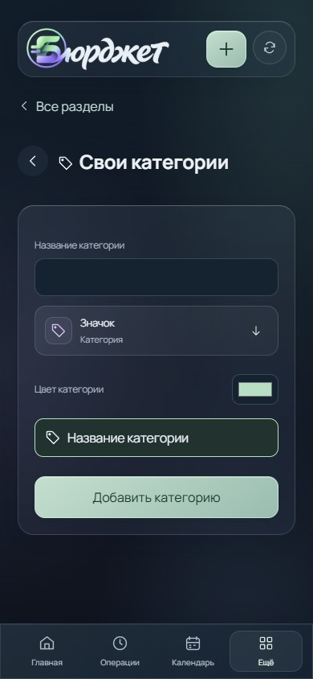 |

В этой папке также сохранены главная, операции, накопления, обеды, уведомления, лимиты, импорт, резервирование и модули в 390 и 1280 px. Отдельные снимки показывают SVG-категорию после сохранения в истории и календаре.

## Проверки

- `npm test`: **549/549**. Проверяется отсутствие денежных изменений при смене оформления, сохранность связей категории и лимитов, перенос символов через экспорт/миграцию, отказ от посторонних имён SVG, сохранность введённого при неуспешном сохранении.
- `npm run build`: успешно. Сохранилось предупреждение о размере архивной оболочки App; её код этим обновлением не менялся.
- `node scripts/check-glass-interface.mjs`: **76 проверок размеров**, 320/390/768/1280 px, без переполнения и ошибок JavaScript. Создание SVG-категории; смена значка счёта без изменения денег; перезагрузка; один расход 250 ₽; символ в истории, календаре и легенде; возврат к прежней серверной оболочке без потери данных. [Результат](after-checks.json).
- `INTERFACE_BASELINE=ae15d18 node scripts/check-glass-interface.mjs`: **64 проверки** старого представления на тех же данных, без финансовых записей. [Результат](before-checks.json).
- `node scripts/check-personal-interface.mjs`: обновление профиля, знакомое действие выше навигации, добровольный переход, черновик, поиск, планы, прежний вид и старт нового профиля. [Результат](profile-transition-checks.json).
- `node scripts/check-reliability-browser.mjs`: перенос без изменения остатков, повторные платежи, перевод/отмена, черновик после перезагрузки, смена профиля, диагностика 503 и задержка Telegram SDK. [Результат](reliability-checks.json).
- Главная без backdrop-filter: читаемые непрозрачные поверхности, доступный фокус, reduced motion, исходные денежные итоги. [Результат](fallback-checks.json).
- `CALENDAR_REVIEW_BUSY=1 node scripts/capture-calendar-review.mjs`: насыщенная сетка, расшифровка, окно события, перенос, возврат в выбранную дату, дополнительные поля и центрированный заголовок подтверждения. [Результат](calendar-checks.json).
- `node scripts/capture-entry-directions.mjs`: комментарий остаётся видимым, сохранение помещается на экране 320–1280 px, выбор счёта сохраняет введённое, списание ровно один раз. [Результат](entry-checks.json).
- `node scripts/check-brand-integration.mjs`: локальные ресурсы, доступное название, отсутствие пересечений шапки, обе оболочки и неизменные остатки.

Браузерные сценарии используют только вымышленные профили и перехваченный API. Настоящий Telegram на телефоне и пользовательские испытания здесь не проводились. Это локальный пилот: версия пакета и публичный выпуск не объявлены 5.0; оставшиеся продуктовые критерии находятся в ROADMAP-5.0.md.

Локальный просмотр: `node scripts/preview-personal.mjs`, http://127.0.0.1:5188/. Изменения вымышленного бюджета хранятся в памяти процесса; сервер и финансовое хранилище рабочего приложения не затрагиваются.
