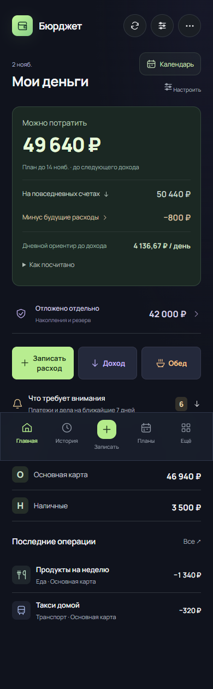
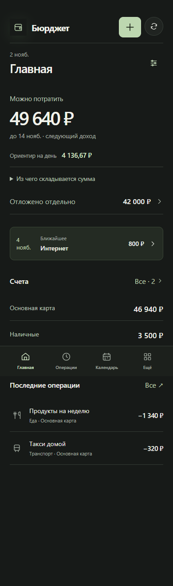
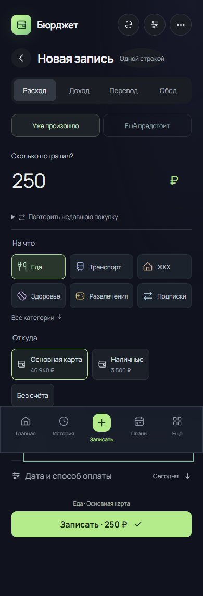
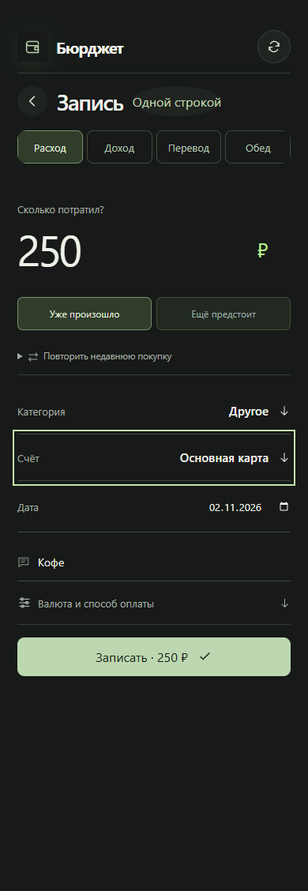
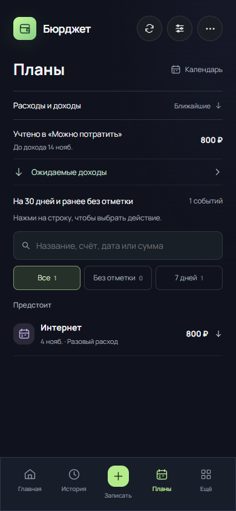
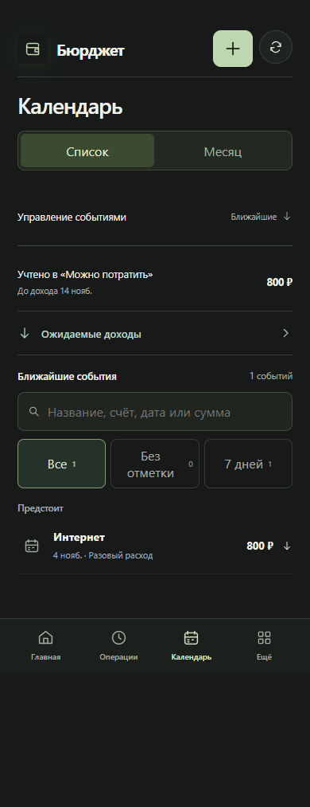
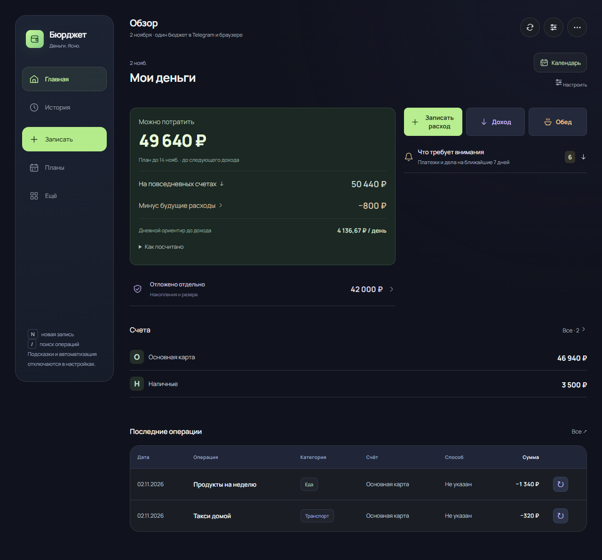
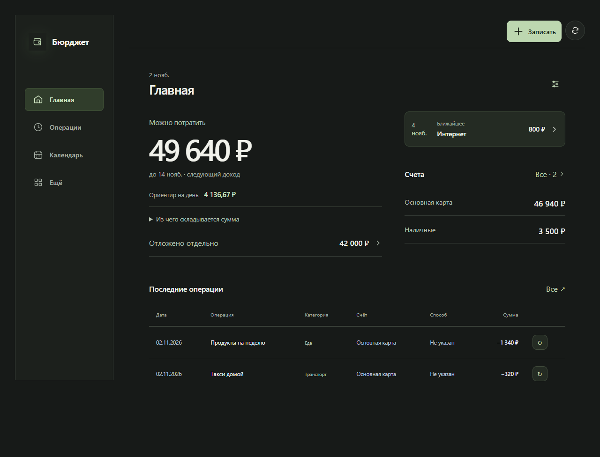

# Новый Бюрджет — пилот 4.16.0

Новый вид включается добровольно: **Ещё → Настройки → Вид приложения → Новый вид · пилот**. Существующие и новые профили сохраняют прежний вид до выбора пользователя. Короткое предложение на главной можно скрыть. После перехода действующему пользователю один раз объясняется перемещение истории, планов и счетов; у нового профиля отдельный старт с реальным остатком счёта.

Код реализации: `c8995ed9c8576ff519e46db78dd8d5f3f5bbf7d9`. Исходный main: `63d4b40c93f330c163e7e298c3dfa7d8fa2b057b`. Это этап 4.x, а не заявление о завершении всей системной версии 5.0.

## Что изменилось

- Четыре основных раздела: Главная, Операции, Календарь, Ещё. Отдельная кнопка ＋ закреплена в шапке; она не закрывает строки и суммы. Форма имеет собственный возврат, без нижней навигации поверх ввода.
- Главная строится вокруг доступной суммы. Расчёт раскрывается отдельно, предупреждения о нехватке и неизвестных суммах остаются видимыми. Ближайшее событие открывает соответствующий день календаря. Порядок и скрытые блоки пользователя сохранены.
- В расходе и доходе сумма идёт первой, затем выбранные категория и счёт. Полные списки открываются в нативном модальном окне с поиском, клавиатурным фокусом и Escape. Нулевые счета и накопления доступны там же. Дата видна сразу; валюта и способ оплаты раскрываются отдельно. Запись без счёта явно предупреждает, что изменится только история, а остатки останутся прежними. Перевод имеет собственную форму и денежный смысл.
- Операции объединяют расходы, доходы и переводы. Возврат из формы сохраняет поиск, фильтр, экран и позицию прокрутки. ＋ создаёт новую запись, а не повторно открывает последнюю просмотренную.
- Календарь явно переключается между списком и месяцем. Создание, перенос, подтверждение, частичная сумма и связь с историей используют прежние общие команды. Строки счетов и меню стали спокойнее; возможности дополнительных модулей сохранены.
- Бот пилота использует «Бюджет», «Записать», «Календарь», «Ещё» и «Операции». Старые кнопки, `/history`, `/payments`, `/plans` продолжают работать; добавлены `/operations` и `/calendar`. Настройки сводок и доступность изображений сохранены.

## Переход и границы совместимости

`settings.interfaceVersion` хранится в том же серверном профиле. Переключение меняет только представление, не копирует бюджет и не пересчитывает историю. Учёт, настройки, категории, уведомления, порядок главной и черновик остаются общими. Архивный `?classic=1` с отдельным локальным хранилищем не используется как путь возврата.

Старые `?history=1`, `?operations=1`, `?payments=1`, `?plans=1`, `?calendar=1`, `?settings=1`, `?lunch=1` продолжают вести в соответствующие действия. Обе оболочки используют один контроллер и общие компоненты; различается презентация. Финансовые команды сосредоточены в ledger, старый импорт `transfer-actions` оставлен совместимым экспортом. Контракт `burget-operations` v1 не меняется.

Прежний серверный вид нельзя убирать до двух подтверждённых стабильных выпусков и проверки освоения. После завершения пилота удалить ветви представления v1 и его CSS, сохранив маршруты, настройки и общий контроллер. Накладывать постоянные дубли кнопок не требуется.

## Реальные сравнения на одинаковых данных

[Фикстура, дата и точные SHA](personal-interface/fixture.json), [результаты браузерных сценариев](personal-interface/evidence.json). Данные вымышленные. «До» снято с отдельного checkout исходного main, «после» — с реализации, одинаковая дата и размеры. Это браузерные снимки приложения, не нарисованные макеты.

| Сценарий | До | После |
|---|---|---|
| Главная, 390 px |  |  |
| Запись, 390 px |  |  |
| Календарь, список |  |  |
| Главная, 1280 px |  |  |

В обеих оболочках исходный остаток основной карты 46 940 ₽. Запись кофе 250 ₽ даёт 46 690 ₽ и три операции. Будущая книга 400 ₽ добавляет план и оставляет остаток 46 690 ₽. Переключение вида сохраняет эти значения; затем отдельно проверяется смена владельца на пустой профиль с меньшей ревизией.

Повторение: `npm run test:personal`. Для точного сравнения ревизий указать `PERSONAL_BASELINE_ROOT` на отдельный checkout базового SHA с установленными зависимостями. Без этой переменной CI сравнивает два вида одного проверяемого кода. `BROWSER_EXECUTABLE_PATH` позволяет использовать установленный Chromium; `PERSONAL_SCREENSHOT_DIR` выбирает каталог артефактов. Рабочие бюджеты и внешние сообщения в этих сценариях не используются.

## Закрытые воспроизведения G01–G07

| Дефект | Изменение | Доказательство |
|---|---|---|
| G01 | Комиссия редактируется и удаляется только вместе с переводом. Создание, изменение, отмена и восстановление имеют составной журнал. Устаревший откат отклоняется. Старую несвязанную комиссию пользователь выбирает явно | `personal-interface.test.js`, `ledger.test.js`, `server-db.test.js`: 1000/100 → 795/300 → 890/200 → 1000/100; undo возвращает точные записи и остатки |
| G02 | Одна операция может обслуживать только один источник. Банковская комиссия и возврат по рассрочке не могут закрыть долг человеку | Общая проверка ролей при командах, связывании, импорте и API; тест комиссии и смешанных ролей |
| G03 | До внешней отправки фиксируется состояние отправки. Потерянная квитанция не разрешает второй внешний вызов. Неизвестный результат назван явно; известный отказ допускает повтор того же ключа | `delivery-integrity.test.js`: отказ UPDATE после принятия Telegram, неизвестный ответ, известный отказ и повтор |
| G04 | Необязательный кэш file_id обслуживается отдельно от принятого фото | Реальная `uploadPicture` с отказом кэша, затем отказ текста и повтор сводки: принято одно фото |
| G05 | Отдельный неизменяемый экспорт на 5 минут, максимум три активные ревизии владельца. Квота проверяется атомарной SQL-командой, просроченные копии очищаются | 60 смен ревизии и удаление кольцевых снимков не ломают действующую ссылку; точная граница TTL и квота проверены |
| G06 | Ревизии сравниваются только внутри владельца; поколение сеанса отбрасывает старые чтения. Чужой результат не подтверждает потерянное сохранение | Задержанные запросы до/после смены сеанса; Chromium: A/revision 10+ → B/revision 1, очистка формы, поиска и календаря |
| G07 | Новый личный expense/cat=lunch отклоняется, вместо тихого снятия счёта. Старый корпоративный факт не пересчитывается; безопасное уточнение комментария разрешено | Доменный и настоящий API-тест: отказ атомарен, остаток не изменяется |

Это закрытие конкретных воспроизведений аудита, а не утверждение об отсутствии любых финансовых дефектов. Противоречивые старые связи не исправляются догадкой: требуется явное согласование/восстановление. Массовая миграция истории не выполняется.

## Характер интерфейса и критерии «сделано ИИ»

У «нейрослопа» нет универсального измеримого визуального стандарта. Здесь это рабочая дизайнерская оценка: повторяющиеся одинаковые карточки без смысловой иерархии, случайные градиенты, декоративные эмодзи, псевдодружелюбные лозунги, избыточные инструкции и одинаковый dashboard для любой предметной области. Убраны эти приёмы, но сохранены предупреждения и ясные названия действий. Денежные суммы, даты и строки имеют разные роли в композиции; цвет сопровождает финансовый смысл.

Основа решений — [NN/g: эстетика и минимализм](https://www.nngroup.com/articles/aesthetic-minimalist-design/) и [узнавание вместо запоминания](https://www.nngroup.com/articles/recognition-and-recall/): оставлять полезные сигналы и раскрывать подробности по необходимости. [Опыт Intercom](https://www.intercom.com/blog/navigating-the-complexity-of-change-aversion/) поддерживает проверку нового вида на добровольной группе. Эти источники не доказывают, что людям понравится именно наш дизайн; это проверяется отдельно.

## Приёмка и следующий этап

Автоматизированно: 542 теста общего кода; сборка Vite; локальная сборка Worker; production dependency audit без уязвимостей. Новый Chromium-сценарий входит в обязательный Linux CI наряду с семью прежними браузерными наборами. Проверены все основные разделы на 320/390/768/1280 px, нативное окно выбора, Escape и возврат фокуса, незавершённый ввод, история, план, смена владельца, приглашение в пилот, одноразовая подсказка, начало с реального остатка и первая покупка, оба направления переключения вида. Исходные сценарии календаря, частичной оплаты, связи, удаления и восстановления остаются в прежних регрессиях.

**Не выполнены людьми:** испытания новичков/действующих пользователей и настоящий Telegram на физическом телефоне. Браузерная автоматизация не заменяет эти проверки. Массовое включение до них запрещено этим планом приёмки.

Протокол пилота: отдельно минимум 5 новичков и 5 действующих пользователей выполняют запись расхода, поиск и изменение, планирование, перенос, связь уже учтённой оплаты и поиск счёта. Для каждой задачи фиксировать успешность без помощи, время до первого верного действия, ошибочные нажатия, потребность в подсказке и повторное выполнение после освоения. Сравнивать со старым видом на равнозначных вымышленных данных; порядок видов чередовать. Ориентир допуска: не менее 90% успешных основных задач в обеих группах, отсутствие денежных дублей и потери контекста, повторное выполнение без помощи. При провале разбирать конкретные пути, не восстанавливать старую композицию автоматически.

На физическом Android и iPhone проверить Telegram viewport/safe area, системную клавиатуру, дату, закрытие модального окна, возврат из фона, потерю сети и неизвестный результат записи. До массового включения проверить также VoiceOver/TalkBack и масштабирование текста. Переключатель прежнего вида остаётся доступен независимо от решения об общем включении.

Публикация проходит штатные CI → независимый зашифрованный бэкап с readback → dry-run Worker → deploy → патчноут. Этот отчёт не подменяет фактические статусы GitHub Actions; они проверяются при выпуске.
