# Читаемость и самостоятельный проход по интерфейсу

2 ноября 2026. До: `d575dc1`. Основная реализация: `9144d22`; удаление старого внешнего импорта шрифта и проверка независимости от Google Fonts: `9fcba20`.

Снимки сделаны в настоящем Chrome, на одинаковых вымышленных данных из [fixture.json](fixture.json), при одинаковых размерах окна, с отключёнными анимациями. Первые состояния до и после не меняют деньги. Снимки создания и пополнения цели отдельно показывают результаты действий.

## Что исправлено

- Локальный Onest с кириллицей и весами 100–900, предзагрузка, полная лицензия в public/fonts. Удалён старый внешний импорт Manrope. В браузерной проверке внешние шрифтовые сервисы заблокированы, а фактически отрисованный шрифт проверяется через Chrome DevTools Protocol.
- Общая шкала размеров вместо десятков разрозненных значений: основной текст и поля 16 px, подписи 14–15 px. Компактная навигация и дни недели 13 px; каталог значков и счётчик дополнительных событий 12 px. Обычного видимого текста меньше 14 px в проверенных состояниях нет.
- Убрана мелкая дата над заголовком главной. Увеличены подписи счетов, операций, форм, календаря, настроек, импорта, резервных копий и аналитики. Увеличены подписи SVG-прогноза.
- Поиск событий имеет одну рамку и общий индикатор фокуса. Исправлено склонение количества событий. Фильтры помещаются компактно, у строк событий появились внутренние отступы.
- Убраны вложенные карточки и повторные заголовки форм целей. Действия разделены тонкими линиями. По согласованию с пользователем форма «Отложить на цель» появляется только при наличии цели с существующим связанным счётом.
- Показатели обедов собраны в один блок с разделителями; на телефоне используются две колонки. У дат увеличена область нажатия. Остаточные яркие зелёные элементы переведены на общий мягкий акцент.
- В календаре сохранены читаемые счётчики: +N занимает отдельную строку, значки не сжимаются до микроскопического размера и не вылезают из ячейки.
- В прежней серверной оболочке уплотнены отступы и сокращена повторяющаяся подпись дневного ориентира, чтобы увеличенный текст не задвигал знакомую кнопку записи под навигацию.

## До → после, 390 × 844

| Сценарий | До | После |
| --- | --- | --- |
| Главная | 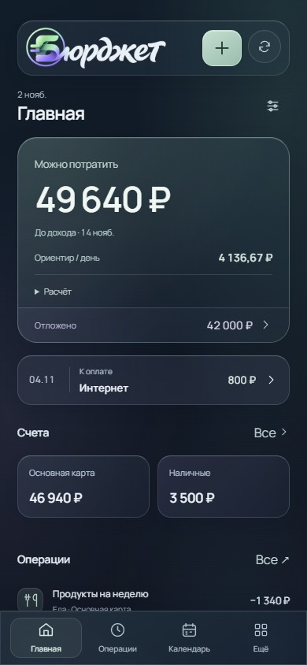 | 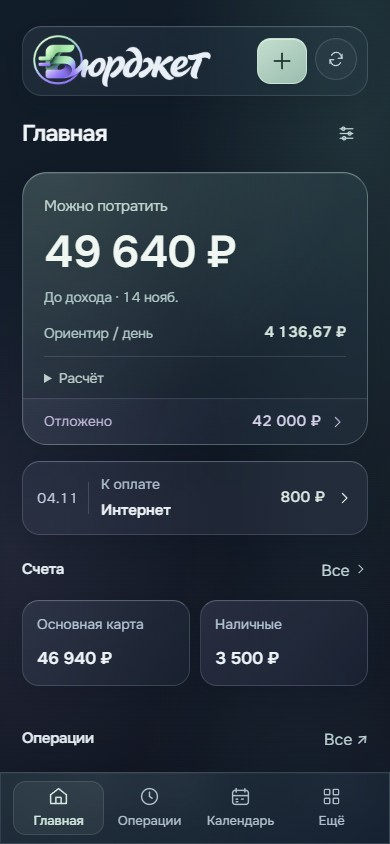 |
| Вложенные действия целей | 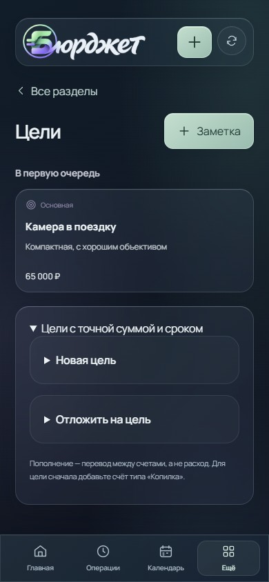 | 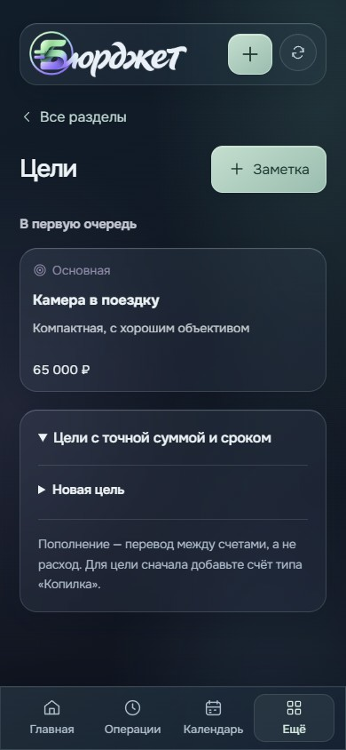 |
| Поиск событий | 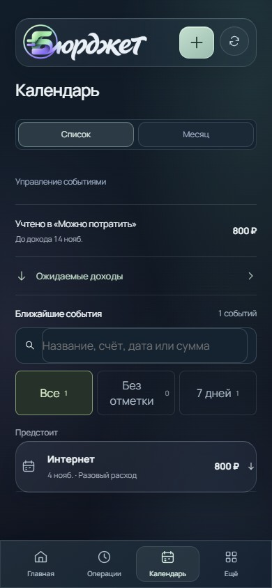 | 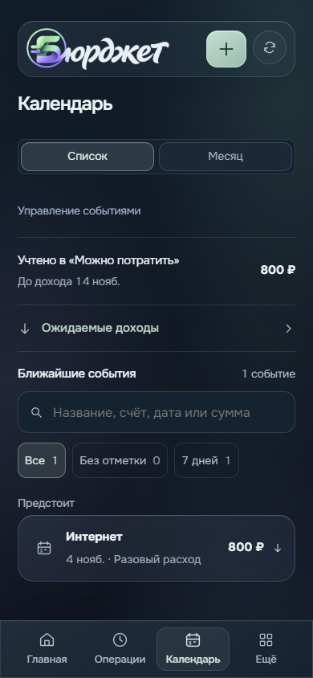 |
| Запись | 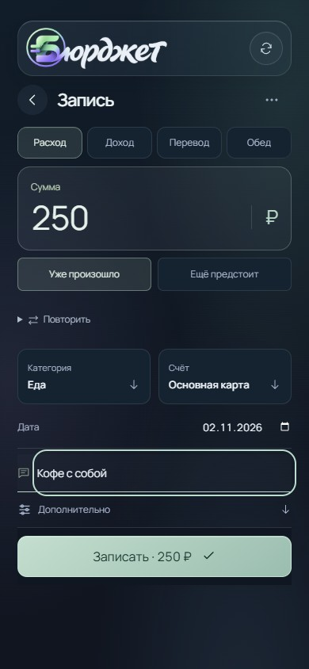 | 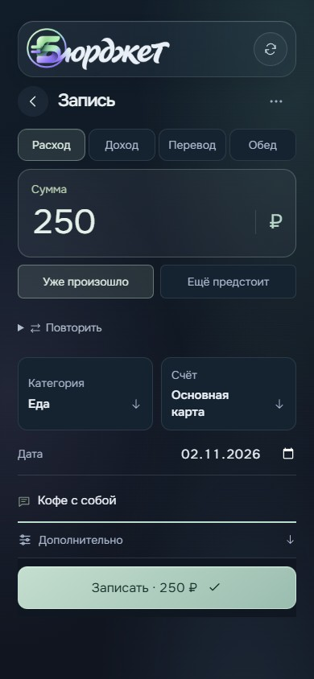 |
| Накопления | 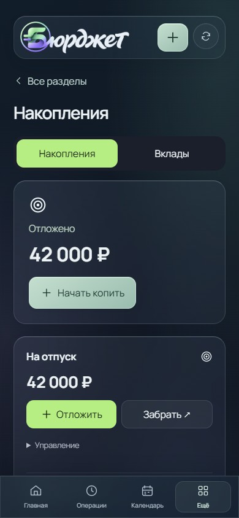 | 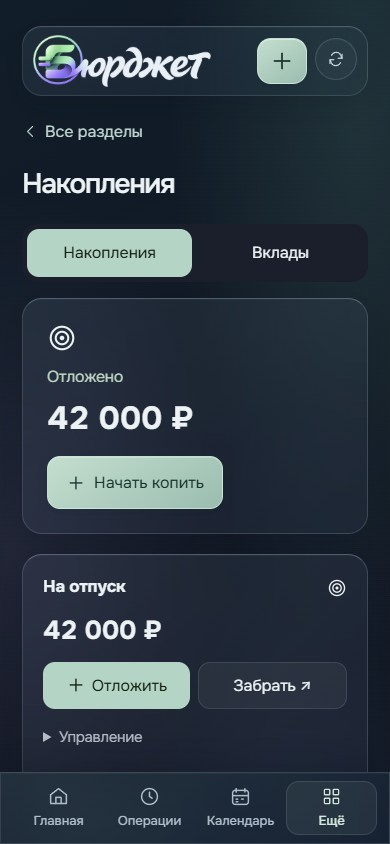 |
| Обеды | 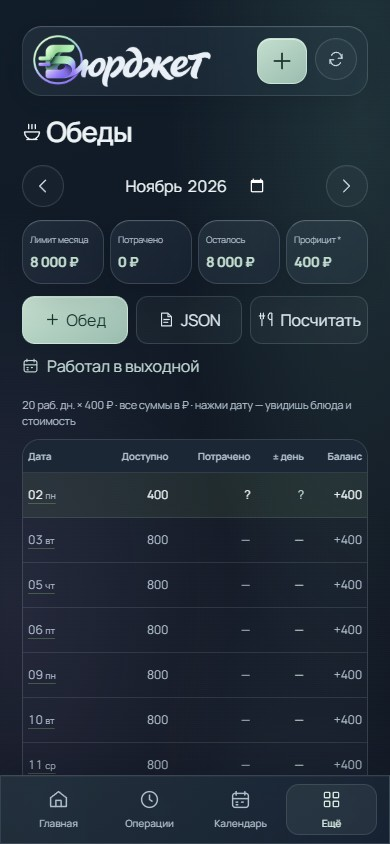 | 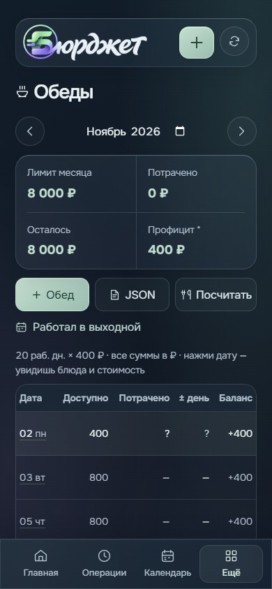 |

Также сохранены операции, счета, календарная сетка, аналитика, настройки, уведомления, лимиты, импорт, резервные копии, модули, категории, каталог SVG и пустой поиск; снимки доступны в 390 и 1280 px.

## Проверки

- `npm test`: **550/550**. Новый тест проверяет отсутствие пустой формы пополнения, появление действия для существующей связанной цели и неизменность данных при открытии.
- `npm run build`: успешно. Сохранилось прежнее предупреждение о размере архивной оболочки App.
- `INTERFACE_EVIDENCE_DIR=docs/readability-review INTERFACE_READABILITY=1 node scripts/check-glass-interface.mjs`: **100 проверок экранов и состояний** на 320/390/768/1280 px. Нет горизонтального переполнения, ошибок JavaScript и обычных подписей меньше 14 px; отрисован настоящий Onest при блокировке внешних шрифтов. Категория SVG, оформление счёта, перезагрузка, один расход, история, календарь и переключение серверной оболочки проходят. [Результат](after-checks.json).
- Та же проверка с `INTERFACE_BASELINE=d575dc1`: **80 проверок** исходного интерфейса, деньги не меняются. В результатах сохранены реальные размеры старых мелких подписей и фактически отрисованный Manrope. [Результат](before-checks.json).
- Через реальные формы создана цель: счета не изменились. После пополнения на 1000 ₽ основной счёт уменьшился ровно на 1000 ₽, накопительный вырос ровно на 1000 ₽, появился один перевод, список расходов не изменился. [Созданная цель](after-goal-created-390.jpg), [после перевода](after-goal-funded-390.jpg).
- `node scripts/check-personal-interface.mjs`: знакомая кнопка остаётся выше навигации, переход добровольный, черновик сохраняется, поиск и планирование работают, новый и прежний виды используют одни данные, старт нового профиля проверен. [Результат](transition-checks.json).
- `CALENDAR_REVIEW_BUSY=1 node scripts/capture-calendar-review.mjs`: счётчики и значки помещаются в насыщенной сетке, перенос и возврат сохраняют выбранную дату и не меняют деньги. [Результат](calendar-checks.json).
- `node scripts/capture-entry-directions.mjs`: сохранение помещается на экране 320–1280 px, комментарий виден, выбор счёта не стирает введённое, списание однократное. [Результат](entry-checks.json).
- `node scripts/check-glass-home.mjs` и `node scripts/check-brand-integration.mjs`: видимость главного итога и ближайшего события, доступный фокус, reduced motion, локальные ресурсы бренда и обе оболочки.

Пройден локальный пилот. Настоящий Telegram на телефоне и испытания с пользователями этим отчётом не заменяются; публичный выпуск 5.0 не объявлен.
